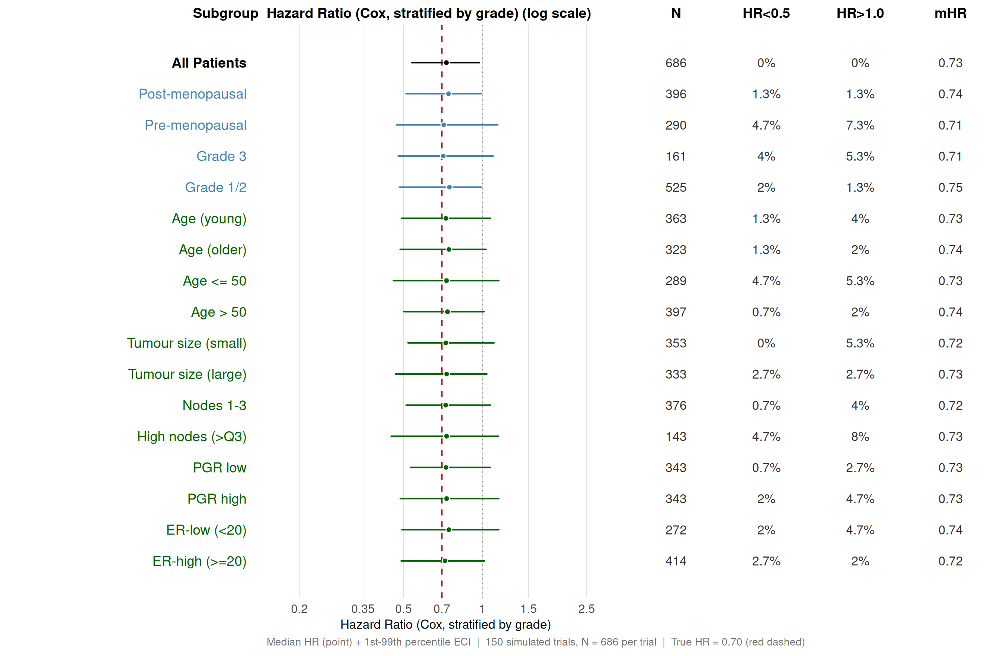
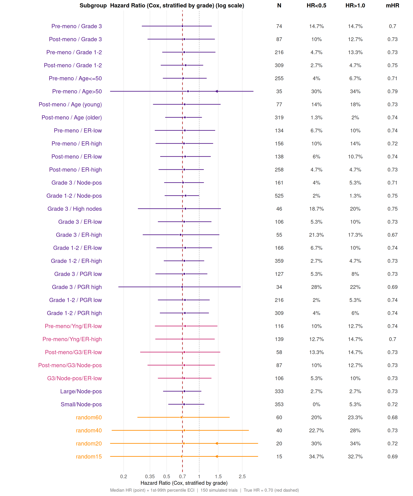
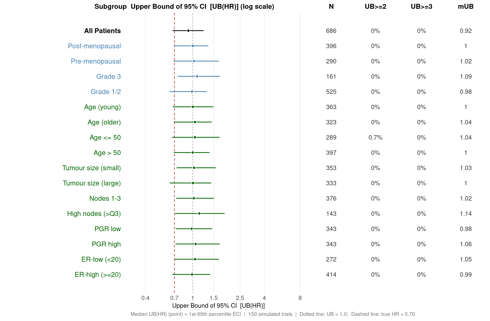
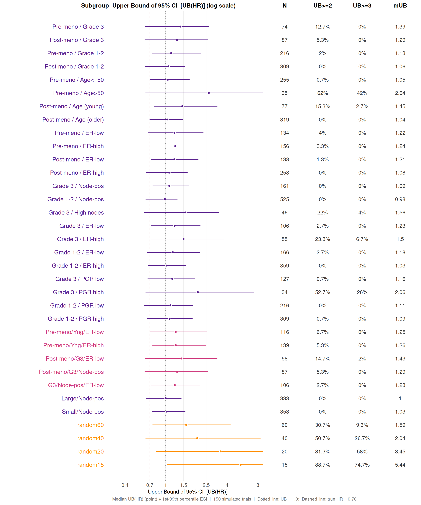
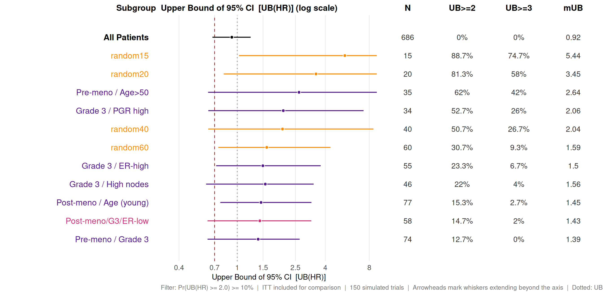
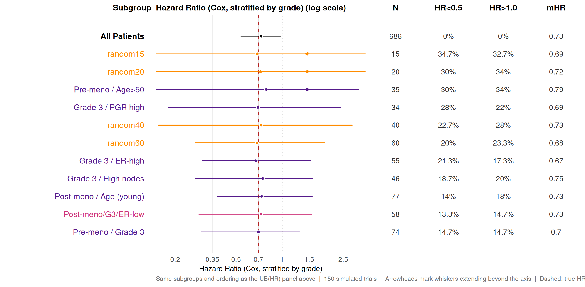
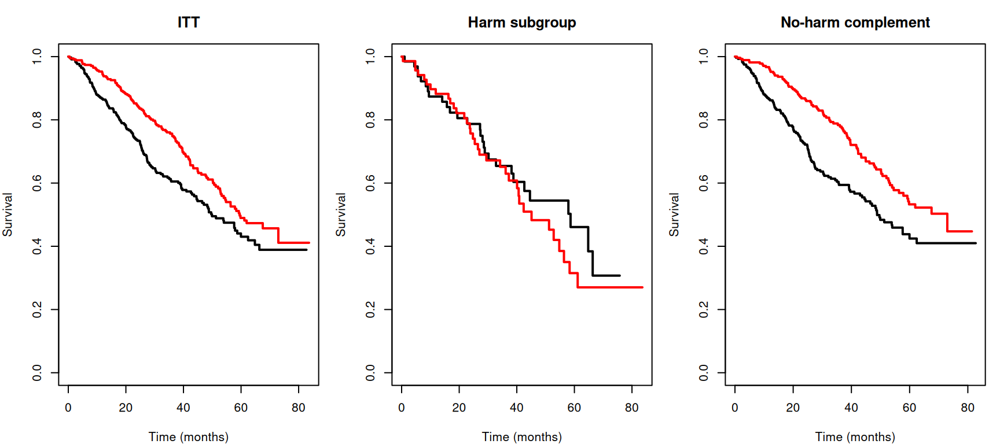

# Extreme Subgroup Effects Under a Uniform Treatment Benefit

**User settings.** These are the only values you need to change to run
this article yourself (see *Running this article yourself* below).

``` r

# n_sims_uniform: number of simulated trials. 150 keeps this article quick
#   to build. For an actual application use 5,000-10,000, after timing a
#   pilot run of about 100 trials on your own machine (see "Number of
#   simulated trials" and the Timing summary).
# n_workers_user: parallel workers. NULL uses about 90% of the available
#   cores; set an integer to override (1L runs without parallel workers).
n_sims_uniform <- 150L
n_workers_user <- NULL

# This article is written for the current CRAN release of forestsearch.
if (utils::packageVersion("forestsearch") < "0.4.0") {
  stop("This article needs forestsearch >= 0.4.0. ",
       "Update it with install.packages(\"forestsearch\").")
}
```

## 1 Overview

A central concern in exploratory subgroup analysis is the potential for
**extreme results driven entirely by chance**, not by genuine treatment
effect heterogeneity. When many subgroups are examined in a single
dataset — as is routine in regulatory submissions and trial reports —
small subgroups in particular can produce hazard ratio estimates that
look dramatic simply because they are noisy. The smaller the subgroup,
the wider the confidence interval, and the higher the probability that
the upper bound strays far from the truth.

This vignette evaluates that risk directly. We generate synthetic trials
from a data generating mechanism (DGM) with a **perfectly uniform
treatment benefit** — the true hazard ratio is identical for every
patient — and ask: how often do standard Cox model analyses produce
extreme subgroup results?

**Design note — fixed baseline (conditional-on-X).** This article uses a
*fixed-baseline* design. Every simulated trial here uses
`simulate_from_dgm(baseline = "fixed")`: the covariate matrix is the
observed GBSG trial data itself — every source patient exactly once — so
subgroup definitions, memberships, and sizes are *identical in every
replicate*. Only treatment assignment, entry times, latent event times,
and censoring are re-drawn per trial. Between-trial variability
therefore isolates the outcome-generation process, conditional on the
enrolled patient panel: the question shifts from *“what if this trial
had enrolled a different sample from the same population?”* to *“given
exactly these patients, how variable are the subgroup analyses across
re-runs of the trial?”* The random benchmark subgroups still re-draw
their *membership* each replicate — but now over a fixed panel, with
sizes exactly 60/40/20/15 by construction.

The vignette is organised as a complete, self-contained workflow:

1.  **Building the DGM** — fitting a Weibull AFT model to real data,
    constructing a super-population, and calibrating the censoring
    process so that simulated trials reproduce the censoring pattern of
    the source data. This step establishes the uniform-effect scenario:
    a DGM where the true HR is 0.70 *for every patient*, with no
    subgroup differential effects.

2.  **Running simulated trials** — drawing 150 synthetic trial
    replicates from the uniform DGM and fitting a stratified Cox model
    in each pre-defined subgroup.

3.  **Characterising the distribution of extreme results** — for each
    subgroup, summarising how variable the Cox HR estimate is across
    simulations (the empirical 99% interval, or “ECI” — defined under
    *Summary Statistics Across Simulations* below) and how large the
    upper confidence bound UB(HR) can become by chance alone. Random
    benchmark subgroups (`random15`, `random20`, `random40`, `random60`)
    with no clinical meaning serve as calibration anchors, making
    explicit that clinical subgroups of the same size can exhibit
    distributional patterns similar to (meaningless) random groupings.

All examples use the GBSG breast cancer dataset
([`survival::gbsg`](https://rdrr.io/pkg/survival/man/gbsg.html)).

The **forestsearch** methodology is described in León et al. (2024);
inference for trial estimands after data-driven subgroup discovery is
developed in León and Anderson (2026). See the References section.

### 1.1 Example of Subgroups Under Study

The subgroups and their features (size, events, etc.) are specific to
the study at hand. GBSG is used here as the case study, but the analyses
can be applied or modified for any study. Part IV defines the GBSG
subgroups examined: clinical factors (menopausal status, grade), single
cuts of continuous variables (age, tumour size, nodes, PGR, ER), two-
and three-way combinations, and four random benchmark subgroups.

The `random*` subgroups are the key benchmark. They are constructed by
randomly sampling 15, 20, 40, and 60 patients. Such subgroups have no
clinical meaning whatsoever — their true HR equals the ITT HR of 0.70.
Any extreme result they produce is purely a function of their small size
and sampling variability.

### 1.2 Summary Statistics Across Simulations

For each subgroup, each simulated trial produces two per-trial values:
the **Cox HR point estimate** (stratified by `grade`) and the **upper
bound of the 95% confidence interval, UB(HR)**. Across the 150 simulated
trials these per-trial values form an empirical distribution for each
subgroup. All downstream summaries — the results table and every forest
panel — operate on this empirical distribution.

#### 1.2.1 99% empirical confidence interval (ECI)

The **99% ECI** is the **1st–99th percentile range** of the per-trial
values accumulated across all simulated trials — computed separately for
the Cox HR and for UB(HR). It is a description of how much these
quantities vary from one synthetic trial to the next under the same DGM.

The 99% ECI is **not** a confidence interval in the inferential sense. A
standard confidence interval is built from a single sample and is
designed to cover the unknown true parameter with a stated probability.
The ECI here is a different object: the true parameter is fixed and
known by construction (true HR = 0.70 everywhere), and what is being
summarised is the empirical spread of *estimates* across repeated trials
drawn from the DGM. It answers “how variable is this estimator in
repeated draws?”, not “what range of parameter values is consistent with
the data?”. The terminology (“empirical confidence interval”) is chosen
to evoke the visual similarity to a forest-plot CI line — point in the
middle, whiskers spanning the range — not equivalence of meaning.

#### 1.2.2 Six summary statistics (table + forest panels)

The results table and the forest-panel annotation columns report the
same six summary statistics for each subgroup.

**For the Cox HR point-estimate distribution:**

- **`Pr(HR<0.5)`** — fraction of simulated trials whose point estimate
  is below 0.5. Measures how often the HR alone looks like an extreme
  benefit by chance.
- **`Pr(HR>1.0)`** — fraction of simulated trials whose point estimate
  is above 1.0. Measures how often the estimate lands on the wrong side
  of no effect.
- **`mHR`** — unconditional median of the HR point estimate across all
  simulated trials. Under the uniform DGM (true HR = 0.70) `mHR` should
  track 0.70 for every subgroup, confirming the Cox model is unbiased.

**For the upper 95% confidence bound UB(HR):**

- **`Pr(UB>=2)`** — fraction of simulated trials whose upper bound is at
  or above 2.0. Measures how often a forest-plot row looks alarming to a
  safety reviewer at a moderately-strict threshold.
- **`Pr(UB>=3)`** — same, at a stricter threshold.
- **`mUB`** — unconditional median of the upper bound across all
  simulated trials.

The forest plots in the Results section visualise the median + 99% ECI
graphically; the annotation columns and the results table give the same
six summary statistics as numbers.

------------------------------------------------------------------------

We note that continuous biomarkers can also be considered. This is more
involved and not necessary for uniform effects, but valuable for trials
with biomarkers when there is interest in exploring the dynamics of
subgroups in the presence of actual biomarker effects (correlated with
other patients’ characteristics).

### 1.3 Setting: Uniform Treatment Effect

The DGM is built from a real trial dataset using
[`generate_aft_dgm_flex()`](https://larry-leon.github.io/forestsearch/reference/generate_aft_dgm_flex.md)
with `model = "null"`. The fitted Weibull AFT treatment coefficient is
then rescaled via `k_treat`, with the multiplier calibrated by `uniroot`
so that the **average hazard ratio (AHR)** matches a chosen target.
Under `model = "null"` the AHR equals the patient-level individual HR,
so calibrating the AHR fixes the true HR for every patient. The key
feature of the resulting DGM is that the true log hazard ratio is
**constant across all patients**:

``` math
\psi^0(\mathbf{L}) = \log(\text{HR}_{\text{true}}) \quad \text{for all } \mathbf{L}.
```

In the examples below the target AHR is 0.70 (a moderate benefit). Every
subgroup — regardless of how it is defined — shares this same underlying
HR. There is no subgroup effect; any apparent finding is a false
positive.

The calibration is performed in Part I via the helper function
[`calibrate_k_treat()`](https://larry-leon.github.io/forestsearch/reference/calibrate_k_treat.md),
the natural sibling of the package’s
[`calibrate_k_inter()`](https://larry-leon.github.io/forestsearch/reference/calibrate_k_inter.md)
(which targets the harm-subgroup HR under `model = "alt"`) and
[`calibrate_cens_adjust()`](https://larry-leon.github.io/forestsearch/reference/calibrate_cens_adjust.md)
(which targets the censoring rate). See the **Appendix: DGM with
Heterogeneous Treatment Effects** for a contrasting setup where one
subgroup has a different treatment effect than the rest of the
population.

### 1.4 Running this article yourself

This article is written for the current CRAN release of **forestsearch**
(0.4.0) and runs as a single file.

1.  **Install the R packages.** Installing **forestsearch** from CRAN
    also installs everything this article uses (survival, ggplot2,
    dplyr, patchwork, future, doFuture, foreach and weightedsurv). knitr
    and rmarkdown are needed to render the file:

    ``` r

    install.packages(c("forestsearch", "knitr", "rmarkdown"))
    ```

2.  **Download this file** into your working directory:

    ``` r

    download.file(
      "https://raw.githubusercontent.com/larry-leon/forestsearch/master/vignettes/articles/extreme_subgroups.qmd",
      "extreme_subgroups.qmd"
    )
    ```

3.  **Adjust the User settings** at the top of the file if you wish:
    `n_sims_uniform` (number of simulated trials) and `n_workers_user`
    (parallel workers).

4.  **Run it**, in either of two ways:

    - In RStudio, open the file and click **Render**. RStudio includes
      Quarto, so nothing else is needed.
    - Or run the chunks interactively (**Run All**). This needs no
      Quarto at all.

    Outside RStudio, render from a terminal with
    `quarto render extreme_subgroups.qmd`, which needs the Quarto
    command-line tool from <https://quarto.org>.

With the default 150 simulated trials, the whole article rendered in
about 20 seconds on the 14-core machine used to build it. The Timing
summary at the end reports the time on your machine and projects the
cost of larger runs.

### 1.5 Documentation

Full documentation, including the function reference and all articles,
is available on the pkgdown site:
<https://larry-leon.github.io/forestsearch/>.

The Getting Started vignette is also installed with the package:

``` r

vignette("forestsearch")
```

The other articles, including this one, are available on the pkgdown
site only.

------------------------------------------------------------------------

## 2 Setup

``` r

library(forestsearch)
library(survival)
library(ggplot2)
library(dplyr)
library(patchwork)     # assembles gg_forest() panels

theme_set(theme_minimal(base_size = 12))
```

``` r

# Load GBSG data and convert time to months (DGM time scale)
data(gbsg, package = "survival")

gbsg$time_months <- gbsg$rfstime / 30.4375
gbsg$treat        <- gbsg$hormon

# Kaplan–Meier median event time.  The naive median over events only —
# median(time[event == 1]) — is biased downward in the presence of
# censoring, since the KM curve accounts for the at-risk set at each
# event time.  If the KM curve does not cross 0.5 the median is
# returned as NA (event time "not reached").
km_overall <- survfit(Surv(time_months, status) ~ 1, data = gbsg)
km_median  <- summary(km_overall)$table[["median"]]

cat("N =", nrow(gbsg), "  Events:", sum(gbsg$status),
    sprintf("(%.0f%%)", 100 * mean(gbsg$status)), "\n")
```

    N = 686   Events: 299 (44%) 

``` r

cat("Median follow-up, (months):",
    round(median(gbsg$time_months), 1), "\n")
```

    Median follow-up, (months): 35.6 

``` r

cat("Median event time, KM (months)  :",
    if (is.na(km_median)) "not reached" else round(km_median, 1), "\n")
```

    Median event time, KM (months)  : 59.4 

### 2.1 Baseline characteristics

The table below summarises the cohort by treatment arm for the variables
used later to define subgroups in Part IV: the continuous covariates
(`age`, `size`, `nodes`, `pgr`, `er`), tumour `grade`, and menopausal
status (`meno`). This is the source data — the super-population in the
DGM is sampled from it, so any baseline imbalance carries through.

``` r

create_summary_table(
  data             = gbsg,
  treat_var        = "treat",
  vars_continuous  = c("age", "size", "nodes", "pgr", "er"),
  vars_categorical = c("grade"),
  vars_binary      = c("meno"),
  var_labels       = list(
    age   = "Age (years)",
    size  = "Tumour size (mm)",
    nodes = "Positive lymph nodes",
    pgr   = "Progesterone receptor (fmol)",
    er    = "Estrogen receptor (fmol)",
    grade = "Tumour grade (1 / 2 / 3)",
    meno  = "Post-menopausal"
  ),
  digits         = 1,
  show_pvalue    = TRUE,
  show_smd       = TRUE,
  show_missing   = TRUE,
  table_title    = "GBSG baseline characteristics — variables used to define subgroups",
  table_subtitle = paste0("Source: survival::gbsg  |  N = ", nrow(gbsg)),
  compact_mode   = TRUE
)
```

| GBSG baseline characteristics — variables used to define subgroups |  |  |  |  |  |
|----|----|----|----|----|----|
| Source: survival::gbsg \| N = 686 |  |  |  |  |  |
| Characteristic |  | Control (n=440) | Treatment (n=246) | P-value¹ | SMD² |
| Age (years) | Mean (SD) | 51.1 (10.0) | 56.6 (9.4) | \<0.001 | 0.57 |
| Tumour size (mm) | Mean (SD) | 29.6 (14.4) | 28.8 (14.1) | 0.470 | 0.06 |
| Positive lymph nodes | Mean (SD) | 4.9 (5.6) | 5.1 (5.3) | 0.665 | 0.03 |
| Progesterone receptor (fmol) | Mean (SD) | 102.0 (170.0) | 124.3 (249.7) | 0.213 | 0.11 |
| Estrogen receptor (fmol) | Mean (SD) | 79.7 (124.2) | 125.8 (191.1) | \<0.001 | 0.30 |
| Tumour grade (1 / 2 / 3) |  |  |  | 0.273 | 0.06 |
|  | 1 | 48 (10.9%) | 33 (13.4%) |  |  |
|  | 2 | 281 (63.9%) | 163 (66.3%) |  |  |
|  | 3 | 111 (25.2%) | 50 (20.3%) |  |  |
| Post-menopausal |  | 209 (47.5%) | 187 (76.0%) | \<0.001 | 0.61 |
| ¹ P-values: t-test for continuous, chi-square/Fisher's exact for categorical/binary variables |  |  |  |  |  |
| ² SMD = Standardized mean difference (Cohen's d for continuous, Cramer's V for categorical) |  |  |  |  |  |

------------------------------------------------------------------------

## 3 Part I — Building the Uniform-Effect Data Generating Mechanism

To evaluate extreme subgroup effects by chance, we need a DGM where the
treatment has a genuine, uniform benefit — so that any subgroup finding
is definitionally a false positive. This section constructs that DGM
from the GBSG data using
[`generate_aft_dgm_flex()`](https://larry-leon.github.io/forestsearch/reference/generate_aft_dgm_flex.md)
with `model = "null"` (uniform treatment effect throughout; no embedded
harm subgroup).

### 3.1 How `generate_aft_dgm_flex()` works

The function fits **two parametric models** to the source data — one for
the event times, one for the censoring times — and uses them jointly to
build a “super population” from which all later synthetic trials are
drawn.

#### 3.1.1 Outcome model — Weibull AFT

A Weibull accelerated failure time (AFT) model is fitted to the observed
event times via
[`survival::survreg()`](https://rdrr.io/pkg/survival/man/survreg.html):

``` math
\log T_i = \mu + \mathbf{x}_i^\top \boldsymbol{\beta} + \tau \, \varepsilon_i,
\qquad \varepsilon_i \sim \text{Extreme Value}.
```

(Standard *minimum* extreme-value distribution with density
$`f_\varepsilon(x) = \exp(x - e^x)`$ — generated in the package via
`log(rexp(n_super))`. See the [Treatment Effect
Definitions](https://larry-leon.github.io/forestsearch/articles/treatment_effect_definitions.md)
and [Biomarker Treatment
Effects](https://larry-leon.github.io/forestsearch/articles/biomarker_effects.md)
articles for the AFT–Cox parameterisation linkage.)

The linear predictor includes treatment, the user-specified
`continuous_vars` and `factor_vars`, and — when `model = "alt"` — a
treatment-by-subgroup interaction term. The treatment coefficient and
the interaction coefficient can be rescaled before sampling via the
`k_treat` and `k_inter` arguments, allowing the marginal treatment
effect and HTE strength to be set independently of the fitted values.
Under `model = "null"` the interaction is removed entirely, producing a
uniform treatment effect across all patients.

#### 3.1.2 Censoring model — AFT with AIC selection (default)

With `select_censoring = TRUE` (the default), the censoring distribution
is fitted *symmetrically* by reversing the event indicator: censored
observations become the “event” of interest in the reversed survival
problem. The function fits **four candidate AFT models** to these
reversed data and picks the best by AIC:

| Candidate    | Distribution | Covariates                     |
|:-------------|:-------------|:-------------------------------|
| `Weibull`    | Weibull      | `treat` + censoring covariates |
| `LogNormal`  | Log-normal   | `treat` + censoring covariates |
| `Weibull0`   | Weibull      | intercept only                 |
| `LogNormal0` | Log-normal   | intercept only                 |

The censoring covariates default to the outcome model’s covariates,
which can be overridden via `continuous_vars_cens` / `factor_vars_cens`.
The intercept-only candidates (`*0`) guard against overfitting when the
censoring process is genuinely unrelated to baseline covariates — in
that case AIC will favour them. The selected model’s parameters are
stored in `dgm$model_params$censoring` (`mu`, `tau`, `gamma`, and
`type`).

Alternative censoring-model modes (set `select_censoring = FALSE`):

- **Analytical**: supply `cens_params$mu` and `cens_params$tau` directly
  — no model is fitted.
- **Force-fit**: leave `cens_params` empty — a single AFT model is
  fitted with the user-specified family (`cens_type`) and formula
  (`cens_intercept_only` toggles between intercept-only and
  covariate-adjusted).

#### 3.1.3 Super-population construction

Once both models are in hand, the function draws `n_super` rows from the
source data with replacement, attaches per-row linear predictors for
both outcome and censoring under each treatment counterfactual, and
returns the result as `dgm$df_super`. It also stores `dgm$df_source` —
the prepared source data with every patient exactly once, carrying the
same linear predictors — which is the frame this vignette simulates from
via `baseline = "fixed"`. Downstream,
[`simulate_from_dgm()`](https://larry-leon.github.io/forestsearch/reference/simulate_from_dgm.md)
re-draws outcomes over that fixed panel without re-fitting anything —
each call is a quantile-transform draw from the fitted distributions.

#### 3.1.4 Marginal censoring rate is not yet calibrated

Even with the AIC-selected censoring model, the interaction between the
fitted censoring distribution and the administrative cutoff
`analysis_time` shifts the *realised* censoring rate in simulated trials
away from the observed rate in the source data. Part II addresses this
directly:
[`check_censoring_dgm()`](https://larry-leon.github.io/forestsearch/reference/check_censoring_dgm.md)
diagnoses the discrepancy, and
[`calibrate_cens_adjust()`](https://larry-leon.github.io/forestsearch/reference/calibrate_cens_adjust.md)
finds a log-scale shift (`cens_adjust`) that aligns the simulated
censoring rate (or KM median censoring time) with the observed value.

### 3.2 Why time-scale consistency matters first

Before fitting anything, confirm that all time parameters are expressed
in the same units. The single most common simulation failure is building
the DGM on days (e.g. `rfstime`) and then passing `analysis_time` in
months. The result is a follow-up window far shorter than the DGM
event-time distribution, producing universal administrative censoring
(`event_sim = 0` for every subject).

After building the DGM, this quick check catches the problem:

``` r

# exp(mu) is the implied median event time on the DGM time scale.
# It should be close to the KM-based observed median event time.
# We use the KM estimator (computed in the data-prep chunk as km_median) rather
# than the naive median over events, which is biased by censoring.
cat("Observed median event time, KM (months):",
    if (is.na(km_median)) "not reached" else round(km_median, 1), "\n")
```

    Observed median event time, KM (months): 59.4 

``` r

cat("(After building dgm_uniform, exp(dgm_uniform$model_params$mu) should be similar.)\n")
```

    (After building dgm_uniform, exp(dgm_uniform$model_params$mu) should be similar.)

### 3.3 Fitting `generate_aft_dgm_flex()`

[`generate_aft_dgm_flex()`](https://larry-leon.github.io/forestsearch/reference/generate_aft_dgm_flex.md)
fits a Weibull AFT model to the source data and generates a large *super
population* from which all future trials will be drawn. For the
extreme-subgroup evaluation we use `model = "null"`, which sets the
treatment effect to be identical for every patient — there is no
subgroup, so any apparent finding is a false positive by construction.

The censoring model is estimated from the data by AIC-based selection
across Weibull and log-normal models, with and without covariate
adjustment. The next section shows how to verify and calibrate this so
that simulated trials reproduce the censoring pattern of the source
data.

**Note.** The DGM built here has a uniform treatment effect — no
embedded subgroup. For a contrasting example with a true HTE (a harm
subgroup defined by ER-low & pre-menopausal status), see the **Appendix:
DGM with Heterogeneous Treatment Effects** at the end of this document.

#### 3.3.1 Calibrating `k_treat` to a target AHR

[`generate_aft_dgm_flex()`](https://larry-leon.github.io/forestsearch/reference/generate_aft_dgm_flex.md)
fits a Weibull AFT to the source data and uses the *fitted* treatment
coefficient as the simulation truth. With `k_treat = 1` (default), the
resulting hazard ratio summaries are whatever the GBSG fit happens to
produce — not exactly-specified targets.

To set the true treatment effect to **exactly HR = 0.70**, we rescale
the fitted treatment coefficient via `k_treat`, with the multiplier
chosen by `uniroot` so that a target summary of the DGM hits 0.70. The
package function
[`calibrate_k_treat()`](https://larry-leon.github.io/forestsearch/reference/calibrate_k_treat.md)
performs this calibration; it is the natural sibling of
[`calibrate_k_inter()`](https://larry-leon.github.io/forestsearch/reference/calibrate_k_inter.md)
(which calibrates the harm-subgroup HR under `model = "alt"`) and
[`calibrate_cens_adjust()`](https://larry-leon.github.io/forestsearch/reference/calibrate_cens_adjust.md)
(which calibrates the censoring rate). All three follow the same
`uniroot`-based pattern.

**Which target?**
[`calibrate_k_treat()`](https://larry-leon.github.io/forestsearch/reference/calibrate_k_treat.md)
can target either of two HR summaries computed on the super-population
of potential outcomes:

- `dgm$hazard_ratios$overall` — the **marginal Cox HR** from a
  no-covariate Cox fit on stacked potential outcomes (default,
  `use_ahr = FALSE`)
- `dgm$hazard_ratios$AHR` — the **average hazard ratio**,
  $`\exp(\overline{\log\text{HR}_{\text{p.o.}}})`$ across the
  super-population (`use_ahr = TRUE`)

Under `model = "null"` (uniform effect) the AHR equals the patient-level
individual HR — the same number for every subject. The **marginal Cox
HR** is attenuated toward 1 relative to the AHR because the Cox model is
non-collapsible: a no-covariate fit on heterogeneous covariate
distributions does not recover the patient-level HR.

The simulation analyses below fit Cox models *stratified by `grade`*,
which is closer to a covariate-adjusted fit than to a marginal fit.
Under proportional hazards (which the Weibull AFT satisfies), a
sufficiently-adjusted Cox model estimates the patient-level HR — i.e.,
the AHR — not the attenuated marginal HR. We therefore calibrate against
the AHR (`use_ahr = TRUE`) so that the median across simulations of the
stratified Cox HR estimate tracks 0.70 closely. Calibrating against
`hazard_ratios$overall` instead would force the marginal Cox HR to 0.70
and pull the simulation median below 0.70 by the same non-collapsibility
shift.

See
[`?calibrate_k_treat`](https://larry-leon.github.io/forestsearch/reference/calibrate_k_treat.md)
for full documentation.

#### 3.3.2 Build the DGM (calibrated `k_treat`)

The full argument list to
[`generate_aft_dgm_flex()`](https://larry-leon.github.io/forestsearch/reference/generate_aft_dgm_flex.md)
is laid out as a single named list `base_args_uniform`. This list is
then used twice — once inside
[`calibrate_k_treat()`](https://larry-leon.github.io/forestsearch/reference/calibrate_k_treat.md)
to find the right `k_treat`, and once to build the final calibrated DGM
— so every knob of the constructor appears exactly once.

``` r

.t_dgm_start <- Sys.time()

# ── All arguments to generate_aft_dgm_flex() except k_treat ───────────────
# k_treat is the calibration parameter; everything else is fixed up front.
base_args_uniform <- list(
  # ── Required: source data & outcome ─────────────────────────────────────
  data                = gbsg,
  continuous_vars     = c("age", "size", "nodes", "pgr", "er"),
  factor_vars         = c("meno", "grade"),
  outcome_var         = "time_months",
  event_var           = "status",
  # ── Treatment ───────────────────────────────────────────────────────────
  treatment_var       = "hormon",
  draw_treatment      = FALSE,                                  # default
  # ── HTE specification — uniform treatment effect, no embedded subgroup ──
  model               = "null",                                 # uniform HR throughout
  subgroup_vars       = NULL,                                   # default — no embedded HTE
  subgroup_cuts       = NULL,                                   # default
  k_inter             = 1,                                      # default (irrelevant under "null")
  spline_spec         = NULL,                                   # default
  set_beta_spec       = list(set_var = NULL, beta_var = NULL),  # default
  # ── Censoring model (independent of treatment effect) ───────────────────
  continuous_vars_cens = NULL,                                  # default → inherit
  factor_vars_cens     = NULL,                                  # default → inherit
  select_censoring     = TRUE,                                  # default — AIC select
  cens_type            = "weibull",                             # default
  cens_params          = list(),                                # default
  cens_intercept_only  = FALSE,                                 # default
  # ── Super population & misc ─────────────────────────────────────────────
  n_super             = 5000,
  standardize         = FALSE,                                  # default
  seed                = 99,
  verbose             = FALSE
)

# ── Step 1: calibrate k_treat so that the AHR is exactly 0.70 ─────────────
# We calibrate to the AHR (average hazard ratio over the super-population),
# not the marginal Cox HR, because the simulation analyses below fit a Cox
# model stratified by `grade` — and under Cox non-collapsibility the
# marginal Cox HR on fully-observed potential outcomes is attenuated toward
# 1 relative to both the AHR and the stratified Cox HR.  Calibrating to the
# AHR makes the simulation median HR track 0.70 closely; calibrating to the
# marginal Cox HR (`use_ahr = FALSE`, the default) would pull the simulation
# median below 0.70.  See `?calibrate_k_treat` for both options.
k_treat_uniform <- calibrate_k_treat(
  target_hr_overall = 0.70,
  base_args         = base_args_uniform,
  k_treat_range     = c(-5, 5),
  tol               = 1e-6,
  use_ahr           = TRUE,
  verbose           = TRUE
)

# ── Step 2: build the DGM with the calibrated k_treat ─────────────────────
dgm_uniform <- do.call(
  generate_aft_dgm_flex,
  c(base_args_uniform, list(k_treat = k_treat_uniform))
)

t_dgm <- as.numeric(difftime(Sys.time(), .t_dgm_start, units = "secs"))

cat("Uniform DGM (AHR-calibrated)\n",
    "  k_treat calibrated to       : ", round(k_treat_uniform, 4), "\n",
    "  AHR (target 0.70)           : ",
    round(dgm_uniform$hazard_ratios$AHR, 4), "\n",
    "  marginal Cox HR (attenuated): ",
    round(dgm_uniform$hazard_ratios$overall, 4), "\n",
    "  implied median event T      : ",
    round(exp(dgm_uniform$model_params$mu), 1), " months\n", sep = "")
```

    Uniform DGM (AHR-calibrated)
      k_treat calibrated to       : 0.956
      AHR (target 0.70)           : 0.7
      marginal Cox HR (attenuated): 0.7665
      implied median event T      : 55.5 months

``` r

# ── Hard stop: fixed-baseline mode requires dgm$df_source ─────────────────
# The whole vignette simulates via baseline = "fixed", which reads the
# source frame stored by the constructor (forestsearch versions that
# store df_source).  Fail here, at build time, rather than 1,000 lines
# later inside the parallel loop.
if (is.null(dgm_uniform$df_source)) {
  stop("dgm_uniform$df_source is missing: this forestsearch version does ",
       "not store the fixed-baseline frame. Update the package ",
       "(baseline = \"fixed\" support) and rebuild the DGM.")
}
cat("Fixed-baseline panel  : nrow(df_source) =",
    nrow(dgm_uniform$df_source), "patients (the GBSG trial data)\n")
```

    Fixed-baseline panel  : nrow(df_source) = 686 patients (the GBSG trial data)

``` r

# Key DGM outputs.
#
# Terminology note: dgm$hazard_ratios$overall is the *marginal* Cox HR
# from a no-covariate fit on stacked potential outcomes — not the
# "true HR" in the patient-level sense.  Under Cox non-collapsibility
# it is attenuated toward 1 relative to the AHR (which equals the
# patient-level individual HR under model = "null").  See "Calibrating
# k_treat to a target AHR" and the Treatment Effect Definitions article.
cat("=== Uniform DGM Summary ===\n")
```

    === Uniform DGM Summary ===

``` r

cat("Time scale          : months\n")
```

    Time scale          : months

``` r

cat("Implied median T    : exp(mu) =",
    round(exp(dgm_uniform$model_params$mu), 1), "months\n")
```

    Implied median T    : exp(mu) = 55.5 months

``` r

cat("Marginal HR         :",
    round(dgm_uniform$hazard_ratios$overall, 3), "\n")
```

    Marginal HR         : 0.766 

``` r

cat("Causal AHR          :",
    round(dgm_uniform$hazard_ratios$AHR, 3), "\n")
```

    Causal AHR          : 0.7 

``` r

cat("Censoring type      :",
    dgm_uniform$model_params$censoring$type, "\n")
```

    Censoring type      : weibull 

------------------------------------------------------------------------

## 4 Part II — Censoring Diagnostics and Calibration

For the simulation results to be credible, the censoring pattern in each
synthetic trial must match what was observed in the source data. If the
simulated censoring rate is much higher or lower than the real one, the
event counts in small subgroups will be systematically wrong, biasing
the HR and UB(HR) distributions we are trying to characterise.

Even with a well-fitted censoring model, the interaction between the DGM
censoring distribution and administrative censoring (the `analysis_time`
cutoff) can shift the effective censoring rate substantially away from
what was observed. This section covers two functions that diagnose and
correct for this shift before the main simulation loop is run.

### 4.1 Simulation pipeline configuration

The simulation pipeline has a small number of parameters that govern
every per-trial draw: the baseline mode, the administrative analysis
time, the recruitment window, and the iteration-seed scheme. Defining
them **once**, in a single `sim_config` list, means the calibration step
(below), the single-trial demonstration in Part III, and the main
parallel loop in Part IV all use exactly the same values — no
duplication, no risk of drift. Change a field here and every downstream
chunk reacts automatically. Under `baseline = "fixed"` the per-trial N
is not a free parameter — it is `nrow(dgm_uniform$df_source)` by
construction.

``` r

# ── Simulation pipeline configuration ──────────────────────────────────────
# Single source of truth for every per-trial parameter.  Every downstream
# call to simulate_from_dgm() and calibrate_cens_adjust() references this
# list — nothing is hard-coded twice.
#
# baseline = "fixed": every simulated trial uses dgm$df_source (each GBSG
# patient exactly once), so per-trial N is nrow(df_source) rather than a
# free n_per_trial parameter — n is deliberately absent from this list.
sim_config <- list(
  baseline         = "fixed",     # conditional-on-X: covariates fixed at trial data
  analysis_time    = 84,          # months — administrative censoring time
  max_entry        = 24,          # months — uniform recruitment window
  seed_base        = 0L,          # per-trial seed = seed_base + iter
  rand_seed_offset = 1e6L         # random-subgroup seed = seed + offset
)

cat("Per-trial simulation parameters\n",
    "  baseline      : ", sim_config$baseline,
    "  (N per trial = ", nrow(dgm_uniform$df_source),
    ", fixed by construction)\n",
    "  analysis_time :", sim_config$analysis_time, "months\n",
    "  max_entry     :", sim_config$max_entry,     "months\n",
    "  seed scheme   : iter seed = ", sim_config$seed_base,
    " + ss\n", sep = "")
```

    Per-trial simulation parameters
      baseline      : fixed  (N per trial = 686, fixed by construction)
      analysis_time :84months
      max_entry     :24months
      seed scheme   : iter seed = 0 + ss

### 4.2 Diagnosing censoring consistency

[`check_censoring_dgm()`](https://larry-leon.github.io/forestsearch/reference/check_censoring_dgm.md)
compares three censoring summaries between the DGM reference data
(`dgm$df_super`) and a simulated dataset: overall censoring rate,
censoring-time quantiles among censored subjects, and the KM-based
median censoring time (estimated by reversing the event indicator so
that censored observations become the “event” of interest).

``` r

# Generate a pilot simulated trial (no calibration yet).
# baseline = "fixed" => the panel is dgm$df_source; n is implied (not passed).
sim_pilot <- simulate_from_dgm(
  dgm            = dgm_uniform,
  baseline       = sim_config$baseline,
  rand_ratio     = 1,                          # default (1:1 randomisation)
  entry_var      = NULL,                       # default (synthetic entry times)
  max_entry      = sim_config$max_entry,
  analysis_time  = sim_config$analysis_time,
  cens_adjust    = 0,                          # pilot: no calibration shift
  draw_treatment = TRUE,                       # default
  seed           = 1,
  strata_rand    = NULL,                       # default
  hrz_crit       = NULL,                       # default
  keep_rand      = FALSE,                      # default
  time_eos       = NULL                        # default
)

cat("Pilot trial:  N =", nrow(sim_pilot),
    "  Event rate:", round(mean(sim_pilot$event_sim), 3), "\n")
```

    Pilot trial:  N = 686   Event rate: 0.408 

``` r

diag0 <- check_censoring_dgm(
  sim_data   = sim_pilot,
  dgm        = dgm_uniform,
  treat_var  = "treat_sim",   # default
  rate_tol   = 0.10,
  median_tol = 0.25,
  verbose    = TRUE
)
```


    =========================================================
      Censoring Diagnostic: DGM Reference vs Simulated
    =========================================================
      DGM censoring type  : weibull
      DGM mu_cens         : 4.0312  [exp = 56.33 time units]
      DGM tau_cens        : 0.4246
      Reference n (super) : 5000
      Simulated n         : 686

    --- 1. Censoring Rates ---
       Group Ref_rate Sim_rate    Diff
     Overall    57.6%    59.2% +1.6 pp
       Arm 0    54.7%    55.4% +0.7 pp
       Arm 1    63.1%    63.0% -0.1 pp

    --- 2. Censoring-Time Quantiles (censored subjects only) ---
        Ref: y[event == 0]  |  Sim: c_time[event_sim == 0]
     Quantile   Ref   Sim Ratio
          25% 29.31 27.54 0.940
          50% 47.34 43.74 0.924
          75% 61.04 56.91 0.932
          90% 70.83 65.97 0.931

    --- 3. KM Median Censoring Time (reversed event indicator) ---
       Group Ref_median Sim_median Ratio
     Overall   54.04517   48.73826 0.902
       Arm 0   51.58111   47.88574 0.928
       Arm 1   56.80493   49.38739 0.869

    --- 4. Implied Time-Scale Check ---
      exp(params$mu)          = 55.53  [median outcome time, DGM scale]
      exp(params$censoring$mu)= 56.33  [median censoring time, DGM scale]
      If these values are implausibly large relative to your
      analysis_time, the DGM was likely built on a different time
      scale (e.g. days vs months).

    [OK] No substantial discrepancies detected.
    =========================================================

**Reading the output.** Flags warn when the absolute censoring-rate
discrepancy exceeds `rate_tol` (default 10 percentage points) or when
the KM median censoring times differ by more than `median_tol` (default
25%). Common causes:

- **Time-scale mismatch** — check `exp(dgm$model_params$mu)` against
  `analysis_time`.
- **Short `analysis_time`** — administrative censoring dominates the
  censoring process, inflating the censoring rate and compressing
  censoring times.
- **Large `cens_adjust`** — the log-scale shift has moved the DGM
  censoring distribution far from the original data.

### 4.3 Calibrating `cens_adjust`

[`calibrate_cens_adjust()`](https://larry-leon.github.io/forestsearch/reference/calibrate_cens_adjust.md)
uses `uniroot` to find the value of `cens_adjust` — a log-scale shift
applied to the DGM censoring model — that equates a chosen summary
statistic between the reference and simulated data. Two targets are
available: `"rate"` (overall censoring rate) and `"km_median"` (KM-based
median censoring time).

**How the objective function works.** At each candidate `cens_adjust`:

1.  [`simulate_from_dgm()`](https://larry-leon.github.io/forestsearch/reference/simulate_from_dgm.md)
    generates `n_eval` synthetic subjects.
2.  [`check_censoring_dgm()`](https://larry-leon.github.io/forestsearch/reference/check_censoring_dgm.md)
    extracts the target metric.
3.  The objective returns `sim_metric - ref_metric`.

`uniroot` finds the zero crossing. The fixed `seed` inside the objective
ensures the same candidate is always evaluated identically, preventing
the root-finder from chasing Monte Carlo noise.

``` r

.t_cal_start <- Sys.time()

# Calibrate under the same fixed-baseline design as the main loop.
# calibrate_cens_adjust() forwards `...` to simulate_from_dgm(), so
# baseline = "fixed" applies inside the objective — but that mode requires
# n == nrow(df_source), hence n and n_eval are pinned to the panel size
# (they are NOT free Monte Carlo sizes here, as they would be under random X).
n_panel <- nrow(dgm_uniform$df_source)

cal_uniform <- calibrate_cens_adjust(
  dgm           = dgm_uniform,
  target        = "rate",                       # "rate" | "km_median"
  n             = n_panel,                      # pinned: fixed panel size
  rand_ratio    = 1,                            # default
  analysis_time = sim_config$analysis_time,
  max_entry     = sim_config$max_entry,
  seed          = 42,
  interval      = c(-3, 3),                     # default — uniroot search interval
  tol           = 1e-4,                         # default — uniroot tolerance
  n_eval        = n_panel,                      # pinned: must equal n under "fixed"
  verbose       = TRUE,
  baseline      = sim_config$baseline           # forwarded to simulate_from_dgm()
)
```


    -------------------------------------------------------
      calibrate_cens_adjust()
    -------------------------------------------------------
      Target metric    : rate
      Reference value  : 0.5756
      Search interval  : [-3.00, 3.00]
      n_eval per call  : 686
      Tolerance        : 1.0e-04
    -------------------------------------------------------
      Searching...


    =========================================================
      Censoring Diagnostic: DGM Reference vs Simulated
    =========================================================
      DGM censoring type  : weibull
      DGM mu_cens         : 4.0312  [exp = 56.33 time units]
      DGM tau_cens        : 0.4246
      Reference n (super) : 5000
      Simulated n         : 686

    --- 1. Censoring Rates ---
       Group Ref_rate Sim_rate    Diff
     Overall    57.6%    57.6% +0.0 pp
       Arm 0    54.7%    53.6% -1.0 pp
       Arm 1    63.1%    61.5% -1.6 pp

    --- 2. Censoring-Time Quantiles (censored subjects only) ---
        Ref: y[event == 0]  |  Sim: c_time[event_sim == 0]
     Quantile   Ref   Sim Ratio
          25% 29.31 29.76 1.016
          50% 47.34 43.20 0.913
          75% 61.04 58.63 0.960
          90% 70.83 69.18 0.977

    --- 3. KM Median Censoring Time (reversed event indicator) ---
       Group Ref_median Sim_median Ratio
     Overall   54.04517   49.05797 0.908
       Arm 0   51.58111   48.59011 0.942
       Arm 1   56.80493   49.74511 0.876

    --- 4. Implied Time-Scale Check ---
      exp(params$mu)          = 55.53  [median outcome time, DGM scale]
      exp(params$censoring$mu)= 56.33  [median censoring time, DGM scale]
      If these values are implausibly large relative to your
      analysis_time, the DGM was likely built on a different time
      scale (e.g. days vs months).

    [OK] No substantial discrepancies detected.
    =========================================================


      === Calibration Result ===
      cens_adjust      : 0.041249
      Reference rate      : 0.5756
      Simulated rate      : 0.5758
      Residual         : 0.0002
      uniroot iters    : 18
    -------------------------------------------------------

``` r

t_cal <- as.numeric(difftime(Sys.time(), .t_cal_start, units = "secs"))
```

``` r

cat("\nCalibrated cens_adjust :", round(cal_uniform$cens_adjust, 4), "\n")
```


    Calibrated cens_adjust : 0.0412 

``` r

cat("Reference censoring rate:", round(cal_uniform$ref_value,    3),  "\n")
```

    Reference censoring rate: 0.576 

``` r

cat("Achieved  censoring rate:", round(cal_uniform$sim_value,    3),  "\n")
```

    Achieved  censoring rate: 0.576 

``` r

cat("Residual                :", round(cal_uniform$residual,     4),  "\n")
```

    Residual                : 2e-04 

**Monotonicity note.** The objective is monotone in `cens_adjust` for
both targets: larger values increase censoring times (lower rate, higher
KM median), smaller values do the opposite. If `uniroot` fails, the
target lies outside the `interval`; widen it and retry.

### 4.4 Verifying the calibrated simulation

``` r

sim_cal <- simulate_from_dgm(
  dgm            = dgm_uniform,
  baseline       = sim_config$baseline,        # fixed panel; n implied
  rand_ratio     = 1,                          # default
  entry_var      = NULL,                       # default
  max_entry      = sim_config$max_entry,
  analysis_time  = sim_config$analysis_time,
  cens_adjust    = cal_uniform$cens_adjust,
  draw_treatment = TRUE,                       # default
  seed           = 123,
  strata_rand    = NULL,                       # default
  hrz_crit       = NULL,                       # default
  keep_rand      = FALSE,                      # default
  time_eos       = NULL                        # default
)

diag_cal <- check_censoring_dgm(
  sim_data   = sim_cal,
  dgm        = dgm_uniform,
  treat_var  = "treat_sim",   # default
  rate_tol   = 0.05,
  median_tol = 0.15,
  verbose    = TRUE
)
```


    =========================================================
      Censoring Diagnostic: DGM Reference vs Simulated
    =========================================================
      DGM censoring type  : weibull
      DGM mu_cens         : 4.0312  [exp = 56.33 time units]
      DGM tau_cens        : 0.4246
      Reference n (super) : 5000
      Simulated n         : 686

    --- 1. Censoring Rates ---
       Group Ref_rate Sim_rate    Diff
     Overall    57.6%    57.9% +0.3 pp
       Arm 0    54.7%    53.1% -1.6 pp
       Arm 1    63.1%    62.7% -0.4 pp

    --- 2. Censoring-Time Quantiles (censored subjects only) ---
        Ref: y[event == 0]  |  Sim: c_time[event_sim == 0]
     Quantile   Ref   Sim Ratio
          25% 29.31 27.65 0.944
          50% 47.34 42.33 0.894
          75% 61.04 59.32 0.972
          90% 70.83 67.83 0.958

    --- 3. KM Median Censoring Time (reversed event indicator) ---
       Group Ref_median Sim_median Ratio
     Overall   54.04517   49.58505 0.917
       Arm 0   51.58111   49.10409 0.952
       Arm 1   56.80493   50.19606 0.884

    --- 4. Implied Time-Scale Check ---
      exp(params$mu)          = 55.53  [median outcome time, DGM scale]
      exp(params$censoring$mu)= 56.33  [median censoring time, DGM scale]
      If these values are implausibly large relative to your
      analysis_time, the DGM was likely built on a different time
      scale (e.g. days vs months).

    [OK] No substantial discrepancies detected.
    =========================================================

------------------------------------------------------------------------

## 5 Part III — Generating Synthetic Trials

With the uniform DGM built, diagnosed, and calibrated, each simulated
trial is a single call to
[`simulate_from_dgm()`](https://larry-leon.github.io/forestsearch/reference/simulate_from_dgm.md).
Under `baseline = "fixed"` the function takes the source panel as-is —
every GBSG patient exactly once, in source order — then assigns
treatment, generates latent survival times from the AFT model, applies
the calibrated censoring model, and truncates at `analysis_time`. No row
sampling occurs: the covariates, and therefore every covariate-defined
subgroup, are identical in every trial.

The single-trial example below illustrates the output structure. In the
uniform DGM every patient has the same true HR of 0.70, so `flag_harm`
is always 0 — there is no embedded subgroup. The 150 replications that
drive the extreme-subgroup analysis in Part IV follow the same pattern,
looping over subgroups inside each replicate.

``` r

sim_data <- simulate_from_dgm(
  dgm            = dgm_uniform,
  baseline       = sim_config$baseline,        # fixed panel; N = nrow(df_source)
  rand_ratio     = 1,
  entry_var      = NULL,                       # default
  max_entry      = sim_config$max_entry,
  analysis_time  = sim_config$analysis_time,
  cens_adjust    = cal_uniform$cens_adjust,
  draw_treatment = TRUE,                       # default
  seed           = 100,
  strata_rand    = NULL,                       # default
  hrz_crit       = NULL,                       # default
  keep_rand      = FALSE,                      # default
  time_eos       = NULL                        # default
)

cat("Simulated trial:  N =", nrow(sim_data), "\n")
```

    Simulated trial:  N = 686 

``` r

cat("Treatment allocation:",
    table(sim_data$treat_sim)[["0"]], "control /",
    table(sim_data$treat_sim)[["1"]], "experimental\n")
```

    Treatment allocation: 343 control / 343 experimental

``` r

cat("Overall event rate :", round(mean(sim_data$event_sim), 3), "\n")
```

    Overall event rate : 0.408 

``` r

cat("flag_harm range    :", paste(range(sim_data$flag_harm), collapse = "–"),
    "  (always 0 under the uniform DGM)\n")
```

    flag_harm range    : 0–0   (always 0 under the uniform DGM)

**Cox specification — marginal here, stratified in Part IV.** The
single-trial sanity check below fits an *unstratified* Cox model
(`treat_sim` only). This deliberately matches the no-covariate fit
behind `dgm_uniform$hazard_ratios$overall` (the marginal HR reported
above), so that the observed and DGM-implied HRs are directly
comparable. The full simulation loop in Part IV uses a *stratified* Cox
model (`treat_sim + strata(grade)`), which under Cox non-collapsibility
recovers a quantity closer to the AHR / patient-level true HR — i.e.,
0.70 — and which reflects how the user’s analysis plan specifies the
primary subgroup analysis.

``` r

# Fit overall Cox model on this single simulated trial
cox_all <- coxph(Surv(y_sim, event_sim) ~ treat_sim, data = sim_data)
hr_obs  <- exp(coef(cox_all))
ci_obs  <- exp(confint(cox_all))

cat("Single-trial Cox analysis (one realisation):\n")
```

    Single-trial Cox analysis (one realisation):

``` r

cat("  Marginal HR (DGM) :",
    round(dgm_uniform$hazard_ratios$overall, 3), "\n")
```

      Marginal HR (DGM) : 0.766 

``` r

cat("  Observed HR       :", round(hr_obs, 3), "\n")
```

      Observed HR       : 0.663 

``` r

cat("  95% CI            : (",
    round(ci_obs[1], 3), ", ", round(ci_obs[2], 3), ")\n", sep = "")
```

      95% CI            : (0.524, 0.84)

------------------------------------------------------------------------

## 6 Part IV — Main Results: Extreme Subgroup Effects Under a Uniform Treatment Benefit

### 6.1 The Core Question

Parts I–III established how to build a uniform DGM and generate
synthetic trials from it. We now use those tools of `forestsearch` to
answer the question this vignette is built around: **when many subgroups
are examined in a trial with a perfectly uniform treatment benefit, how
extreme can a standard Cox subgroup analysis look by chance alone?**

We generate 150 synthetic trials from `dgm_uniform` and fit a Cox model
(stratified by `grade`) in each pre-defined subgroup of every trial. For
each subgroup we accumulate the per-trial HR estimate and the upper 95%
confidence bound. The resulting empirical distributions are summarised
using the six statistics defined under *Summary Statistics Across
Simulations* in the Overview — `Pr(HR<0.5)`, `Pr(HR>1.0)`, `mHR`,
`Pr(UB>=2)`, `Pr(UB>=3)`, `mUB` — and visualised as median + 99% ECI
ranges in the forest panels. As discussed there, the 99% ECI describes
empirical spread across simulated trials; it is not a confidence
interval in the inferential sense.

The `random*` subgroups (no clinical basis, same true HR as everyone
else) serve as calibration anchors: any clinical subgroup of the same N
has an identical chance distribution, so clinical rationale provides no
statistical protection against the extreme results that small samples
naturally produce.

------------------------------------------------------------------------

### 6.2 Setting: Uniform Treatment Effect (recap)

The DGM built in Part I (`dgm_uniform`) sets the true log hazard ratio
constant across all patients:

``` math
\psi^0(\mathbf{L}) = \log(\mathrm{HR}_{\mathrm{true}})
  \quad \text{for all } \mathbf{L}.
```

With true HR = 0.70, every subgroup — regardless of how it is defined —
shares this same underlying HR. Any apparent subgroup finding in the
analysis below is, by construction, a false positive.

------------------------------------------------------------------------

### 6.3 Subgroups Under Study

Each simulated trial analyses the same set of pre-defined subgroups,
ranging from clinically motivated subpopulations to deliberately
artificial ones.

The **`random*` subgroups** are the key benchmark. They are constructed
by randomly sampling approximately 20% of subjects and taking the first
15, 20, 40, and 60 patients from that draw:

``` r

set.seed(8316951)
gbsg$flag_itt <- 1L

# ── Scalar cut-points for continuous variables ────────────────────────────
# Computed once from the observed data; re-exposed as columns inside each
# simulated df_s so that subset expressions like "age <= age_med" resolve.
age_med  <- median(gbsg$age)          # ~53 yrs
size_med <- median(gbsg$size)         # ~25 mm
nodes_q3 <- quantile(gbsg$nodes, 0.75)  # top-quartile node count (~5)
pgr_med  <- median(gbsg$pgr)          # median PGR
er_cut   <- 20                         # ER-low clinical threshold (fmol / mg)

subgroups <- list(

  # ── A. Full trial (ITT) ─────────────────────────────────────────────────
  list(id = "flag_itt == 1",                       name = "All Patients",              grp = "ITT"),

  # ── B. Single clinical / factor subgroups ───────────────────────────────
  list(id = "meno == 1",                           name = "Post-menopausal",           grp = "Clinical"),
  list(id = "meno == 0",                           name = "Pre-menopausal",            grp = "Clinical"),
  list(id = "grade == 3",                          name = "Grade 3",                   grp = "Clinical"),
  list(id = "grade != 3",                          name = "Grade 1/2",                 grp = "Clinical"),

  # ── C. Single continuous-variable cuts ──────────────────────────────────
  list(id = "age <= age_med",                      name = "Age (young)",               grp = "Continuous"),
  list(id = "age > age_med",                       name = "Age (older)",               grp = "Continuous"),
  list(id = "age <= 50",                           name = "Age <= 50",                 grp = "Continuous"),
  list(id = "age > 50",                            name = "Age > 50",                  grp = "Continuous"),
  list(id = "size <= size_med",                    name = "Tumour size (small)",       grp = "Continuous"),
  list(id = "size > size_med",                     name = "Tumour size (large)",       grp = "Continuous"),
  list(id = "nodes == 0",                          name = "Node-negative",             grp = "Continuous"),
  list(id = "nodes > 0 & nodes <= 3",              name = "Nodes 1-3",                grp = "Continuous"),
  list(id = "nodes > nodes_q3",                    name = "High nodes (>Q3)",          grp = "Continuous"),
  list(id = "pgr <= pgr_med",                      name = "PGR low",                  grp = "Continuous"),
  list(id = "pgr > pgr_med",                       name = "PGR high",                 grp = "Continuous"),
  list(id = "er <= er_cut",                        name = "ER-low (<20)",              grp = "Continuous"),
  list(id = "er > er_cut",                         name = "ER-high (>=20)",            grp = "Continuous"),

  # ── D. Menopausal status x Grade (2x2) ──────────────────────────────────
  list(id = "meno == 0 & grade == 3",              name = "Pre-meno / Grade 3",        grp = "Interaction: meno x grade"),
  list(id = "meno == 1 & grade == 3",              name = "Post-meno / Grade 3",       grp = "Interaction: meno x grade"),
  list(id = "meno == 0 & grade != 3",              name = "Pre-meno / Grade 1-2",      grp = "Interaction: meno x grade"),
  list(id = "meno == 1 & grade != 3",              name = "Post-meno / Grade 1-2",     grp = "Interaction: meno x grade"),

  # ── E. Menopausal status x Age ───────────────────────────────────────────
  list(id = "meno == 0 & age <= 50",               name = "Pre-meno / Age<=50",        grp = "Interaction: meno x age"),
  list(id = "meno == 0 & age > 50",                name = "Pre-meno / Age>50",         grp = "Interaction: meno x age"),
  list(id = "meno == 1 & age <= age_med",          name = "Post-meno / Age (young)",   grp = "Interaction: meno x age"),
  list(id = "meno == 1 & age > age_med",           name = "Post-meno / Age (older)",   grp = "Interaction: meno x age"),

  # ── F. Menopausal status x ER status ────────────────────────────────────
  list(id = "meno == 0 & er <= er_cut",            name = "Pre-meno / ER-low",         grp = "Interaction: meno x ER"),
  list(id = "meno == 0 & er > er_cut",             name = "Pre-meno / ER-high",        grp = "Interaction: meno x ER"),
  list(id = "meno == 1 & er <= er_cut",            name = "Post-meno / ER-low",        grp = "Interaction: meno x ER"),
  list(id = "meno == 1 & er > er_cut",             name = "Post-meno / ER-high",       grp = "Interaction: meno x ER"),

  # ── G. Grade x Node status ───────────────────────────────────────────────
  list(id = "grade == 3 & nodes == 0",             name = "Grade 3 / Node-neg",        grp = "Interaction: grade x nodes"),
  list(id = "grade == 3 & nodes > 0",              name = "Grade 3 / Node-pos",        grp = "Interaction: grade x nodes"),
  list(id = "grade != 3 & nodes == 0",             name = "Grade 1-2 / Node-neg",      grp = "Interaction: grade x nodes"),
  list(id = "grade != 3 & nodes > 0",              name = "Grade 1-2 / Node-pos",      grp = "Interaction: grade x nodes"),
  list(id = "grade == 3 & nodes > nodes_q3",       name = "Grade 3 / High nodes",      grp = "Interaction: grade x nodes"),

  # ── H. Grade x ER status ─────────────────────────────────────────────────
  list(id = "grade == 3 & er <= er_cut",           name = "Grade 3 / ER-low",          grp = "Interaction: grade x ER"),
  list(id = "grade == 3 & er > er_cut",            name = "Grade 3 / ER-high",         grp = "Interaction: grade x ER"),
  list(id = "grade != 3 & er <= er_cut",           name = "Grade 1-2 / ER-low",        grp = "Interaction: grade x ER"),
  list(id = "grade != 3 & er > er_cut",            name = "Grade 1-2 / ER-high",       grp = "Interaction: grade x ER"),

  # ── I. Grade x PGR ──────────────────────────────────────────────────────
  list(id = "grade == 3 & pgr <= pgr_med",         name = "Grade 3 / PGR low",         grp = "Interaction: grade x PGR"),
  list(id = "grade == 3 & pgr > pgr_med",          name = "Grade 3 / PGR high",        grp = "Interaction: grade x PGR"),
  list(id = "grade != 3 & pgr <= pgr_med",         name = "Grade 1-2 / PGR low",       grp = "Interaction: grade x PGR"),
  list(id = "grade != 3 & pgr > pgr_med",          name = "Grade 1-2 / PGR high",      grp = "Interaction: grade x PGR"),

  # ── J. Age x ER x Menopausal (3-way) ───────────────────────────────────
  list(id = "meno == 0 & age <= 50 & er <= er_cut",  name = "Pre-meno/Yng/ER-low",    grp = "3-way"),
  list(id = "meno == 0 & age <= 50 & er > er_cut",   name = "Pre-meno/Yng/ER-high",   grp = "3-way"),
  list(id = "meno == 1 & grade == 3 & er <= er_cut", name = "Post-meno/G3/ER-low",    grp = "3-way"),
  list(id = "meno == 1 & grade == 3 & nodes > 0",    name = "Post-meno/G3/Node-pos",  grp = "3-way"),
  list(id = "grade == 3 & nodes > 0 & er <= er_cut", name = "G3/Node-pos/ER-low",     grp = "3-way"),

  # ── K. Size x Node combinations ─────────────────────────────────────────
  list(id = "size > size_med & nodes > 0",         name = "Large/Node-pos",            grp = "Interaction: size x nodes"),
  list(id = "size > size_med & nodes == 0",        name = "Large/Node-neg",            grp = "Interaction: size x nodes"),
  list(id = "size <= size_med & nodes > 0",        name = "Small/Node-pos",            grp = "Interaction: size x nodes"),
  list(id = "size <= size_med & nodes == 0",       name = "Small/Node-neg",            grp = "Interaction: size x nodes"),

  # ── L. Random benchmark subgroups ───────────────────────────────────────
  # No clinical meaning; regenerated each simulation. Calibrate variability
  # by size against the clinical and interaction subgroups above.
  list(id = "random60 == 1",                       name = "random60",                  grp = "Random (N~60)"),
  list(id = "random40 == 1",                       name = "random40",                  grp = "Random (N~40)"),
  list(id = "random20 == 1",                       name = "random20",                  grp = "Random (N~20)"),
  list(id = "random15 == 1",                       name = "random15",                  grp = "Random (N~15)")
)

# ── Show observed sizes from GBSG ────────────────────────────────────────
# Scalar cut-points exposed as columns so eval() resolves them correctly.
gbsg_eval           <- gbsg
gbsg_eval$age_med   <- age_med
gbsg_eval$size_med  <- size_med
gbsg_eval$nodes_q3  <- nodes_q3
gbsg_eval$pgr_med   <- pgr_med
gbsg_eval$er_cut    <- er_cut
gbsg_eval$random60  <- 0L
gbsg_eval$random40  <- 0L
gbsg_eval$random20  <- 0L
gbsg_eval$random15  <- 0L

sg_sizes <- sapply(subgroups, function(s) {
  tryCatch(
    sum(eval(parse(text = s$id), envir = gbsg_eval)),
    error = function(e) NA_integer_
  )
})
is_random_sg <- grepl("^random", sapply(subgroups, `[[`, "name"))
rand_sizes   <- c(60L, 40L, 20L, 15L)

sg_overview <- data.frame(
  Subgroup = sapply(subgroups, `[[`, "name"),
  Group    = sapply(subgroups, `[[`, "grp"),
  N_source = ifelse(is_random_sg, rand_sizes[cumsum(is_random_sg)], sg_sizes),
  stringsAsFactors = FALSE
)
print(sg_overview, row.names = FALSE)
```

                    Subgroup                      Group N_source
                All Patients                        ITT      686
             Post-menopausal                   Clinical      396
              Pre-menopausal                   Clinical      290
                     Grade 3                   Clinical      161
                   Grade 1/2                   Clinical      525
                 Age (young)                 Continuous      363
                 Age (older)                 Continuous      323
                   Age <= 50                 Continuous      289
                    Age > 50                 Continuous      397
         Tumour size (small)                 Continuous      353
         Tumour size (large)                 Continuous      333
               Node-negative                 Continuous        0
                   Nodes 1-3                 Continuous      376
            High nodes (>Q3)                 Continuous      143
                     PGR low                 Continuous      343
                    PGR high                 Continuous      343
                ER-low (<20)                 Continuous      272
              ER-high (>=20)                 Continuous      414
          Pre-meno / Grade 3  Interaction: meno x grade       74
         Post-meno / Grade 3  Interaction: meno x grade       87
        Pre-meno / Grade 1-2  Interaction: meno x grade      216
       Post-meno / Grade 1-2  Interaction: meno x grade      309
          Pre-meno / Age<=50    Interaction: meno x age      255
           Pre-meno / Age>50    Interaction: meno x age       35
     Post-meno / Age (young)    Interaction: meno x age       77
     Post-meno / Age (older)    Interaction: meno x age      319
           Pre-meno / ER-low     Interaction: meno x ER      134
          Pre-meno / ER-high     Interaction: meno x ER      156
          Post-meno / ER-low     Interaction: meno x ER      138
         Post-meno / ER-high     Interaction: meno x ER      258
          Grade 3 / Node-neg Interaction: grade x nodes        0
          Grade 3 / Node-pos Interaction: grade x nodes      161
        Grade 1-2 / Node-neg Interaction: grade x nodes        0
        Grade 1-2 / Node-pos Interaction: grade x nodes      525
        Grade 3 / High nodes Interaction: grade x nodes       46
            Grade 3 / ER-low    Interaction: grade x ER      106
           Grade 3 / ER-high    Interaction: grade x ER       55
          Grade 1-2 / ER-low    Interaction: grade x ER      166
         Grade 1-2 / ER-high    Interaction: grade x ER      359
           Grade 3 / PGR low   Interaction: grade x PGR      127
          Grade 3 / PGR high   Interaction: grade x PGR       34
         Grade 1-2 / PGR low   Interaction: grade x PGR      216
        Grade 1-2 / PGR high   Interaction: grade x PGR      309
         Pre-meno/Yng/ER-low                      3-way      116
        Pre-meno/Yng/ER-high                      3-way      139
         Post-meno/G3/ER-low                      3-way       58
       Post-meno/G3/Node-pos                      3-way       87
          G3/Node-pos/ER-low                      3-way      106
              Large/Node-pos  Interaction: size x nodes      333
              Large/Node-neg  Interaction: size x nodes        0
              Small/Node-pos  Interaction: size x nodes      353
              Small/Node-neg  Interaction: size x nodes        0
                    random60              Random (N~60)       60
                    random40              Random (N~40)       40
                    random20              Random (N~20)       20
                    random15              Random (N~15)       15

``` r

cat("
Total subgroups:", nrow(sg_overview), "
")
```


    Total subgroups: 56 

These `random*` subgroups have no clinical meaning whatsoever — their
true HR equals the ITT HR of 0.70. Any extreme result they produce is
purely a function of their small size and sampling variability. Placing
them alongside clinical subgroups of similar size makes explicit how
much of the spread in those clinical findings is attributable to noise
alone. Under the fixed-baseline design, the `N_source` column above is
not merely descriptive: it is *exactly* the per-trial size of every
covariate-defined subgroup in every one of the 150 replicates.

------------------------------------------------------------------------

### 6.4 Summary Statistics

For each subgroup the primary analysis — Cox model stratified by the
randomisation factor (`grade`) — is fitted in every simulated trial. The
accumulated per-trial HR estimates and 95% upper bounds are summarised
using the six statistics defined under *Summary Statistics Across
Simulations* in the Overview: `Pr(HR<0.5)`, `Pr(HR>1.0)`, `mHR`,
`Pr(UB>=2)`, `Pr(UB>=3)`, and `mUB`. The Results section below presents
these in tabular form and visualises the underlying distributions as
median + 99% ECI ranges in the forest panels.

------------------------------------------------------------------------

### 6.5 Simulation Loop

The DGM (`dgm_uniform`), calibrated censoring shift (`cal_uniform`), and
simulation pipeline configuration (`sim_config`) were all built in Parts
I–II. The Part IV loop reuses them directly — there is no re-build, no
re-calibration, no duplication of parameters.

**Number of simulated trials.** This article runs 150 simulated trials
so that it builds quickly. That is enough to show the qualitative
pattern, but the tail summaries (the 1st and 99th percentiles,
`Pr(UB>=3)`) are imprecise at this size. For an actual application, run
5,000–10,000 trials. Before committing to a long run, time a pilot run
of about 100 trials on your own machine (the Timing summary at the end
projects the cost of larger runs) and scale up from there.

#### 6.5.1 Parallel backend

The simulation loop below is embarrassingly parallel — every iteration
is independent and uses iteration-local seeds derived from `sim_config`
(`seed_base + ss` for
[`simulate_from_dgm()`](https://larry-leon.github.io/forestsearch/reference/simulate_from_dgm.md),
and `seed_base + ss + rand_seed_offset` for the random-subgroup re-draw)
— so bit-for-bit reproducibility is preserved regardless of execution
order. We use `doFuture` with a `multisession` plan (portable across
Windows / macOS / Linux) and target **at least 90% of available cores**,
so a 5,000-sim run scales close to the number of physical cores
available.

``` r

library(future)
library(doFuture)
library(foreach)

# By default, target at least 90% of available cores; ceiling() guarantees
# the 90% floor on machines where 0.9 * cores is non-integer.  Set
# n_workers_user in the User settings chunk to override.
.t_par_start  <- Sys.time()
n_cores_total <- future::availableCores()
n_workers     <- if (is.null(n_workers_user)) {
  max(1L, ceiling(0.90 * n_cores_total))
} else {
  max(1L, as.integer(n_workers_user))
}

future::plan(future::multisession, workers = n_workers)
t_par_setup   <- as.numeric(difftime(Sys.time(), .t_par_start, units = "secs"))

cat(sprintf(
  "Parallel plan: multisession with %d workers (%.0f%% of %d available cores).\n",
  n_workers, 100 * n_workers / n_cores_total, n_cores_total
))
```

    Parallel plan: multisession with 4 workers (100% of 4 available cores).

``` r

# ── Per-iteration helpers ──────────────────────────────────────────────────
# Two pure functions.  Nothing is captured from the outer scope — every
# input is passed explicitly — so the %dofuture% body below is a single
# line dispatching into run_one_sim().

# Fit a stratified Cox model and return c(HR point estimate, upper 95% CI).
cox_sR <- function(data) {
  fit <- tryCatch(
    coxph(Surv(y_sim, event_sim) ~ treat_sim + strata(grade), data = data),
    error = function(e) NULL
  )
  if (is.null(fit) || nrow(summary(fit)$conf.int) == 0) {
    return(c(NA_real_, NA_real_))
  }
  ci <- summary(fit)$conf.int[1, ]
  c(ci["exp(coef)"], ci["upper .95"])
}

# Run one simulated trial and return per-subgroup (HR, UB, N) row vectors.
# `cut_points`   list of scalars exposed as columns of df_s so subgroup
#                expressions like "age <= age_med" resolve correctly.
# `cox_fn`       per-subgroup analysis function — swap for sensitivity
#                analyses (unstratified, X+sR, etc.) without touching
#                the loop.
run_one_sim <- function(ss, dgm, cens_adjust, sim_config,
                         subgroups, cut_points, cox_fn) {

  # 1. Draw one synthetic trial from the calibrated DGM.
  #    baseline = "fixed": the covariate panel is dgm$df_source (every
  #    source patient exactly once), identical for every ss — only
  #    treatment, entry, event times, and censoring are re-drawn.  n is
  #    implied by the panel and deliberately not passed.
  df_s <- simulate_from_dgm(
    dgm           = dgm,
    baseline      = sim_config$baseline,
    analysis_time = sim_config$analysis_time,
    max_entry     = sim_config$max_entry,
    cens_adjust   = cens_adjust,
    seed          = sim_config$seed_base + ss
  )

  # 2. Expose flag_itt and scalar cut-points as columns
  df_s$flag_itt <- 1L
  for (nm in names(cut_points)) df_s[[nm]] <- cut_points[[nm]]

  # 3. Regenerate random-benchmark subgroups for this trial.
  #    Membership is re-drawn each replicate, but over the FIXED panel:
  #    sizes are exactly 60/40/20/15 every trial (n_s is constant), so the
  #    random benchmarks isolate pure membership noise at fixed N.
  set.seed(sim_config$seed_base + ss + sim_config$rand_seed_offset)
  n_s   <- nrow(df_s)
  r_idx <- sample.int(n_s, min(60L, n_s), replace = FALSE)
  df_s$random60 <- as.integer(seq_len(n_s) %in% r_idx)
  df_s$random40 <- as.integer(seq_len(n_s) %in% r_idx[seq_len(min(40L, length(r_idx)))])
  df_s$random20 <- as.integer(seq_len(n_s) %in% r_idx[seq_len(min(20L, length(r_idx)))])
  df_s$random15 <- as.integer(seq_len(n_s) %in% r_idx[seq_len(min(15L, length(r_idx)))])

  # 4. Fit cox_fn() in every pre-defined subgroup
  sg_ids <- vapply(subgroups, `[[`, character(1L), "id")
  n_sg   <- length(subgroups)
  hr_row <- rep(NA_real_, n_sg)
  ub_row <- rep(NA_real_, n_sg)
  n_row  <- rep(NA_real_, n_sg)

  for (gg in seq_len(n_sg)) {
    df_sg <- tryCatch(
      subset(df_s, eval(parse(text = sg_ids[[gg]]))),
      error = function(e) NULL
    )
    if (is.null(df_sg) || nrow(df_sg) < 5) next
    n_row[gg]  <- nrow(df_sg)
    r          <- cox_fn(df_sg)
    hr_row[gg] <- r[1]
    ub_row[gg] <- r[2]
  }

  list(hr = hr_row, ub = ub_row, n = n_row)
}
```

``` r

.t_sims_start <- Sys.time()

# Bundle scalar cut-points into a single argument
cut_points <- list(age_med = age_med, size_med = size_med,
                    nodes_q3 = nodes_q3, pgr_med = pgr_med, er_cut = er_cut)

# ── Parallel simulation loop ──────────────────────────────────────────────
# Each iteration is one call to run_one_sim().  Per-iteration seeding is
# handled inside the helper, so .options.future declares seed = NULL.
sim_results <- foreach::foreach(
  ss = seq_len(n_sims_uniform),
  .options.future = list(
    seed     = NULL,
    packages = c("forestsearch", "survival")
  )
) %dofuture% {
  run_one_sim(ss, dgm_uniform, cal_uniform$cens_adjust, sim_config,
              subgroups, cut_points, cox_sR)
}

# ── Recombine per-iteration results into matrices ─────────────────────────
sg_names <- vapply(subgroups, `[[`, character(1L), "name")
sim_hrs  <- do.call(rbind, lapply(sim_results, `[[`, "hr"))
sim_ubs  <- do.call(rbind, lapply(sim_results, `[[`, "ub"))
sim_ns   <- do.call(rbind, lapply(sim_results, `[[`, "n"))
colnames(sim_hrs) <- sg_names
colnames(sim_ubs) <- sg_names
colnames(sim_ns)  <- sg_names

# Release workers (memory hygiene; not strictly required)
future::plan(future::sequential)

cat("Simulations completed:", n_sims_uniform,
    " |  Parallel workers used:", n_workers, "\n")
```

    Simulations completed: 150  |  Parallel workers used: 4 

``` r

t_sims <- as.numeric(difftime(Sys.time(), .t_sims_start, units = "secs"))
```

------------------------------------------------------------------------

### 6.6 Results

#### 6.6.1 Summary table

``` r

# Median HR and 1-99th percentile ECI across simulations
hr_q  <- t(apply(sim_hrs, 2, quantile, probs = c(0.01, 0.50, 0.99),
                 na.rm = TRUE))
ub_q  <- t(apply(sim_ubs, 2, quantile, probs = c(0.01, 0.50, 0.99),
                 na.rm = TRUE))

# n_valid: number of simulations where Cox estimation succeeded
n_valid     <- apply(sim_hrs, 2, function(x) sum(!is.na(x)))
pct_valid   <- round(100 * n_valid / n_sims_uniform, 1)

# Under baseline = "fixed" subgroup sizes are constant across trials, so
# this "mean" is the exact per-trial N for every covariate-defined subgroup
# (and exactly 60/40/20/15 for the random benchmarks, whose membership —
# not size — is re-drawn each replicate).
mean_n      <- round(apply(sim_ns,  2, mean, na.rm = TRUE))

# Tail probabilities and unconditional medians used across the results
# table and every forest panel.  Computed here once so every downstream
# chunk references the same vector — denominated by n_valid (not
# n_sims_uniform) so NAs from estimation failures are excluded.
pr_hr_lt050 <- apply(sim_hrs, 2, function(x) mean(x < 0.5, na.rm = TRUE))
pr_hr_gt1   <- apply(sim_hrs, 2, function(x) mean(x > 1.0, na.rm = TRUE))
pr_ub_ge2   <- apply(sim_ubs, 2, function(x) mean(x >= 2.0, na.rm = TRUE))
pr_ub_ge3   <- apply(sim_ubs, 2, function(x) mean(x >= 3.0, na.rm = TRUE))

# Unconditional median displays (formatted as character for annotation columns)
mhr_uncond <- ifelse(is.na(hr_q[, 2]), "-",
                     as.character(round(hr_q[, 2], 2)))
mub_uncond <- ifelse(is.na(ub_q[, 2]), "-",
                     as.character(round(ub_q[, 2], 2)))

fmt_pct <- function(x) ifelse(is.nan(x), "-", paste0(round(100 * x, 1), "%"))

results_tbl <- data.frame(
  Subgroup    = sg_names,
  Mean_N      = ifelse(is.nan(mean_n), "-", as.character(mean_n)),
  N_valid     = paste0(n_valid, " (", pct_valid, "%)"),
  # ── HR-panel columns ────────────────────────────────────────────────────
  Pr_HR_lt050 = fmt_pct(pr_hr_lt050),
  Pr_HR_gt1   = fmt_pct(pr_hr_gt1),
  mHR         = mhr_uncond,
  # ── UB-panel columns ────────────────────────────────────────────────────
  Pr_UB_ge2   = fmt_pct(pr_ub_ge2),
  Pr_UB_ge3   = fmt_pct(pr_ub_ge3),
  mUB         = mub_uncond,
  stringsAsFactors = FALSE
)
colnames(results_tbl) <- c(
  "Subgroup", "N", "#(% converged)",
  "Pr(HR<0.5)", "Pr(HR>1.0)", "mHR",
  "Pr(UB>=2)", "Pr(UB>=3)", "mUB"
)
print(results_tbl, row.names = FALSE)
```

                    Subgroup   N #(% converged) Pr(HR<0.5) Pr(HR>1.0)  mHR
                All Patients 686     150 (100%)         0%         0% 0.73
             Post-menopausal 396     150 (100%)       1.3%       1.3% 0.74
              Pre-menopausal 290     150 (100%)       4.7%       7.3% 0.71
                     Grade 3 161     150 (100%)         4%       5.3% 0.71
                   Grade 1/2 525     150 (100%)         2%       1.3% 0.75
                 Age (young) 363     150 (100%)       1.3%         4% 0.73
                 Age (older) 323     150 (100%)       1.3%         2% 0.74
                   Age <= 50 289     150 (100%)       4.7%       5.3% 0.73
                    Age > 50 397     150 (100%)       0.7%         2% 0.74
         Tumour size (small) 353     150 (100%)         0%       5.3% 0.72
         Tumour size (large) 333     150 (100%)       2.7%       2.7% 0.73
               Node-negative   -         0 (0%)          -          -    -
                   Nodes 1-3 376     150 (100%)       0.7%         4% 0.72
            High nodes (>Q3) 143     150 (100%)       4.7%         8% 0.73
                     PGR low 343     150 (100%)       0.7%       2.7% 0.73
                    PGR high 343     150 (100%)         2%       4.7% 0.73
                ER-low (<20) 272     150 (100%)         2%       4.7% 0.74
              ER-high (>=20) 414     150 (100%)       2.7%         2% 0.72
          Pre-meno / Grade 3  74     150 (100%)      14.7%      14.7%  0.7
         Post-meno / Grade 3  87     150 (100%)        10%      12.7% 0.73
        Pre-meno / Grade 1-2 216     150 (100%)       4.7%      13.3% 0.73
       Post-meno / Grade 1-2 309     150 (100%)       2.7%       4.7% 0.75
          Pre-meno / Age<=50 255     150 (100%)         4%       6.7% 0.71
           Pre-meno / Age>50  35     150 (100%)        30%        34% 0.79
     Post-meno / Age (young)  77     150 (100%)        14%        18% 0.73
     Post-meno / Age (older) 319     150 (100%)       1.3%         2% 0.74
           Pre-meno / ER-low 134     150 (100%)       6.7%        10% 0.74
          Pre-meno / ER-high 156     150 (100%)        10%        14% 0.72
          Post-meno / ER-low 138     150 (100%)         6%      10.7% 0.74
         Post-meno / ER-high 258     150 (100%)       4.7%       4.7% 0.73
          Grade 3 / Node-neg   -         0 (0%)          -          -    -
          Grade 3 / Node-pos 161     150 (100%)         4%       5.3% 0.71
        Grade 1-2 / Node-neg   -         0 (0%)          -          -    -
        Grade 1-2 / Node-pos 525     150 (100%)         2%       1.3% 0.75
        Grade 3 / High nodes  46     150 (100%)      18.7%        20% 0.75
            Grade 3 / ER-low 106     150 (100%)       5.3%        10% 0.73
           Grade 3 / ER-high  55     150 (100%)      21.3%      17.3% 0.67
          Grade 1-2 / ER-low 166     150 (100%)       6.7%        10% 0.74
         Grade 1-2 / ER-high 359     150 (100%)       2.7%       4.7% 0.73
           Grade 3 / PGR low 127     150 (100%)       5.3%         8% 0.73
          Grade 3 / PGR high  34     150 (100%)        28%        22% 0.69
         Grade 1-2 / PGR low 216     150 (100%)         2%       5.3% 0.74
        Grade 1-2 / PGR high 309     150 (100%)         4%         6% 0.74
         Pre-meno/Yng/ER-low 116     150 (100%)        10%      12.7% 0.74
        Pre-meno/Yng/ER-high 139     150 (100%)      12.7%      14.7%  0.7
         Post-meno/G3/ER-low  58     150 (100%)      13.3%      14.7% 0.73
       Post-meno/G3/Node-pos  87     150 (100%)        10%      12.7% 0.73
          G3/Node-pos/ER-low 106     150 (100%)       5.3%        10% 0.73
              Large/Node-pos 333     150 (100%)       2.7%       2.7% 0.73
              Large/Node-neg   -         0 (0%)          -          -    -
              Small/Node-pos 353     150 (100%)         0%       5.3% 0.72
              Small/Node-neg   -         0 (0%)          -          -    -
                    random60  60     150 (100%)        20%      23.3% 0.68
                    random40  40     150 (100%)      22.7%        28% 0.73
                    random20  20     150 (100%)        30%        34% 0.72
                    random15  15     150 (100%)      34.7%      32.7% 0.69
     Pr(UB>=2) Pr(UB>=3)  mUB
            0%        0% 0.92
            0%        0%    1
            0%        0% 1.02
            0%        0% 1.09
            0%        0% 0.98
            0%        0%    1
            0%        0% 1.04
          0.7%        0% 1.04
            0%        0%    1
            0%        0% 1.03
            0%        0%    1
             -         -    -
            0%        0% 1.02
            0%        0% 1.14
            0%        0% 0.98
            0%        0% 1.06
            0%        0% 1.05
            0%        0% 0.99
         12.7%        0% 1.39
          5.3%        0% 1.29
            2%        0% 1.13
            0%        0% 1.06
          0.7%        0% 1.05
           62%       42% 2.64
         15.3%      2.7% 1.45
            0%        0% 1.04
            4%        0% 1.22
          3.3%        0% 1.24
          1.3%        0% 1.21
            0%        0% 1.08
             -         -    -
            0%        0% 1.09
             -         -    -
            0%        0% 0.98
           22%        4% 1.56
          2.7%        0% 1.23
         23.3%      6.7%  1.5
          2.7%        0% 1.18
            0%        0% 1.03
          0.7%        0% 1.16
         52.7%       26% 2.06
            0%        0% 1.11
          0.7%        0% 1.09
          6.7%        0% 1.25
          5.3%        0% 1.26
         14.7%        2% 1.43
          5.3%        0% 1.29
          2.7%        0% 1.23
            0%        0%    1
             -         -    -
            0%        0% 1.03
             -         -    -
         30.7%      9.3% 1.59
         50.7%     26.7% 2.04
         81.3%       58% 3.45
         88.7%     74.7% 5.44

**Reading the table.** The columns mirror the annotation columns of the
forest plots below. Every row shares the same true HR = 0.70, so `mHR`
(the unconditional median HR across simulations) should track 0.70
throughout — confirming the Cox model is unbiased. The tail-probability
columns are what move with subgroup size:

- **`Pr(HR<0.5)`** and **`Pr(HR>1.0)`** measure how often the point
  estimate alone looks extremely favorable or lands on the wrong side of
  no effect by chance — relevant when a forest-plot row is read as
  evidence of differential benefit or harm.
- **`Pr(UB>=2)`** and **`Pr(UB>=3)`** measure how often the upper 95%
  confidence bound crosses thresholds a safety reviewer would treat as
  alarming.

For `random15`, these probabilities are substantial — the small-N
subgroup routinely produces upper bounds far above 1.0 even though the
true HR is 0.70. For the ITT they are negligible. The forest plots below
show the full ECI structure visually; this table gives the underlying
numbers per subgroup.

------------------------------------------------------------------------

#### 6.6.2 Forest plot: HR point estimate distributions

Each row shows one subgroup. The point is the median HR across 150
simulations; the line spans the 1st–99th percentile ECI. The red dashed
line marks the true HR = 0.70; the grey dotted line marks HR = 1.0.
`random*` benchmarks (orange) are shown alongside same-sized clinical
subgroups (blue) so that the comparison is immediate.

``` r

# =============================================================================
# Forest Plot Sizing Parameters — edit here to resize all four panels
# =============================================================================
#
# HOW SIZING WORKS WITH gg_forest()
# ──────────────────────────────────
# gg_forest() uses ggplot2 + patchwork.  Unlike forestploter, there is NO
# hidden scaling.  Row height is simply:
#
#     row_height_in  =  fig.height  /  n_rows
#
# So to set a target row height (e.g. 0.45 in):
#     fig.height  =  n_rows  ×  0.45  +  overhead_in
#
# where overhead_in ≈ 1.5 in covers the title, x-axis, and caption.
# ─────────────────────────────────────────────────────────────────────────────

fp_row_height   <- 0.45   # in — target height per row (increase to spread rows)
fp_overhead_in  <- 1.5    # in — fixed overhead (title + x-axis + footnote)
fp_base_size    <- 14     # pt — ggplot2 base font size (controls ALL text sizes)
fp_point_size   <- 2.2    # relative size of the median point symbol
fp_line_size    <- 0.75   # line width of CI whiskers

# ── Colour map (used by all four panels) ──────────────────────────────────
cat_cols <- c(
  "ITT"         = "black",
  "Clinical"    = "steelblue",
  "Continuous"  = "darkgreen",
  "Interaction" = "purple4",
  "3-way"       = "violetred3",
  "Random"      = "darkorange"
)

# ── Recommended fig.height for each panel ─────────────────────────────────
cat_ok  <- dplyr::case_when(
  sapply(subgroups, `[[`, "grp") == "ITT"               ~ "ITT",
  sapply(subgroups, `[[`, "grp") == "Clinical"          ~ "Clinical",
  sapply(subgroups, `[[`, "grp") == "Continuous"        ~ "Continuous",
  grepl("^Interaction", sapply(subgroups, `[[`, "grp")) ~ "Interaction",
  sapply(subgroups, `[[`, "grp") == "3-way"             ~ "3-way",
  TRUE                                                  ~ "Random"
)

ok    <- !is.na(hr_q[, 2])
ok_ub <- !is.na(ub_q[, 2])

single_cats <- c("ITT", "Clinical", "Continuous")
combo_cats  <- c("Interaction", "3-way", "Random")

idx_hr_single <- which(cat_ok[ok]  %in% single_cats)
idx_hr_combo  <- which(cat_ok[ok]  %in% combo_cats)
idx_ub_single <- which(cat_ok[ok_ub] %in% single_cats)
idx_ub_combo  <- which(cat_ok[ok_ub] %in% combo_cats)

n_single <- length(idx_hr_single)
n_combo  <- length(idx_hr_combo)

fh_single <- round(n_single * fp_row_height + fp_overhead_in, 1)
fh_combo  <- round(n_combo  * fp_row_height + fp_overhead_in, 1)

cat(sprintf(
  "Single panels: %d rows  ->  recommended fig.height = %.1f in
",
  n_single, fh_single
))
```

    Single panels: 17 rows  ->  recommended fig.height = 9.2 in

``` r

cat(sprintf(
  "Combo  panels: %d rows  ->  recommended fig.height = %.1f in
",
  n_combo,  fh_combo
))
```

    Combo  panels: 34 rows  ->  recommended fig.height = 16.8 in

**Panel A — HR distributions, single-variable subgroups.** Point =
median HR; whiskers = 1st–99th percentile ECI. The true HR is 0.70 for
every subgroup (red dashed line).

``` r

sg_single   <- sg_names[ok][idx_hr_single]
cat_single  <- cat_ok[ok][idx_hr_single]

gg_forest(
  subgroups   = sg_single,
  est         = hr_q[ok, 2][idx_hr_single],
  lo          = hr_q[ok, 1][idx_hr_single],
  hi          = hr_q[ok, 3][idx_hr_single],
  cat_vec     = cat_single,
  cat_colours = cat_cols,
  annot       = list(
    "N"      = as.character(mean_n[ok][idx_hr_single]),
    "HR<0.5" = paste0(round(100 * pr_hr_lt050[ok][idx_hr_single], 1), "%"),
    "HR>1.0" = paste0(round(100 * pr_hr_gt1[ok][idx_hr_single],   1), "%"),
    "mHR"    = mhr_uncond[ok][idx_hr_single]
  ),
  ref_line    = 0.70,
  vert_lines  = 1.00,
  ref_col     = "firebrick",
  vert_col    = "grey55",
  vert_lty    = "dotted",
  xlim        = c(0.15, 3.5),
  ticks_at    = c(0.20, 0.35, 0.50, 0.70, 1.00, 1.50, 2.50),
  xlog        = TRUE,
  xlab        = "Hazard Ratio (Cox, stratified by grade)",
  footnote    = paste0(
    "Median HR (point) + 1st-99th percentile ECI  |  ",
    n_sims_uniform, " simulated trials, N = ", nrow(gbsg), " per trial  |  ",
    "True HR = 0.70 (red dashed)"
  ),
  point_size  = fp_point_size,
  line_size   = fp_line_size,
  base_size   = fp_base_size,
  widths      = c(3.5, 5, 1.1, 1.2, 1.2, 1.1),
  clip_marker = "arrow"
)
```



HR distribution — single-variable subgroups (log scale). Spread reflects
sampling variability alone; all subgroups share the same true HR = 0.70.

**Panel B — HR distributions, combination and random-benchmark
subgroups.** Note how the ECI widens sharply as subgroup N falls below
~60; the `random*` benchmarks (orange) define the noise floor for each
size class.

``` r

sg_combo   <- sg_names[ok][idx_hr_combo]
cat_combo  <- cat_ok[ok][idx_hr_combo]

gg_forest(
  subgroups   = sg_combo,
  est         = hr_q[ok, 2][idx_hr_combo],
  lo          = hr_q[ok, 1][idx_hr_combo],
  hi          = hr_q[ok, 3][idx_hr_combo],
  cat_vec     = cat_combo,
  cat_colours = cat_cols,
  annot       = list(
    "N"      = as.character(mean_n[ok][idx_hr_combo]),
    "HR<0.5" = paste0(round(100 * pr_hr_lt050[ok][idx_hr_combo], 1), "%"),
    "HR>1.0" = paste0(round(100 * pr_hr_gt1[ok][idx_hr_combo],   1), "%"),
    "mHR"    = mhr_uncond[ok][idx_hr_combo]
  ),
  ref_line    = 0.70,
  vert_lines  = 1.00,
  ref_col     = "firebrick",
  vert_col    = "grey55",
  vert_lty    = "dotted",
  xlim        = c(0.15, 3.5),
  ticks_at    = c(0.20, 0.35, 0.50, 0.70, 1.00, 1.50, 2.50),
  xlog        = TRUE,
  xlab        = "Hazard Ratio (Cox, stratified by grade)",
  footnote    = paste0(
    "Median HR (point) + 1st-99th percentile ECI  |  ",
    n_sims_uniform, " simulated trials  |  ",
    "True HR = 0.70 (red dashed)"
  ),
  point_size  = fp_point_size,
  line_size   = fp_line_size,
  base_size   = fp_base_size,
  widths      = c(3.5, 5, 1.1, 1.2, 1.2, 1.1),
  clip_marker = "arrow"
)
```



HR distribution — combination subgroups and random benchmarks (log
scale). Random benchmarks of matching size (orange) are the baseline for
chance variability.

------------------------------------------------------------------------

#### 6.6.3 Forest plot: UB(HR) distributions

The upper confidence bound UB(HR) is the quantity a safety reviewer
examines when asking whether a subgroup demonstrates harm or lack of
benefit. The plots below show the distribution of UB(HR) across
simulations in the same ECI format. Values above 1.0 (grey dotted line)
represent trials where the confidence interval includes no treatment
effect. The right-hand annotation columns show: the proportion of trials
in which UB(HR) reaches each of two clinically meaningful thresholds
(`UB>=2`, `UB>=3`), and the unconditional median UB(HR) across all
trials (`mUB`).

**Panel A — UB(HR) distributions, single-variable subgroups.**

``` r

sg_ub_s   <- sg_names[ok_ub][idx_ub_single]
cat_ub_s  <- cat_ok[ok_ub][idx_ub_single]

gg_forest(
  subgroups   = sg_ub_s,
  est         = ub_q[ok_ub, 2][idx_ub_single],
  lo          = ub_q[ok_ub, 1][idx_ub_single],
  hi          = ub_q[ok_ub, 3][idx_ub_single],
  cat_vec     = cat_ub_s,
  cat_colours = cat_cols,
  annot       = list(
    "N"     = as.character(mean_n[ok_ub][idx_ub_single]),
    "UB>=2" = paste0(round(100 * pr_ub_ge2[ok_ub][idx_ub_single], 1), "%"),
    "UB>=3" = paste0(round(100 * pr_ub_ge3[ok_ub][idx_ub_single], 1), "%"),
    "mUB"   = mub_uncond[ok_ub][idx_ub_single]
  ),
  ref_line    = 1.00,
  vert_lines  = 0.70,
  ref_col     = "grey55",
  ref_lty     = "dotted",
  vert_col    = "firebrick",
  vert_lty    = "dashed",
  xlim        = c(0.30, 9.0),
  ticks_at    = c(0.40, 0.70, 1.00, 1.50, 2.50, 4.00, 8.00),
  xlog        = TRUE,
  xlab        = "Upper Bound of 95% CI  [UB(HR)]",
  footnote    = paste0(
    "Median UB(HR) (point) + 1st-99th percentile ECI  |  ",
    n_sims_uniform, " simulated trials  |  ",
    "Dotted line: UB = 1.0;  Dashed line: true HR = 0.70"
  ),
  point_size  = fp_point_size,
  line_size   = fp_line_size,
  base_size   = fp_base_size,
  widths      = c(3.5, 5, 1.1, 1.2, 1.2, 1.1),
  clip_marker = "arrow"
)
```



UB(HR) distribution — single-variable subgroups (log scale). Values
right of the dotted line are upper bounds at or above HR = 1.0.

**Panel B — UB(HR) distributions, combination subgroups and random
benchmarks.** The `UB>=2` and `UB>=3` columns are the key safety
quantities — they show how often a randomly-defined subgroup’s upper
confidence bound crosses thresholds that a reviewer would treat as
concerning, even though the true HR is 0.70 throughout.

``` r

sg_ub_c   <- sg_names[ok_ub][idx_ub_combo]
cat_ub_c  <- cat_ok[ok_ub][idx_ub_combo]

gg_forest(
  subgroups   = sg_ub_c,
  est         = ub_q[ok_ub, 2][idx_ub_combo],
  lo          = ub_q[ok_ub, 1][idx_ub_combo],
  hi          = ub_q[ok_ub, 3][idx_ub_combo],
  cat_vec     = cat_ub_c,
  cat_colours = cat_cols,
  annot       = list(
    "N"      = as.character(mean_n[ok_ub][idx_ub_combo]),
    "UB>=2"  = paste0(round(100 * pr_ub_ge2[ok_ub][idx_ub_combo], 1), "%"),
    "UB>=3"  = paste0(round(100 * pr_ub_ge3[ok_ub][idx_ub_combo], 1), "%"),
    "mUB"    = mub_uncond[ok_ub][idx_ub_combo]
  ),
  ref_line    = 1.00,
  vert_lines  = 0.70,
  ref_col     = "grey55",
  ref_lty     = "dotted",
  vert_col    = "firebrick",
  vert_lty    = "dashed",
  xlim        = c(0.30, 9.0),
  ticks_at    = c(0.40, 0.70, 1.00, 1.50, 2.50, 4.00, 8.00),
  xlog        = TRUE,
  xlab        = "Upper Bound of 95% CI  [UB(HR)]",
  footnote    = paste0(
    "Median UB(HR) (point) + 1st-99th percentile ECI  |  ",
    n_sims_uniform, " simulated trials  |  ",
    "Dotted line: UB = 1.0;  Dashed line: true HR = 0.70"
  ),
  point_size  = fp_point_size,
  line_size   = fp_line_size,
  base_size   = fp_base_size,
  widths      = c(3.5, 5, 1.1, 1.2, 1.2, 1.1),
  clip_marker = "arrow"
)
```



UB(HR) distribution — combination and random-benchmark subgroups. The
widening ECI for small subgroups is the central message: chance alone
produces UB(HR) \> 3-5 for N ~ 15-40.

------------------------------------------------------------------------

#### 6.6.4 Forest plot: high-risk subgroups (Pr(UB ≥ 2.0) ≥ 10%)

The panels above present *all* pre-defined subgroups grouped by
category. A complementary view is to filter to subgroups whose UB(HR)
distribution crosses 2.0 with non-negligible frequency — concretely,
those where at least 10% of simulated trials produce UB(HR) ≥ 2.0. These
are the subgroups most likely to generate alarming-looking forest-plot
rows by chance alone. **All Patients (ITT)** is always retained as a
reference anchor, regardless of whether it meets the filter.

Rows are ordered with the ITT at the top, then the remaining subgroups
in descending order of `Pr(UB>=2)` — so the most chance-prone subgroups
appear immediately below the ITT for direct comparison.

``` r

sg_hr  <- sg_names[include_highrisk][ord_highrisk]
cat_hr <- cat_ok[include_highrisk][ord_highrisk]

gg_forest(
  subgroups   = sg_hr,
  est         = ub_q[include_highrisk, 2][ord_highrisk],
  lo          = ub_q[include_highrisk, 1][ord_highrisk],
  hi          = ub_q[include_highrisk, 3][ord_highrisk],
  cat_vec     = cat_hr,
  cat_colours = cat_cols,
  annot       = list(
    "N"      = as.character(mean_n[include_highrisk][ord_highrisk]),
    "UB>=2"  = paste0(round(100 * pr_ub_ge2[include_highrisk][ord_highrisk], 1), "%"),
    "UB>=3"  = paste0(round(100 * pr_ub_ge3[include_highrisk][ord_highrisk], 1), "%"),
    "mUB"    = mub_uncond[include_highrisk][ord_highrisk]
  ),
  ref_line    = 1.00,
  vert_lines  = 0.70,
  ref_col     = "grey55",
  ref_lty     = "dotted",
  vert_col    = "firebrick",
  vert_lty    = "dashed",
  xlim        = c(0.30, 9.0),
  ticks_at    = c(0.40, 0.70, 1.00, 1.50, 2.50, 4.00, 8.00),
  xlog        = TRUE,
  xlab        = "Upper Bound of 95% CI  [UB(HR)]",
  footnote    = paste0(
    "Filter: Pr(UB(HR) >= 2.0) >= ", round(100 * pr_thresh_highrisk), "%  |  ",
    "ITT included for comparison  |  ",
    n_sims_uniform, " simulated trials  |  ",
    "Arrowheads mark whiskers extending beyond the axis  |  ",
    "Dotted: UB = 1.0;  Dashed: true HR = 0.70"
  ),
  point_size  = fp_point_size,
  line_size   = fp_line_size,
  base_size   = fp_base_size,
  widths      = c(3.5, 5, 1.1, 1.2, 1.2, 1.1),
  clip_marker = "arrow"
)
```



UB(HR) distribution — subgroups where at least 10% of simulated trials
produce UB(HR) \>= 2.0, with All Patients (ITT) for comparison. All
share the same true HR = 0.70; differences are entirely sampling
variability.

The contrast is the point of the plot: every row shares the same true HR
(0.70), yet the filtered subgroups produce UB(HR) values that are
substantively different from the ITT. Because the filter is on a tail
probability rather than on any clinical attribute, small subgroups
populate this panel regardless of whether they were defined by a
biomarker, a clinical interaction, or pure random sampling.

The companion view below is the *HR point-estimate distribution* for the
same set of subgroups. Where the UB(HR) panel above asks “how alarming
can the upper confidence bound look by chance?”, the HR panel asks “how
misleading can the point estimate itself be?” The two views together
complete the picture: small subgroups produce extreme results in both
tails.

``` r

gg_forest(
  subgroups   = sg_names[include_highrisk][ord_highrisk],
  est         = hr_q[include_highrisk, 2][ord_highrisk],
  lo          = hr_q[include_highrisk, 1][ord_highrisk],
  hi          = hr_q[include_highrisk, 3][ord_highrisk],
  cat_vec     = cat_ok[include_highrisk][ord_highrisk],
  cat_colours = cat_cols,
  annot       = list(
    "N"      = as.character(mean_n[include_highrisk][ord_highrisk]),
    "HR<0.5" = paste0(round(100 * pr_hr_lt050[include_highrisk][ord_highrisk], 1), "%"),
    "HR>1.0" = paste0(round(100 * pr_hr_gt1[include_highrisk][ord_highrisk], 1), "%"),
    "mHR"    = mhr_uncond[include_highrisk][ord_highrisk]
  ),
  ref_line    = 0.70,
  vert_lines  = 1.00,
  ref_col     = "firebrick",
  ref_lty     = "dashed",
  vert_col    = "grey55",
  vert_lty    = "dotted",
  xlim        = c(0.15, 3.5),
  ticks_at    = c(0.20, 0.35, 0.50, 0.70, 1.00, 1.50, 2.50),
  xlog        = TRUE,
  xlab        = "Hazard Ratio (Cox, stratified by grade)",
  footnote    = paste0(
    "Same subgroups and ordering as the UB(HR) panel above  |  ",
    n_sims_uniform, " simulated trials  |  ",
    "Arrowheads mark whiskers extending beyond the axis  |  ",
    "Dashed: true HR = 0.70;  Dotted: HR = 1.0"
  ),
  point_size  = fp_point_size,
  line_size   = fp_line_size,
  base_size   = fp_base_size,
  widths      = c(3.5, 5, 1.1, 1.2, 1.2, 1.1),
  clip_marker = "arrow"
)
```



HR distribution — same high-risk subgroups as the panel above (Pr(UB(HR)
\>= 2.0) \>= 10%, plus ITT for comparison). Every row shares the same
true HR = 0.70 (red dashed); spread reflects sampling variability alone.

Read together with the UB(HR) panel, the message is direct: the same
small subgroups that produce large upper bounds also routinely produce
point estimates that overstate (HR \< 0.5) or understate (HR \> 1.0) the
true effect. None of this reflects genuine heterogeneity — the DGM
guarantees a uniform HR of 0.70 for every patient.

------------------------------------------------------------------------

## 7 Summary

| Step | Function | Purpose |
|:---|:---|:---|
| 1 | — | Convert source data to consistent time scale |
| 2 | [`generate_aft_dgm_flex()`](https://larry-leon.github.io/forestsearch/reference/generate_aft_dgm_flex.md), [`calibrate_k_treat()`](https://larry-leon.github.io/forestsearch/reference/calibrate_k_treat.md) | Fit AFT model; calibrate the uniform effect to the target AHR; build super population and source panel |
| 3 | [`check_censoring_dgm()`](https://larry-leon.github.io/forestsearch/reference/check_censoring_dgm.md) | Verify simulated censoring matches source data |
| 4 | [`calibrate_cens_adjust()`](https://larry-leon.github.io/forestsearch/reference/calibrate_cens_adjust.md) | Find `cens_adjust` that aligns censoring rate or KM median |
| 5 | [`simulate_from_dgm()`](https://larry-leon.github.io/forestsearch/reference/simulate_from_dgm.md) | Draw synthetic trials over the fixed source panel (`baseline = "fixed"`) |
| 6 | Cox fits + summaries | Fit the stratified Cox model in every subgroup and accumulate HR and UB(HR) distributions |

The extreme-subgroup evaluation in Part IV answers a question: *under a
null where every patient shares the same true HR, how alarming can a
standard Cox subgroup analysis look by chance?* The `random*` subgroups
anchor the answer — any clinical subgroup of similar size has an
identical chance distribution of HR and UB(HR) regardless of clinical
rationale. Because the baseline panel is held fixed, this document gives
the *conditional-on-X* version of that answer: all between-trial spread
is outcome-generation noise for exactly the enrolled GBSG patients, with
no covariate-resampling contribution. —

#### 7.0.1 Timing summary

Wall-clock time for each computational stage and a projection for larger
simulation budgets. The simulation loop dominates and scales linearly in
`n_sims_uniform`; the DGM and censoring-calibration steps are one-time
costs that don’t change with replicate count.

| Step                                                   |   Elapsed | Per trial |
|:-------------------------------------------------------|----------:|----------:|
| DGM construction (generate_aft_dgm_flex)               |  1.40 sec |         — |
| Censoring calibration (calibrate_cens_adjust)          |    452 ms |         — |
| Simulation loop (150 trials × 56 subgroups, 4 workers) | 13.17 sec |     88 ms |
| Total                                                  | 15.02 sec |         — |

Timing for n_sims_uniform = 150, parallel across 4 of 4 cores. {.table
.caption-top style="width:100%;"}


    Throughput: 11.4 trials/sec (wall-clock, 4 workers)  |  Projected total time:  1,000 sims → 1.5 min    │    5,000 sims → 7.3 min

## 8 Appendix: DGM with Heterogeneous Treatment Effects

The main vignette uses a **uniform-effect DGM** (`model = "null"`):
every patient shares the same true HR = 0.70, and any apparent subgroup
finding is a false positive. This appendix illustrates the alternative
case — a DGM with **genuine heterogeneous treatment effects (HTE)**,
where a specific subgroup of patients experiences a different (smaller
or larger) treatment effect than the rest of the population.

[`generate_aft_dgm_flex()`](https://larry-leon.github.io/forestsearch/reference/generate_aft_dgm_flex.md)
supports HTE via `model = "alt"` combined with `subgroup_vars`,
`subgroup_cuts`, and the interaction modifier `k_inter`. The example
below embeds a **harm subgroup** defined by ER-low (`er ≤ 20`) and
pre-menopausal (`meno == 0`) status, with the interaction strength
chosen so the within-harm-subgroup HR is materially attenuated relative
to the no-harm complement.

``` r

set.seed(42)

dgm_hte <- generate_aft_dgm_flex(
  # ── Required: source data & outcome ─────────────────────────────────────
  data                = gbsg,
  continuous_vars     = c("age", "size", "nodes", "pgr", "er"),
  factor_vars         = c("meno", "grade"),
  outcome_var         = "time_months",
  event_var           = "status",
  # ── Treatment ───────────────────────────────────────────────────────────
  treatment_var       = "hormon",
  draw_treatment      = FALSE,                                  # default
  # ── HTE specification — embedded harm subgroup ──────────────────────────
  model               = "alt",                                  # alternative DGM (HTE)
  subgroup_vars       = c("er", "meno"),
  subgroup_cuts       = list(er = 20, meno = 0),                # ER-low & pre-menopausal
  k_treat             = 1,                                      # default
  k_inter             = 1.5,                                    # moderate interaction
  spline_spec         = NULL,                                   # default
  set_beta_spec       = list(set_var = NULL, beta_var = NULL),  # default
  # ── Censoring model ─────────────────────────────────────────────────────
  continuous_vars_cens = NULL,                                  # default → inherit
  factor_vars_cens     = NULL,                                  # default → inherit
  select_censoring     = TRUE,                                  # default — AIC select
  cens_type            = "weibull",                             # default
  cens_params          = list(),                                # default
  cens_intercept_only  = FALSE,                                 # default
  # ── Super population & misc ─────────────────────────────────────────────
  n_super             = 5000,
  standardize         = FALSE,                                  # default
  seed                = 42,
  verbose             = FALSE
)
```

``` r

# Terminology: dgm_hte$hazard_ratios$harm_subgroup,
# $no_harm_subgroup, and $overall are all *marginal* Cox HRs from
# no-covariate fits on the corresponding potential-outcomes subsets.
# Under Cox non-collapsibility these are attenuated toward 1 relative
# to the corresponding AHRs (which equal the patient-level individual
# HRs within each subgroup).  See "Calibrating k_treat to a target AHR".
cat("=== HTE DGM Summary ===\n")
```

    === HTE DGM Summary ===

``` r

cat("Time scale            : months\n")
```

    Time scale            : months

``` r

cat("Implied median T      : exp(mu) =",
    round(exp(dgm_hte$model_params$mu), 1), "months\n")
```

    Implied median T      : exp(mu) = 57.8 months

``` r

cat("Subgroup proportion   :", round(dgm_hte$subgroup_info$proportion, 3), "\n")
```

    Subgroup proportion   : 0.188 

``` r

cat("Marginal HR (harm)    :",
    round(dgm_hte$hazard_ratios$harm_subgroup, 3), "\n")
```

    Marginal HR (harm)    : 1.206 

``` r

cat("Marginal HR (no harm) :",
    round(dgm_hte$hazard_ratios$no_harm_subgroup, 3), "\n")
```

    Marginal HR (no harm) : 0.729 

``` r

cat("Marginal HR (overall) :",
    round(dgm_hte$hazard_ratios$overall, 3), "\n")
```

    Marginal HR (overall) : 0.781 

``` r

cat("Censoring type        :",
    dgm_hte$model_params$censoring$type, "\n")
```

    Censoring type        : weibull 

### 8.1 Calibration and a single trial

Calibration follows the same procedure as in Part II — only the DGM
object changes. We reuse `sim_config` so the per-trial pipeline
parameters (`analysis_time`, `max_entry`) are identical to the main
analysis.

``` r

# Same fixed-baseline design as the main analysis: n / n_eval pinned to
# the panel (dgm_hte$df_source has the same source rows as dgm_uniform's).
n_panel_hte <- nrow(dgm_hte$df_source)

cal_hte <- calibrate_cens_adjust(
  dgm           = dgm_hte,
  target        = "rate",
  n             = n_panel_hte,                  # pinned: fixed panel size
  rand_ratio    = 1,                            # default
  analysis_time = sim_config$analysis_time,
  max_entry     = sim_config$max_entry,
  seed          = 42,
  interval      = c(-3, 3),                     # default
  tol           = 1e-4,                         # default
  n_eval        = n_panel_hte,                  # pinned: must equal n under "fixed"
  verbose       = FALSE,
  baseline      = sim_config$baseline           # forwarded to simulate_from_dgm()
)

cat("Calibrated cens_adjust :", round(cal_hte$cens_adjust, 4), "\n")
```

    Calibrated cens_adjust : 0.041 

``` r

cat("Achieved censoring rate:", round(cal_hte$sim_value,   3), "\n")
```

    Achieved censoring rate: 0.576 

``` r

sim_hte <- simulate_from_dgm(
  dgm            = dgm_hte,
  baseline       = sim_config$baseline,        # fixed panel; n implied
  rand_ratio     = 1,
  entry_var      = NULL,                       # default
  max_entry      = sim_config$max_entry,
  analysis_time  = sim_config$analysis_time,
  cens_adjust    = cal_hte$cens_adjust,
  draw_treatment = TRUE,                       # default
  seed           = 100,
  strata_rand    = NULL,                       # default
  hrz_crit       = NULL,                       # default
  keep_rand      = FALSE,                      # default
  time_eos       = NULL                        # default
)

cat("Simulated HTE trial:  N =", nrow(sim_hte), "\n")
```

    Simulated HTE trial:  N = 686 

``` r

cat("Harm-subgroup size :", sum(sim_hte$flag_harm == 1),
    " (", round(100 * mean(sim_hte$flag_harm), 1), "% of trial)\n", sep = "")
```

    Harm-subgroup size :134 (19.5% of trial)

``` r

cat("Overall event rate :", round(mean(sim_hte$event_sim), 3), "\n")
```

    Overall event rate : 0.415 

``` r

cat("Event rate (harm subgroup):",
    round(mean(sim_hte$event_sim[sim_hte$flag_harm == 1]), 3), "\n")
```

    Event rate (harm subgroup): 0.47 

``` r

cat("Event rate (no-harm)      :",
    round(mean(sim_hte$event_sim[sim_hte$flag_harm == 0]), 3), "\n")
```

    Event rate (no-harm)      : 0.402 

### 8.2 True vs observed HR by subgroup

Fitting unstratified Cox models within each true subgroup recovers the
embedded heterogeneity — the harm subgroup’s observed HR is materially
higher than the no-harm complement’s.

``` r

cox_all_hte    <- coxph(Surv(y_sim, event_sim) ~ treat_sim, data = sim_hte)
cox_harm_hte   <- coxph(Surv(y_sim, event_sim) ~ treat_sim,
                        data = subset(sim_hte, flag_harm == 1))
cox_noharm_hte <- coxph(Surv(y_sim, event_sim) ~ treat_sim,
                        data = subset(sim_hte, flag_harm == 0))

results_hte <- data.frame(
  Subgroup    = c("ITT", "Harm (true)", "No-harm (true)"),
  N           = c(nrow(sim_hte),
                  sum(sim_hte$flag_harm == 1),
                  sum(sim_hte$flag_harm == 0)),
  Marginal_HR = round(c(dgm_hte$hazard_ratios$overall,
                        dgm_hte$hazard_ratios$harm_subgroup,
                        dgm_hte$hazard_ratios$no_harm_subgroup), 3),
  Observed_HR = round(exp(c(coef(cox_all_hte),
                            coef(cox_harm_hte),
                            coef(cox_noharm_hte))), 3)
)
print(results_hte, row.names = FALSE)
```

           Subgroup   N Marginal_HR Observed_HR
                ITT 686       0.781       0.713
        Harm (true) 134       1.206       1.204
     No-harm (true) 552       0.729       0.622

### 8.3 Kaplan–Meier curves by subgroup

``` r

op <- par(mfrow = c(1, 3), mar = c(4, 4, 3, 1))

plot(survfit(Surv(y_sim, event_sim) ~ treat_sim, data = sim_hte),
     col = c("black", "red"), lwd = 2,
     xlab = "Time (months)", ylab = "Survival",
     main = "ITT")
plot(survfit(Surv(y_sim, event_sim) ~ treat_sim,
             data = subset(sim_hte, flag_harm == 1)),
     col = c("black", "red"), lwd = 2,
     xlab = "Time (months)", ylab = "Survival",
     main = "Harm subgroup")
plot(survfit(Surv(y_sim, event_sim) ~ treat_sim,
             data = subset(sim_hte, flag_harm == 0)),
     col = c("black", "red"), lwd = 2,
     xlab = "Time (months)", ylab = "Survival",
     main = "No-harm complement")
```



Kaplan–Meier curves for one simulated HTE trial. Harm-subgroup curves
diverge less between arms than the no-harm complement, reflecting the
embedded HTE.

``` r

par(op)
```

This appendix DGM is a useful target for evaluating subgroup-discovery
methods (such as
[`forestsearch()`](https://larry-leon.github.io/forestsearch/reference/forestsearch.md)):
we know the true harm subgroup by construction and can measure whether
the method recovers it.

------------------------------------------------------------------------

## 9 References

León, L. F., Jemielita, T., Guo, Z., Marceau West, R. and Anderson, K.
M. (2024). Exploratory subgroup identification in the heterogeneous Cox
model: A relatively simple procedure. *Statistics in Medicine*, 43(20),
3921-3942. <https://doi.org/10.1002/sim.10163>

León, L. F. and Anderson, K. M. (2026). Inference for standard trial
estimands after data-driven subgroup discovery. arXiv:2609.38361
\[stat.ME\]. <https://arxiv.org/abs/2609.38361>

------------------------------------------------------------------------

## 10 Session Information

``` r

sessionInfo()
```

    R version 4.6.1 (2026-06-24)
    Platform: x86_64-pc-linux-gnu
    Running under: Ubuntu 24.04.5 LTS

    Matrix products: default
    BLAS:   /usr/lib/x86_64-linux-gnu/openblas-pthread/libblas.so.3
    LAPACK: /usr/lib/x86_64-linux-gnu/openblas-pthread/libopenblasp-r0.3.26.so;  LAPACK version 3.12.0

    locale:
     [1] LC_CTYPE=C.UTF-8       LC_NUMERIC=C           LC_TIME=C.UTF-8
     [4] LC_COLLATE=C.UTF-8     LC_MONETARY=C.UTF-8    LC_MESSAGES=C.UTF-8
     [7] LC_PAPER=C.UTF-8       LC_NAME=C              LC_ADDRESS=C
    [10] LC_TELEPHONE=C         LC_MEASUREMENT=C.UTF-8 LC_IDENTIFICATION=C

    time zone: UTC
    tzcode source: system (glibc)

    attached base packages:
    [1] stats     graphics  grDevices utils     datasets  methods   base

    other attached packages:
    [1] doFuture_1.4.0     foreach_1.5.2      future_1.80.0      patchwork_1.3.2
    [5] dplyr_1.2.1        ggplot2_4.0.3      survival_3.8-6     forestsearch_0.4.0

    loaded via a namespace (and not attached):
     [1] gt_1.4.0             sass_0.4.10          generics_0.1.4
     [4] xml2_1.6.0           shape_1.4.6.1        lattice_0.22-9
     [7] listenv_1.1.0        digest_0.6.39        magrittr_2.0.5
    [10] grf_2.6.1            evaluate_1.0.5       grid_4.6.1
    [13] RColorBrewer_1.1-3   iterators_1.0.14     policytree_1.2.5
    [16] mvtnorm_1.4-2        fastmap_1.2.0        jsonlite_2.0.0
    [19] Matrix_1.7-5         glmnet_5.1           scales_1.4.0
    [22] weightedsurv_0.1.0   codetools_0.2-20     cli_3.6.6
    [25] rlang_1.3.0          parallelly_1.48.0    future.apply_1.21.0
    [28] splines_4.6.1        withr_3.0.3          yaml_2.3.12
    [31] otel_0.2.0           tools_4.6.1          parallel_4.6.1
    [34] globals_0.20.0       vctrs_0.7.3          R6_2.6.1
    [37] stats4_4.6.1         lifecycle_1.0.5      randomForest_4.7-1.2
    [40] fs_2.1.0             pkgconfig_2.0.3      progressr_1.1.0
    [43] pillar_1.11.1        gtable_0.3.6         data.table_1.18.6.1
    [46] glue_1.8.1           Rcpp_1.1.2           xfun_0.62
    [49] tibble_3.3.1         tidyselect_1.2.1     knitr_1.52
    [52] farver_2.1.2         htmltools_0.5.9      labeling_0.4.3
    [55] rmarkdown_2.32       compiler_4.6.1       S7_0.2.2            
