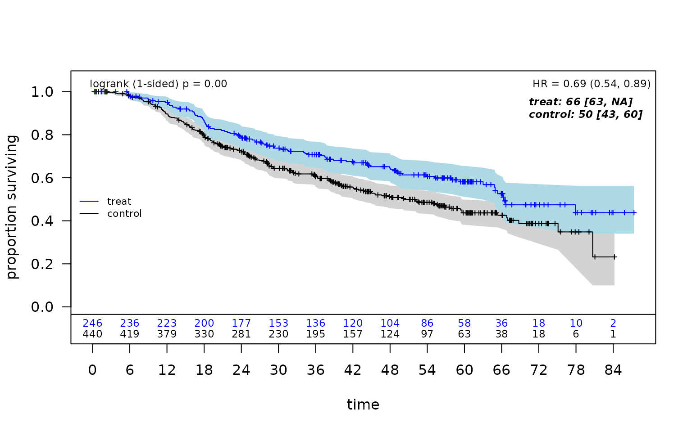
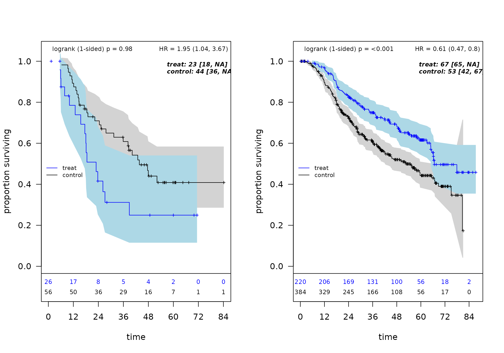
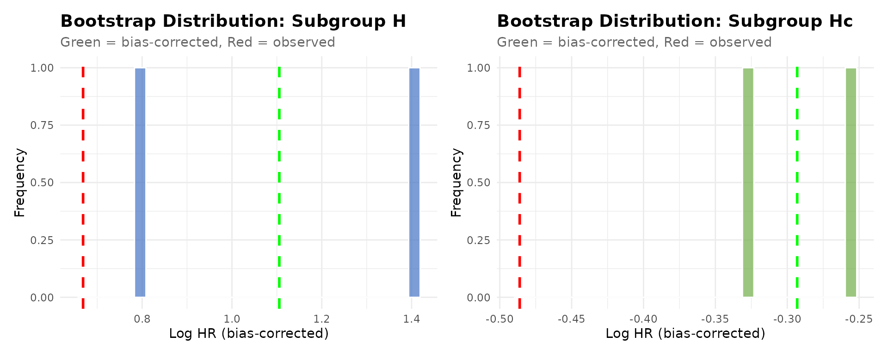
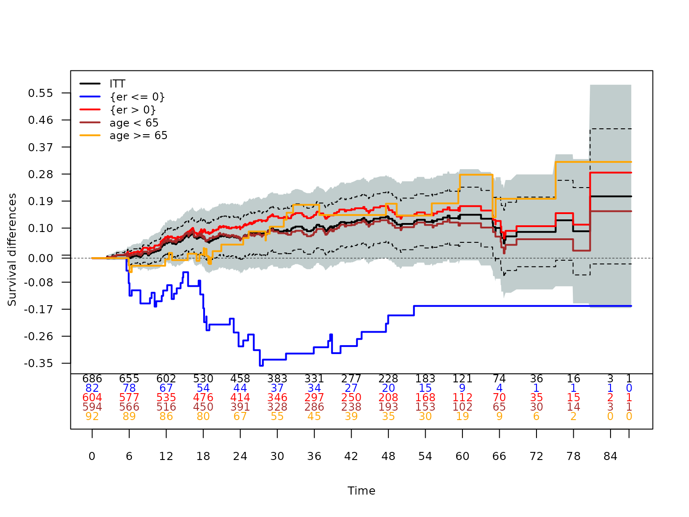

# Exploratory subgroup identification with forestsearch (the 2024 workflow)

> **About this article (added October 2026).** This is the package’s
> original vignette, written for forestsearch as described in León,
> Jemielita, Guo, Marceau West and Anderson (2024), *Statistics in
> Medicine*, <https://doi.org/10.1002/sim.10163>. It is kept as a
> reference for that publication: the full argument listing, the
> bootstrap bias correction and the cross-validation workflow it
> documents are still available in the package. The current methodology
> — the search as closed-form stability selection with its declaration
> calibration (León and Anderson 2026b, arXiv:2610.28379) and the
> selection-adjusted inference reported with `mr_inference = TRUE` (León
> and Anderson 2026a, arXiv:2609.38361) — is documented in
> [`vignette("forestsearch")`](https://larry-leon.github.io/forestsearch/articles/forestsearch.md)
> and the [post-selection
> article](https://larry-leon.github.io/forestsearch/articles/survival-post-selection.html).
> The code below runs as written; its settings are those of the 2024
> workflow and may differ from the current defaults and from the
> manuscript analyses.

## Introduction

This vignette demonstrates the **ForestSearch** methodology for
exploratory subgroup identification in survival analysis, as described
in León et al. (2024) *Statistics in Medicine*.

### Motivation

In clinical trials, particularly oncology, subgroup analyses are
essential for:

- Evaluating treatment effect consistency across patient populations
- Identifying subgroups where treatment may be detrimental (harm)
- Characterizing subgroups with enhanced benefit
- Informing regulatory decisions and clinical practice

While prespecified subgroups provide stronger evidence, important
subgroups based on patient characteristics may not be anticipated.
ForestSearch provides a principled approach to **exploratory** subgroup
identification with proper statistical inference.

### Methodology Overview

ForestSearch identifies subgroups through:

1.  **Candidate factor selection**: Using LASSO and/or Generalized
    Random Forests (GRF)
2.  **Exhaustive subgroup search**: Evaluating all combinations up to
    `maxk` factors
3.  **Consistency-based selection**: Applying splitting consistency
    criteria
4.  **Bootstrap bias correction**: Adjusting for selection-induced
    optimism
5.  **Cross-validation**: Assessing algorithm stability

The key innovation is the **splitting consistency criterion**: a
subgroup is considered “consistent with harm” if, when randomly split
50/50 many times, both halves consistently show hazard ratios ≥ 1.0 (for
example if 1.0 represents a meaningful “harm threshold”).

## Setup

### Load Required Packages

``` r

library(forestsearch)
library(survival)
library(data.table)
library(ggplot2)
library(gt)
library(grf)
library(policytree)
library(doFuture)

# Optional packages for enhanced output
library(patchwork)
library(weightedsurv)

# Set ggplot theme
theme_set(theme_minimal(base_size = 12))
```

## Data: German Breast Cancer Study Group Trial

### Study Background

The GBSG trial evaluated hormonal treatment (tamoxifen) versus no
hormonal therapy in node-positive breast cancer patients. Key
characteristics:

- **Sample size**: N = 686
- **Outcome**: Recurrence-free survival time
- **Censoring rate**: ~56%
- **Treatment**: Hormonal therapy (tamoxifen) vs. no hormonal therapy

### Data Preparation

``` r

# Load GBSG data (from the survival package)
df.analysis <- gbsg

# Prepare analysis variables
df.analysis <- within(df.analysis, {
  id <- seq_len(nrow(df.analysis))
  time_months <- rfstime / 30.4375
  grade3 <- ifelse(grade == "3", 1, 0)
  treat <- hormon
})

# Define variable roles
confounders.name <- c("age", "meno", "size", "grade3", "nodes", "pgr", "er")
outcome.name <- "time_months"
event.name <- "status"
id.name <- "id"
treat.name <- "hormon"

# Display data structure
cat("Sample size:", nrow(df.analysis), "\n")
```

    ## Sample size: 686

``` r

cat("Events:", sum(df.analysis[[event.name]]), 
    sprintf("(%.1f%%)\n", 100 * mean(df.analysis[[event.name]])))
```

    ## Events: 299 (43.6%)

``` r

cat("Baseline factors:", paste(confounders.name, collapse = ", "), "\n")
```

    ## Baseline factors: age, meno, size, grade3, nodes, pgr, er

### Baseline Characteristics

``` r

create_summary_table(
  data                  = df.analysis,                                       # required
  treat_var             = treat.name,                                        # default "treat"
  vars_continuous       = c("age", "nodes", "size", "er", "pgr"),            # default NULL
  vars_categorical      = c("grade", "meno"),                                # default NULL
  vars_binary           = NULL,                                              # default NULL
  var_labels            = NULL,                                              # default NULL
  digits                = 1,                                                 # default 1
  show_pvalue           = TRUE,                                              # default TRUE
  show_smd              = TRUE,                                              # default TRUE
  show_missing          = TRUE,                                              # default TRUE
  table_title           = "GBSG Baseline Characteristics by Treatment Arm",  # default "Baseline Characteristics by Treatment Arm"
  table_subtitle        = NULL,                                              # default NULL
  source_note           = NULL,                                              # default NULL
  font_size             = 12,                                                # default 12
  header_font_size      = 14,                                                # default 14
  footnote_font_size    = 10,                                                # default 10
  use_alternating_rows  = TRUE,                                              # default TRUE
  stripe_color          = "#f9f9f9",                                         # default "#f9f9f9"
  indent_size           = 20,                                                # default 20
  highlight_pval        = 0.05,                                              # default 0.05
  highlight_smd         = 0.2,                                               # default 0.2
  highlight_color       = "#fff3cd",                                         # default "#fff3cd"
  compact_mode          = FALSE,                                             # default FALSE
  column_width_var      = 200,                                               # default 200
  column_width_stats    = 120,                                               # default 120
  show_column_borders   = FALSE                                              # default FALSE
)
```

| GBSG Baseline Characteristics by Treatment Arm |  |  |  |  |  |
|----|----|----|----|----|----|
| Characteristic |  | Control (n=440) | Treatment (n=246) | P-value¹ | SMD² |
| age | Mean (SD) | 51.1 (10.0) | 56.6 (9.4) | \<0.001 | 0.57 |
| nodes | Mean (SD) | 4.9 (5.6) | 5.1 (5.3) | 0.665 | 0.03 |
| size | Mean (SD) | 29.6 (14.4) | 28.8 (14.1) | 0.470 | 0.06 |
| er | Mean (SD) | 79.7 (124.2) | 125.8 (191.1) | \<0.001 | 0.30 |
| pgr | Mean (SD) | 102.0 (170.0) | 124.3 (249.7) | 0.213 | 0.11 |
| grade |  |  |  | 0.273 | 0.06 |
|  | 1 | 48 (10.9%) | 33 (13.4%) |  |  |
|  | 2 | 281 (63.9%) | 163 (66.3%) |  |  |
|  | 3 | 111 (25.2%) | 50 (20.3%) |  |  |
| meno |  | 209 (47.5%) | 187 (76.0%) | \<0.001 | 0.61 |
| ¹ P-values: t-test for continuous, chi-square/Fisher's exact for categorical/binary variables |  |  |  |  |  |
| ² SMD = Standardized mean difference (Cohen's d for continuous, Cramer's V for categorical) |  |  |  |  |  |

### Kaplan-Meier Analysis (ITT Population)

``` r

# Prepare counting process data for KM plot
dfcount <- df_counting(
  df = df.analysis,
  by.risk = 6,
  tte.name = outcome.name,
  event.name = event.name,
  treat.name = treat.name
)

# Plot with confidence intervals and log-rank test
plot_weighted_km(
  dfcount,
  conf.int = TRUE,
  show.logrank = TRUE,
  ymax = 1.05,
  xmed.fraction = 0.775,
  ymed.offset = 0.125
)
```



The ITT Cox hazard ratio estimate is approximately 0.69 (95% CI: 0.54,
0.89), suggesting an overall benefit for hormonal therapy.

## Preliminary Analysis: Generalized Random Forests

Before running ForestSearch, we can use GRF to explore potential
treatment effect heterogeneity and identify candidate factors.

``` r

t0 <- proc.time()

# All grf.subg.harm.survival() parameters shown with their default values.
# Required: data, confounders.name, outcome.name, event.name, id.name, treat.name.
grf_est <- grf.subg.harm.survival(
  data                      = df.analysis,         # required
  confounders.name          = confounders.name,    # required
  outcome.name              = outcome.name,        # required
  event.name                = event.name,          # required
  id.name                   = id.name,             # required
  treat.name                = treat.name,          # required
  frac.tau                  = 0.6,                 # default 1.0; max follow-up fraction
  n.min                     = 60,                  # default 60; min subgroup size
  dmin.grf                  = 12,                  # default 0.0; min RMST diff (months)
  RCT                       = TRUE,                # default TRUE
  details                   = TRUE,                # default FALSE
  sg.criterion              = "mDiff",             # default "mDiff"; or "Nsg"
  maxdepth                  = 2,                   # default 2; max policy tree depth (<=3)
  seedit                    = 8316951,             # default 8316951
  return_selected_cuts_only = FALSE,               # default FALSE
  tune_grf                  = FALSE                # default FALSE; CV hyperparameter tuning
)
```

    ## tau, maxdepth = 46.75811 2 
    ##    leaf.node control.mean control.size control.se depth
    ## 1          2         6.49        82.00       3.34     1
    ## 2          3        -4.10       604.00       1.06     1
    ## 11         4        -7.90       112.00       2.81     2
    ## 21         5         3.86       177.00       1.87     2
    ## 4          7        -5.89       356.00       1.33     2
    ## 
    ## Selected subgroup:
    ##   leaf.node control.mean control.size control.se depth
    ## 1         2         6.49        82.00       3.34     1
    ## 
    ## GRF subgroup found
    ## Terminating node at max.diff (sg.harm.id):
    ## [1] "er <= 0"
    ## 
    ## All splits (from all trees):
    ## [1] "er <= 0"   "age <= 50" "age <= 43"

``` r

timings$grf <- (proc.time() - t0)["elapsed"]
```

``` r

# Display policy trees
# leaf1 = recommend control, leaf2 = recommend treatment
par(mfrow = c(1, 2))
plot(grf_est$tree1, leaf.labels = c("Control", "Treat"), main = "Depth 1")
```

``` r

plot(grf_est$tree2, leaf.labels = c("Control", "Treat"), main = "Depth 2")
```

``` r

par(mfrow = c(1, 1))
```

GRF identifies estrogen receptor status (ER) as a key factor, with ER ≤
0 suggesting potential harm from hormonal therapy.

## ForestSearch Analysis

### Parallel Processing Configuration

ForestSearch supports parallel processing for computationally intensive
operations (bootstrap, cross-validation).

``` r

# Detect available cores (limited to 2 cores for CRAN checks)
n_cores <- 2
n_cores_total <- parallel::detectCores()
cat("Using", n_cores, "of", n_cores_total, "total cores for parallel processing")
```

    ## Using 2 of 4 total cores for parallel processing

### Running ForestSearch

ForestSearch performs an exhaustive search over candidate subgroup
combinations with up to `maxk` factors. Key parameters:

| Parameter                | Value | Description                             |
|--------------------------|-------|-----------------------------------------|
| `hr.threshold`           | 1.25  | Minimum HR for consistency evaluation   |
| `hr.consistency`         | 1.0   | Minimum consistency rate for candidates |
| `pconsistency.threshold` | 0.90  | Required consistency for selection      |
| `maxk`                   | 2     | Maximum factors in subgroup definition  |
| `n.min`                  | 60    | Minimum subgroup sample size            |
| `d0.min`, `d1.min`       | 12    | Minimum events per treatment arm        |

``` r

t0 <- proc.time()

# All forestsearch() parameters shown with their default values.
# Comments indicate the package default; the value used here may differ.
fs <- forestsearch(
  df.analysis                = df.analysis,                  # required

  # ─── Variable names ─────────────────────────────────────────────────────
  outcome.name               = outcome.name,                 # default "tte"
  event.name                 = event.name,                   # default "event"
  treat.name                 = treat.name,                   # default "treat"
  id.name                    = id.name,                      # default "id"
  potentialOutcome.name      = NULL,                         # default NULL
  flag_harm.name             = NULL,                         # default NULL
  confounders.name           = confounders.name,             # default NULL

  # ─── Parallel processing ────────────────────────────────────────────────
  parallel_args              = list(plan = "multisession",
                                    workers = n_cores,
                                    show_message = TRUE),    # default plan="multisession"

  # ─── Prediction / RCT flag ──────────────────────────────────────────────
  df.predict                 = NULL,                         # default NULL
  df.test                    = NULL,                         # default NULL
  is.RCT                     = TRUE,                         # default TRUE
  seedit                     = 8316951,                      # default 8316951
  est.scale                  = "hr",                         # default "hr"

  # ─── Factor selection: LASSO + GRF ──────────────────────────────────────
  use_lasso                  = TRUE,                         # default TRUE
  use_grf                    = TRUE,                         # default TRUE
  grf_res                    = NULL,                         # default NULL; pass cached GRF result
  grf_cuts                   = NULL,                         # default NULL
  grf_depth                  = 2,                            # default 2
  dmin.grf                   = 0.0,                          # default 0.0
  frac.tau                   = 0.8,                          # default 0.8
  return_selected_cuts_only  = TRUE,                         # default TRUE
  tune_grf                   = FALSE,                        # default FALSE

  # ─── Cuts / discretization ──────────────────────────────────────────────
  conf_force                 = NULL,                         # default NULL
  defaultcut_names           = NULL,                         # default NULL
  cut_type                   = "default",                    # default "default"
  exclude_cuts               = NULL,                         # default NULL
  replace_med_grf            = FALSE,                        # default FALSE
  cont.cutoff                = 4,                            # default 4
  conf.cont_medians          = NULL,                         # default NULL
  conf.cont_medians_force    = NULL,                         # default NULL
  conf.cont_jcuts            = NULL,                         # default NULL

  # ─── Subgroup constraints ───────────────────────────────────────────────
  n.min                      = 60,                           # default 60; min subgroup size
  d0.min                     = 12,                           # default 10; min events arm 0
  d1.min                     = 12,                           # default 10; min events arm 1
  maxk                       = 2,                            # default 2; max factors per SG
  max_subgroups_search       = 3,                            # default 10

  # ─── Thresholds (preferred names take precedence if both supplied) ─────
  effect.threshold           = NULL,                         # default NULL; alias for hr.threshold
  consistency.threshold      = NULL,                         # default NULL; alias for hr.consistency
  hr.threshold               = 1.25,                         # default 1.25; screening threshold
  hr.consistency             = 1.0,                          # default 1.0; consistency threshold

  # ─── Selection (sg_focus / Pareto neighborhood) ─────────────────────────
  sg_focus                   = "maxSG",                    # default "hr"; "hr"/"eff", "maxSG", "minSG", "hrMaxSG"/"effMaxSG", "hrMinSG"/"effMinSG"
  selection_rule             = "neighborhood",               # default "neighborhood"; or "pareto", "both" (only for hrMaxSG/hrMinSG)
  effect_neighborhood        = 0.10,                         # default 0.10; tol for hrMaxSG/hrMinSG

  # ─── Consistency evaluation ─────────────────────────────────────────────
  fs.splits                  = 100,                          # default 1000; split-half repeats
  m1.threshold               = Inf,                          # default Inf
  pconsistency.threshold     = 0.80,                         # default 0.90
  stop_threshold             = 0.80,                         # default 0.95; early-stop consistency

  # ─── Two-stage consistency ──────────────────────────────────────────────
  use_twostage               = TRUE,                         # default TRUE
  twostage_args              = list(),                       # default list()

  # ─── GLM outcome support (survival analysis here) ───────────────────────
  outcome_type               = "survival",                   # default "survival"; or "binary", "continuous", "count"
  effect_measure             = NULL,                         # default NULL; auto-set from outcome_type
  offset.name                = NULL,                         # default NULL; required for count
  adverse_outcome            = NULL,                         # default NULL; auto-set
  overdispersion             = "none",                       # default "none"; or "quasi", "negbin"
  grf_count_transform        = "log",                        # default "log"; or "identity"

  # ─── Propensity-score adjustment (observational analyses) ───────────────
  ps_method                  = NULL,                         # default NULL
  ps_adjust_method           = "none",                       # default "none"; or "iptw", "dr_gcomp"
  ps_hat                     = NULL,                         # default NULL

  # ─── Output / diagnostics ───────────────────────────────────────────────
  show_candidate_summary     = TRUE,                         # default FALSE; pre-/post-consistency previews
  minp                       = 0.025,                        # default 0.025
  details                    = TRUE,                         # default FALSE
  quiet                      = FALSE,                        # default FALSE
  by.risk                    = 12,                           # default 12
  plot.sg                    = TRUE,                         # default FALSE; KM plots for SG
  plot.grf                   = FALSE                         # default FALSE
)
```

    ## GRF subgroup: er <= 0 
    ## GRF cuts identified: 1 
    ##   Cuts: er <= 0 
    ## Cox-LASSO selected: 4 of 7 candidate factors
    ##   Omitted: age, meno, er 
    ## Candidate factors: 14 
    ##  [1] "er <= 0"    "size <= 29" "size <= 25" "size <= 20" "size <= 35"
    ##  [6] "nodes <= 5" "nodes <= 3" "nodes <= 1" "nodes <= 7" "pgr <= 110"
    ## [11] "pgr <= 33"  "pgr <= 7"   "pgr <= 132" "grade3"    
    ## Number of possible configurations (<= maxk): maxk = 2 , # combinations = 406 
    ## Per-arm events criteria: control >= 12, treatment >= 12
    ## Sample size criteria: n >= 60 
    ## Subgroup search completed in 0.01 minutes
    ## 
    ## --- Filtering Summary ---
    ##   Combinations evaluated: 406 
    ##   Passed variance check: 374 
    ##   Passed prevalence (>= 0.025 ): 374 
    ##   Passed redundancy check: 354 
    ##   Passed events counts (d0>= 12, d1>= 12): 250
    ##   Passed sample size (n>= 60 ): 247 
    ##   Cox model fit successfully: 247
    ##   Passed effect threshold (effect >= 1.2500): 7
    ## -------------------------
    ## 
    ## Found 7 subgroup candidate(s)
    ## # of candidate subgroups (meeting all criteria) = 7 
    ## # of unique initial candidates: 7

    ## # Restricting to top stop_Kgroups = 3 
    ## # of candidates to evaluate: 3 
    ## 
    ## ==============================================================================================================
    ## CANDIDATE EVALUATION PREVIEW (pre-consistency) (sg_focus = "maxSG", selection_rule = "neighborhood")
    ## ==============================================================================================================
    ## Rank  HR      N      E     K    OF  Subgroup
    ## --------------------------------------------------------------------------------------------------------------
    ##    1   1.951     82    45    1  *   {er <= 0}
    ##    2   2.222     75    41    2  *   {er <= 0} & {pgr <= 33}
    ##    3   1.710     72    39    2  -   {pgr <= 7} & {grade3}
    ## --------------------------------------------------------------------------------------------------------------
    ## To evaluate: 3   On frontier: 2
    ## Legend: OF = on Pareto frontier.
    ## ==============================================================================================================

    ## Parallel config: workers = 2 , batch_size = 3 
    ## Batch 1 / 1 : candidates 1 - 3 
    ## Evaluated 3 of 3 candidates (complete) 
    ## 3 subgroups passed consistency threshold



    ## *** Subgroup found: {er <= 0} 
    ## % consistency criteria met= 0.96 
    ## SG focus = maxSG 
    ## 
    ## ==============================================================================================================
    ## CANDIDATE EVALUATION SUMMARY  (sg_focus = "maxSG", selection_rule = "neighborhood")
    ## ==============================================================================================================
    ## Rank  HR      N      E     K    P      OF  S  Subgroup
    ## --------------------------------------------------------------------------------------------------------------
    ##    1   1.951     82    45    1  0.960  *   *  {er <= 0}
    ##    2   2.222     75    41    2  0.990  *   -  {er <= 0} & {pgr <= 33}
    ##    3   1.710     72    39    2  0.860  -   -  {pgr <= 7} & {grade3}
    ## --------------------------------------------------------------------------------------------------------------
    ## Evaluated: 3   Passed: 3   On frontier: 2   Selected: m=1
    ## Legend: P = Pcons (consistency probability); OF = on Pareto frontier; S = selected.
    ## ==============================================================================================================
    ## 
    ## Seconds and minutes forestsearch overall = 5.49 0.0915 
    ## Consistency algorithm used: twostage 
    ## Subgroup identified: {er <= 0}

``` r

plan("sequential")
timings$forestsearch <- (proc.time() - t0)["elapsed"]

cat("\nForestSearch completed in", 
    round(timings$forestsearch, 1), "seconds\n")
```

    ## 
    ## ForestSearch completed in 5.5 seconds

### ForestSearch Results

#### Identified Subgroups

``` r

# Generate results tables
# All sg_tables() parameters shown with their default values.
res_tabs <- sg_tables(
  fs                    = fs,                                # required
  which_df              = "est",                             # default "est"
  est_title             = "Treatment Effect Estimates",      # default "Treatment Effect Estimates"
  est_caption           = "Training data estimates",         # default "Training data estimates"
  sg_title              = "Identified Subgroups",            # default "Identified Subgroups"
  sg_subtitle           = NULL,                              # default NULL
  potentialOutcome.name = NULL,                              # default NULL
  hr_1a                 = NA,                                # default NA
  hr_0a                 = NA,                                # default NA
  ndecimals             = 3,                                 # default 3
  include_search_info   = TRUE,                              # default TRUE
  subgroup_notation     = NULL,                              # default NULL; or "harm", "benefit"
  font_size             = 12                                 # default 12
)

# Display top subgroups meeting criteria
res_tabs$sg10_out
```

| **Identified Subgroups** |  |  |  |  |  |  |
|----|----|----|----|----|----|----|
| Two-factor subgroups (maxk=2) |  |  |  |  |  |  |
| Factor 1 | Factor 2 | N | Events | E₁ | HR | P_(cons) |
| {er \<= 0} |  | 82 | 45 | 16 | 1.951 | 0.960 |
| {er \<= 0} | {pgr \<= 33} | 75 | 41 | 16 | 2.222 | 0.990 |
| {pgr \<= 7} | {grade3} | 72 | 39 | 13 | 1.710 | 0.860 |
| **Search Configuration:** Single-factor candidates (L) = 28; Maximum combinations evaluated = 406; Search depth (maxk) = 2 |  |  |  |  |  |  |
| **Search Results:** Candidate subgroups found = 7; Maximum HR estimate = 2.54 |  |  |  |  |  |  |
| **Note:** E₁ = events in treatment arm; P_(cons) = consistency proportion |  |  |  |  |  |  |

#### Treatment Effect Estimates

``` r

# ITT and subgroup estimates
res_tabs$tab_estimates
```

| **Treatment Effect Estimates** |  |  |  |  |  |  |  |
|----|----|----|----|----|----|----|----|
| Training data estimates |  |  |  |  |  |  |  |
| Subgroup | n | n1 | events | m1 | m0 | RMST | HR (95% CI) |
| ITT | 686 (100.0%) | 246 (35.9%) | 299 (43.6%) | 66.3 | 50.2 | 7.8 | 0.69 (0.54, 0.89) |
| Questionable¹ | 82 (12.0%) | 26 (31.7%) | 45 (54.9%) | 22.9 | 43.7 | -14 | 1.95 (1.04, 3.67) |
| Recommend | 604 (88.0%) | 220 (36.4%) | 254 (42.1%) | 66.7 | 52.6 | 9.3 | 0.61 (0.47, 0.80) |
| ¹ **Identified subgroup:** {er \<= 0} |  |  |  |  |  |  |  |

#### Identified Subgroup Definition

``` r

cat("Identified subgroup (H):", paste(fs$sg.harm, collapse = " & "), "\n")
```

    ## Identified subgroup (H): {er <= 0}

``` r

cat("Subgroup size:", sum(fs$df.est$treat.recommend == 0), 
    sprintf("(%.1f%% of ITT)\n", 
            100 * mean(fs$df.est$treat.recommend == 0)))
```

    ## Subgroup size: 82 (12.0% of ITT)

ForestSearch identifies **Estrogen ≤ 0** (ER-negative) as the subgroup
with potential harm. This is biologically plausible: tamoxifen is a
selective estrogen receptor modulator with limited efficacy in
ER-negative tumors.

## Bootstrap Bias Correction

### Rationale

Cox model estimates from identified subgroups are **upwardly biased**
due to the selection process (subgroups are selected *because* they show
extreme effects). Bootstrap bias correction addresses this by:

1.  Resampling with replacement
2.  Re-running the entire ForestSearch algorithm
3.  Computing bias terms from bootstrap vs. observed estimates
4.  Applying infinitesimal jackknife variance estimation

### Running Bootstrap Analysis

``` r

# Number of bootstrap iterations
# Use 500-2000 for production; reduced here for vignette
NB <- 2

t0 <- proc.time()

# All forestsearch_bootstrap_dofuture() parameters shown with their defaults.
fs_bc <- forestsearch_bootstrap_dofuture(
  fs.est        = fs,                                        # required
  nb_boots      = NB,                                        # required (use 500-2000 for production)
  seed          = 8316951L,                                  # default 8316951L
  details       = FALSE,                                     # default FALSE
  show_three    = FALSE,                                     # default FALSE
  parallel_args = list(plan = "multisession",
                       workers = n_cores,
                       show_message = TRUE),                 # default list()
  digits        = 4                                          # default 4
)

plan("sequential")
timings$bootstrap <- (proc.time() - t0)["elapsed"]

cat("\nBootstrap completed in", 
    round(timings$bootstrap / 60, 1), "minutes\n")
```

    ## 
    ## Bootstrap completed in 0.2 minutes

### Bootstrap Summary and Diagnostics

``` r

# All summarize_bootstrap_results() parameters shown with their defaults.
summaries <- summarize_bootstrap_results(
  sgharm       = fs$sg.harm,                                 # required
  boot_results = fs_bc,                                      # required
  create_plots = TRUE,                                       # default FALSE
  est.scale    = "hr",                                       # default "hr"
  digits       = 2                                           # default 2
)
```

    ## 
    ## ===============================================================
    ##            BOOTSTRAP ANALYSIS SUMMARY                          
    ## ===============================================================
    ## 
    ## IDENTIFIED SUBGROUP:
    ## -------------------------------------------------------------
    ##   H: {er <= 0}
    ## 
    ## BOOTSTRAP SUCCESS METRICS:
    ## -------------------------------------------------------------
    ##   Total iterations:              2
    ##   Successful subgroup ID:        2 (100.0%)
    ##   Failed to find subgroup:       0 (0.0%)
    ## 
    ## TIMING ANALYSIS:
    ## -------------------------------------------------------------
    ## Overall:
    ##   Total bootstrap time:          0.14 minutes (0.00 hours)
    ##   Average per iteration:         0.07 min (4.3 sec)
    ##   Projected for 1000 boots:      72.01 min (1.20 hrs)

``` r

# Display bias-corrected estimates table
summaries$table
```

[TABLE]

### Kaplan-Meier by Identified Subgroups

``` r

# All plot_sg_weighted_km() parameters shown with their defaults.
km_result <- plot_sg_weighted_km(
  fs.est         = fs,                                       # required
  fs_bc          = fs_bc,                                    # default NULL
  outcome.name   = "time_months",                            # default "Y"
  event.name     = "status",                                 # default "Event"
  treat.name     = "hormon",                                 # default "Treat"
  by.risk        = 12,                                       # default NULL
  sg0_name       = NULL,                                     # default NULL
  sg1_name       = NULL,                                     # default NULL
  conf.int       = TRUE,                                     # default TRUE
  show.logrank   = FALSE,                                    # default TRUE
  show.cox       = FALSE,                                    # default TRUE
  show.cox.bc    = TRUE,                                     # default TRUE
  put.legend.lr  = "topleft",                                # default "topleft"
  ymax           = 1.05,                                     # default 1.05
  xmed.fraction  = 0.65,                                     # default 0.65
  hr_bc_position = "topright",                               # default "bottomright"
  hr_bc_cex      = 0.725,                                    # default 0.725
  title          = NULL,                                     # default NULL
  verbose        = FALSE                                     # default FALSE
)
```


Kaplan-Meier survival curves by identified subgroup

**Note:** Identified subgroup: {er \<= 0}. HR(bc) = bootstrap
bias-corrected hazard ratio. Medians \[95% CI\] for arms are
un-adjusted.

#### Event Count Summary

Low event counts can lead to unstable HR estimates. This summary helps
identify potential issues:

``` r

# note that default required minimum events is 12 for subgroup candidate
# Here we evaluate frequency of subgroup candidates in bootstrap samples less than 15
# All summarize_bootstrap_events() parameters shown with their defaults.
event_summary <- summarize_bootstrap_events(
  boot_results = fs_bc,                                      # required
  threshold    = 15                                          # default 5
)
```

    ## 
    ## === Bootstrap Event Count Summary ===
    ## Total bootstrap iterations: 2
    ## Event threshold: <15 events
    ## 
    ## ORIGINAL Subgroup H on BOOTSTRAP samples:
    ##   Control arm <15 events: 0 (0.0%)
    ##   Treatment arm <15 events: 0 (0.0%)
    ##   Either arm <15 events: 0 (0.0%)
    ## 
    ## ORIGINAL Subgroup Hc on BOOTSTRAP samples:
    ##   Control arm <15 events: 0 (0.0%)
    ##   Treatment arm <15 events: 0 (0.0%)
    ##   Either arm <15 events: 0 (0.0%)
    ## 
    ## NEW Subgroups found: 2 (100.0%)
    ## 
    ## NEW Subgroup H* on ORIGINAL data:
    ##   Control arm <15 events: 0 (0.0% of successful)
    ##   Treatment arm <15 events: 0 (0.0% of successful)
    ##   Either arm <15 events: 0 (0.0% of successful)
    ## 
    ## NEW Subgroup Hc* on ORIGINAL data:
    ##   Control arm <15 events: 0 (0.0% of successful)
    ##   Treatment arm <15 events: 0 (0.0% of successful)
    ##   Either arm <15 events: 0 (0.0% of successful)

#### Bootstrap Diagnostics

``` r

# Quality metrics
summaries$diagnostics_table_gt
```

| **Bootstrap Diagnostics Summary**  |                   |            |
|------------------------------------|-------------------|------------|
| Analysis of 2 bootstrap iterations |                   |            |
| Category                           | Metric            | Value      |
| Success Rate                       | Total iterations  | 2          |
|                                    | Successful        | 2 (100.0%) |
|                                    | Failed            | 0 (0.0%)   |
|                                    | Success rating    | Excellent  |
| Subgroup H (Questionable)          | Observed HR       | 1.951      |
|                                    | Bias-corrected HR | 3.021      |
|                                    | Bootstrap CV (%)  | 38.5%      |
|                                    | N estimates       | 2          |
| Subgroup Hc (Recommend)            | Observed HR       | 0.615      |
|                                    | Bias-corrected HR | 0.746      |
|                                    | Bootstrap CV (%)  | 18.1%      |
|                                    | N estimates       | 2          |

#### Subgroup Agreement

How consistently does bootstrap identify the same subgroup?

``` r

# Agreement with original analysis
if (!is.null(summaries$subgroup_summary$original_agreement)) {
  summaries$subgroup_summary$original_agreement
}
```

    ##                             Metric      Value
    ##                             <char>     <char>
    ## 1:      Total bootstrap iterations          2
    ## 2:           Successful iterations          2
    ## 3: Failed iterations (no subgroup)          0
    ## 4:                                           
    ## 5:    Original subgroup definition  {er <= 0}
    ## 6:       Exact match with original   0 (0.0%)
    ## 7:         Different from original 2 (100.0%)
    ## 8:   Partial match (shared factor)   0 (0.0%)

``` r

# Factor presence across bootstrap iterations
if (!is.null(summaries$subgroup_summary$factor_presence)) {
  summaries$subgroup_summary$factor_presence
}
```

    ##   Rank Factor Count Percent
    ## 1    1     er     2     100
    ## 2    2    pgr     1      50
    ## 3    3   size     1      50

#### Bootstrap Distributions

``` r

if (!is.null(summaries$plots)) {
  summaries$plots$H_distribution + summaries$plots$Hc_distribution
}
```



## Cross-Validation

Cross-validation assesses the **stability** of the ForestSearch
algorithm. Two approaches are available:

### K-Fold Cross-Validation

``` r

# 10-fold CV with multiple iterations
# Use Ksims >= 50 for production
Ksims <- 1

t0 <- proc.time()

# All forestsearch_tenfold() parameters shown with their defaults.
fs_kfold <- forestsearch_tenfold(
  fs.est        = fs,                                        # required
  sims          = Ksims,                                     # required (use >=50 for production)
  Kfolds        = 2,                                         # default 10
  details       = FALSE,                                     # default TRUE
  seed          = 8316951L,                                  # default 8316951L
  parallel_args = list(plan = "multisession",
                       workers = n_cores,
                       show_message = FALSE),                # default plan="multisession", workers=6
  keep_resCV    = FALSE                                      # default FALSE
)

plan("sequential")
timings$kfold <- (proc.time() - t0)["elapsed"]

# All cv_metrics_tables() parameters shown with their defaults.
metrics_tables <- cv_metrics_tables(
  cv_result        = fs_kfold,                               # required
  sg_definition    = NULL,                                   # default NULL
  title            = "Cross-Validation Metrics",             # default "Cross-Validation Metrics"
  show_percentages = TRUE,                                   # default TRUE
  digits           = 1,                                      # default 1
  include_raw      = FALSE,                                  # default FALSE
  table_style      = "combined",                             # default "combined"; or "separate", "minimal"
  use_gt           = TRUE                                    # default TRUE
)
metrics_tables
```

| **Cross-Validation Metrics** |  |  |
|----|----|----|
| Subgroup: Identified Subgroup |  |  |
| Metric | Description | Value (%) |
| Agreement |  |  |
| Sensitivity (H) | Agreement rate for subgroup H | 19.5 |
| Sensitivity (Hc) | Agreement rate for complement Hc | 76.2 |
| PPV (H) | Positive predictive value for H | 10.0 |
| PPV (Hc) | Positive predictive value for Hc | 87.5 |
| Subgroup Finding |  |  |
| Any Found | Any subgroup identified | 100.0 |
| Exact Match | Exact match on all factors | 0.0 |
| At Least 1 | At least one factor matches | 0.0 |
| Cov1 Any | First covariate found (any cut) | 0.0 |
| Cov2 Any | Second covariate found (any cut) | NA |
| Cov1 & Cov2 | Both covariates found | 0.0 |
| Cov1 Exact | First covariate exact match | 0.0 |
| Cov2 Exact | Second covariate exact match | NA |
| Based on 1 simulation(s) with 2-fold CV. Values are proportions shown as percentages. |  |  |

### Out-of-Bag (N-Fold) Cross-Validation

N-fold CV (leave-one-out):

``` r

t0 <- proc.time()

# All forestsearch_Kfold() parameters shown with their defaults.
fs_OOB <- forestsearch_Kfold(
  fs.est        = fs,                                        # required
  Kfolds        = round(nrow(df.analysis)/100, 0),           # default nrow(fs.est$df.est) (LOO)
  seedit        = 8316951L,                                  # default 8316951L
  parallel_args = list(plan = "multisession",
                       workers = n_cores,
                       show_message = TRUE),                 # default plan="multisession", workers=6
  sg0.name      = "Not recommend",                           # default "Not recommend"
  sg1.name      = "Recommend",                               # default "Recommend"
  details       = FALSE                                      # default FALSE
)

plan("sequential")
timings$oob <- (proc.time() - t0)["elapsed"]

# All forestsearch_KfoldOut() parameters shown with their defaults.
cv_out <- forestsearch_KfoldOut(
  res     = fs_OOB,                                          # required
  details = FALSE,                                           # default FALSE
  outall  = TRUE,                                            # default FALSE
  digits  = 4                                                # default 4
)

# All cv_summary_tables() parameters shown with their defaults.
tables <- cv_summary_tables(
  kfold_out    = cv_out,                                     # required
  title        = "Cross-Validation Summary",                 # default "Cross-Validation Summary"
  subtitle     = NULL,                                       # default NULL
  show_metrics = TRUE,                                       # default TRUE
  digits       = 3,                                          # default 3
  font_size    = 12,                                         # default 12
  use_gt       = TRUE                                        # default TRUE
)

tables$combined_table

tables$metrics_table
```

## Results Visualization

### Forest Plot

The forest plot summarizes treatment effects across the ITT population,
reference subgroups, and identified subgroups with cross-validation
metrics.

``` r

# Define reference subgroups for comparison
subgroups <- list(
  age_gt65 = list(
    subset_expr = "age > 65",
    name = "Age > 65",
    type = "reference"
  ),
  age_le65 = list(
    subset_expr = "age <= 65",
    name = "Age ≤ 65",
    type = "reference"
  ),
  pgr_positive = list(
    subset_expr = "pgr > 0",
    name = "PgR > 0",
    type = "reference"
  ),
  pgr_negative = list(
    subset_expr = "pgr <= 0",
    name = "PgR ≤ 0",
    type = "reference"
  )
)


# All create_forest_theme() parameters shown with their defaults.
my_theme <- create_forest_theme(
  base_size         = 24,                                    # default 10
  scale             = 1.0,                                   # default 1.0
  row_padding       = NULL,                                  # default NULL
  ci_pch            = 15,                                    # default 15
  ci_lwd            = NULL,                                  # default NULL
  ci_Theight        = NULL,                                  # default NULL
  ci_col            = "black",                               # default "black"
  header_fontsize   = NULL,                                  # default NULL (auto)
  body_fontsize     = NULL,                                  # default NULL (auto)
  footnote_fontsize = 17,                                    # default NULL
  footnote_col      = "darkcyan",                            # default "darkcyan"
  title_fontsize    = NULL,                                  # default NULL
  cv_fontsize       = 22,                                    # default NULL
  cv_col            = "gray30",                              # default "gray30"
  refline_lwd       = NULL,                                  # default NULL
  refline_lty       = "dashed",                              # default "dashed"
  refline_col       = "gray30",                              # default "gray30"
  vertline_lwd      = NULL,                                  # default NULL
  vertline_lty      = "dashed",                              # default "dashed"
  vertline_col      = "gray20",                              # default "gray20"
  arrow_type        = "closed",                              # default "closed"
  arrow_col         = "black",                               # default "black"
  summary_fill      = "black",                               # default "black"
  summary_col       = "black"                                # default "black"
)


# Create forest plot
# Include fs_kfold and fs_OOB if available for CV metrics
# All plot_subgroup_results_forestplot() parameters shown with their defaults.
result <- plot_subgroup_results_forestplot(
  fs_results        = list(fs.est   = fs,
                           fs_bc    = fs_bc,
                           fs_OOB   = NULL,
                           fs_kfold = fs_kfold),             # required
  df_analysis       = df.analysis,                           # required
  subgroup_list     = subgroups,                             # default NULL
  outcome.name      = outcome.name,                          # required
  event.name        = event.name,                            # required
  treat.name        = treat.name,                            # required
  E.name            = "Hormonal",                            # default "Experimental"
  C.name            = "Chemo",                               # default "Control"
  est.scale         = "hr",                                  # default "hr"
  xlog              = TRUE,                                  # default TRUE
  title_text        = NULL,                                  # default NULL
  arrow_text        = c("Favors Experimental", "Favors Control"),  # default same
  footnote_text     = c("Eg 80% of training found SG: 70% of B (+) also B in CV testing"),  # default same
  xlim              = c(0.25, 1.5),                          # default c(0.25, 1.5)
  ticks_at          = c(0.25, 0.70, 1.0, 1.5),               # default c(0.25, 0.70, 1.0, 1.5)
  show_cv_metrics   = TRUE,                                  # default TRUE
  cv_source         = "auto",                                # default "auto"; or "kfold", "oob", "both"
  posthoc_colors    = c("powderblue", "beige"),              # default same
  reference_colors  = c("yellow", "powderblue"),             # default same
  ci_column_spaces  = 25,                                    # default 20
  conf.level        = 0.95,                                  # default 0.95
  theme             = my_theme,                              # default NULL
  outcome_type      = NULL,                                  # default NULL; auto-detect
  effect_measure    = NULL,                                  # default NULL; auto-detect
  offset.name       = NULL,                                  # default NULL
  extreme_ci_cap    = 1.5,                                   # default 1.5
  xlim_method       = "clinical"                             # default "clinical"; or "data"
)


# Option 2: Custom sizing
# All render_forestplot() parameters shown with their defaults.
render_forestplot(
  x       = result,                                          # required
  newpage = TRUE                                             # default TRUE
)
```


Subgroup forest plot including identified subgroups

#### KM Difference plots: ITT and subgroups

The solid black line denotes the ITT Kaplan-Meier treatment difference
estimates along with 95% CIs (the grey shaded region). K-M differences
corresponding to subgroups are displayed.

``` r

# Add additional subgroups along with ITT and identified subgroups
ref_sgs <- list(
age_young = list(subset_expr = "age < 65", color = "brown"),
age_old = list(subset_expr = "age >= 65", color = "orange")
)

# All plot_km_band_forestsearch() parameters shown with their defaults.
plot_km_band_forestsearch(
  df             = df.analysis,                              # required
  fs.est         = fs,                                       # default NULL
  sg_cols        = NULL,                                     # default NULL
  sg_labels      = NULL,                                     # default NULL
  sg_colors      = NULL,                                     # default NULL
  itt_color      = "azure3",                                 # default "azure3"
  outcome.name   = outcome.name,                             # default "tte"
  event.name     = event.name,                               # default "event"
  treat.name     = treat.name,                               # default "treat"
  xlabel         = "Time",                                   # default "Time"
  ylabel         = "Survival differences",                   # default "Survival differences"
  yseq_length    = 5,                                        # default 5
  draws_band     = 20,                                       # default 1000 (lower for speed)
  tau_add        = NULL,                                     # default NULL
  by_risk        = 6,                                        # default 6
  risk_cex       = 0.75,                                     # default 0.75
  risk_delta     = 0.035,                                    # default 0.035
  risk_pad       = 0.015,                                    # default 0.015
  ymax_pad       = 0.11,                                     # default 0.11
  show_legend    = TRUE,                                     # default TRUE
  legend_pos     = "topleft",                                # default "topleft"
  legend_cex     = 0.75,                                     # default 0.75
  ref_subgroups  = ref_sgs,                                  # default NULL
  verbose        = FALSE                                     # default FALSE
)
```



``` r

# # Example with more subgroups
# ref_sgs <- list(
# pgr_positive = list(subset_expr = "pgr > 0", color ="green"),
# pgr_negative = list(subset_expr = "pgr <= 0", color = "purple"),
# age_young = list(subset_expr = "age < 65", color = "brown"),
# age_old = list(subset_expr = "age >= 65", color = "orange")
# )
```

## Summary and Interpretation

### Key Findings

``` r

# Extract key results
cat("=" %>% rep(60) %>% paste(collapse = ""), "\n")
```

    ## ============================================================

``` r

cat("FORESTSEARCH ANALYSIS SUMMARY\n")
```

    ## FORESTSEARCH ANALYSIS SUMMARY

``` r

cat("=" %>% rep(60) %>% paste(collapse = ""), "\n\n")
```

    ## ============================================================

``` r

cat("Dataset: GBSG (N =", nrow(df.analysis), ")\n")
```

    ## Dataset: GBSG (N = 686 )

``` r

cat("Outcome: Recurrence-free survival\n\n")
```

    ## Outcome: Recurrence-free survival

``` r

cat("ITT Analysis:\n")
```

    ## ITT Analysis:

``` r

cat("  HR (95% CI): 0.69 (0.54, 0.89)\n\n")
```

    ##   HR (95% CI): 0.69 (0.54, 0.89)

``` r

cat("Identified Subgroup (H):\n")
```

    ## Identified Subgroup (H):

``` r

cat("  Definition:", paste(fs$sg.harm, collapse = " & "), "\n")
```

    ##   Definition: {er <= 0}

``` r

cat("  Size:", sum(fs$df.est$treat.recommend == 0), 
    sprintf("(%.1f%%)\n", 100 * mean(fs$df.est$treat.recommend == 0)))
```

    ##   Size: 82 (12.0%)

``` r

cat("  Unadjusted HR:", sprintf("%.2f", fs$grp.consistency$out_sg$result$hr[1]), "\n")
```

    ##   Unadjusted HR: 1.95

``` r

cat("\nComplement Subgroup (Hc):\n")
```

    ## 
    ## Complement Subgroup (Hc):

``` r

cat("  Size:", sum(fs$df.est$treat.recommend == 1),
    sprintf("(%.1f%%)\n", 100 * mean(fs$df.est$treat.recommend == 1)))
```

    ##   Size: 604 (88.0%)

### Clinical Interpretation

The ForestSearch analysis identifies **estrogen receptor-negative (ER ≤
0)** patients as a subgroup with potential lack of benefit from hormonal
therapy.

**Biological plausibility**: Tamoxifen is a selective estrogen receptor
modulator. Its efficacy depends on ER expression. The finding that
ER-negative patients may not benefit is consistent with:

- Mechanistic understanding of tamoxifen action
- Meta-analyses showing no tamoxifen benefit in ER-negative breast
  cancer
- Clinical guidelines recommending tamoxifen primarily for ER-positive
  tumors

**Caveats**:

1.  This is an **exploratory** analysis requiring independent validation
2.  The bias-corrected estimates have wider confidence intervals
3.  Cross-validation metrics should be evaluated for algorithm stability

### Computational Timing

| Computational Timing |            |            |
|----------------------|------------|------------|
| Component            | Time (sec) | Time (min) |
| GRF                  | 1.3        | 0.0        |
| ForestSearch         | 5.5        | 0.1        |
| Bootstrap            | 9.6        | 0.2        |
| Total                | 30.1       | 0.5        |

[ Code](#collapse-timingsummary)

``` r
timings$total <- (proc.time() - t_vignette_start)["elapsed"]

timing_df <- data.frame(
  Analysis = c("GRF", "ForestSearch", "Bootstrap", "Total"),
  Seconds = c(
    timings$grf,
    timings$forestsearch,
    timings$bootstrap,
    timings$total
  )
)
timing_df$Minutes <- timing_df$Seconds / 60

gt(timing_df) |>
  tab_header(title = "Computational Timing") |>
  fmt_number(columns = c(Seconds, Minutes), decimals = 1) |>
  cols_label(
    Analysis = "Component",
    Seconds = "Time (sec)",
    Minutes = "Time (min)"
  )
```

## References

León LF, Jemielita T, Guo Z, Marceau West R, Anderson KM (2024).
“Exploratory subgroup identification in the heterogeneous Cox model: A
relatively simple procedure.” *Statistics in Medicine*. DOI:
10.1002/sim.10163

## Session Information

``` r

sessionInfo()
```

    ## R version 4.6.1 (2026-06-24)
    ## Platform: x86_64-pc-linux-gnu
    ## Running under: Ubuntu 24.04.5 LTS
    ## 
    ## Matrix products: default
    ## BLAS:   /usr/lib/x86_64-linux-gnu/openblas-pthread/libblas.so.3 
    ## LAPACK: /usr/lib/x86_64-linux-gnu/openblas-pthread/libopenblasp-r0.3.26.so;  LAPACK version 3.12.0
    ## 
    ## locale:
    ##  [1] LC_CTYPE=C.UTF-8       LC_NUMERIC=C           LC_TIME=C.UTF-8       
    ##  [4] LC_COLLATE=C.UTF-8     LC_MONETARY=C.UTF-8    LC_MESSAGES=C.UTF-8   
    ##  [7] LC_PAPER=C.UTF-8       LC_NAME=C              LC_ADDRESS=C          
    ## [10] LC_TELEPHONE=C         LC_MEASUREMENT=C.UTF-8 LC_IDENTIFICATION=C   
    ## 
    ## time zone: UTC
    ## tzcode source: system (glibc)
    ## 
    ## attached base packages:
    ## [1] stats     graphics  grDevices utils     datasets  methods   base     
    ## 
    ## other attached packages:
    ##  [1] weightedsurv_0.1.0  patchwork_1.3.2     doFuture_1.4.0     
    ##  [4] future_1.80.0       foreach_1.5.2       policytree_1.2.5   
    ##  [7] grf_2.6.1           gt_1.4.0            ggplot2_4.0.3      
    ## [10] data.table_1.18.6.1 survival_3.8-6      forestsearch_0.4.0 
    ## 
    ## loaded via a namespace (and not attached):
    ##  [1] gtable_0.3.6         shape_1.4.6.1        xfun_0.62           
    ##  [4] bslib_0.12.0         htmlwidgets_1.6.4    visNetwork_2.1.4    
    ##  [7] lattice_0.22-9       vctrs_0.7.3          tools_4.6.1         
    ## [10] generics_0.1.4       parallel_4.6.1       tibble_3.3.1        
    ## [13] pkgconfig_2.0.3      Matrix_1.7-5         forestploter_1.2.0  
    ## [16] RColorBrewer_1.1-3   S7_0.2.2             desc_1.4.3          
    ## [19] lifecycle_1.0.5      compiler_4.6.1       farver_2.1.2        
    ## [22] textshaping_1.0.5    codetools_0.2-20     litedown_0.11       
    ## [25] htmltools_0.5.9      sass_0.4.10          yaml_2.3.12         
    ## [28] glmnet_5.2           pillar_1.11.1        pkgdown_2.2.1       
    ## [31] jquerylib_0.1.4      cachem_1.1.0         iterators_1.0.14    
    ## [34] parallelly_1.48.0    commonmark_2.0.0     tidyselect_1.2.1    
    ## [37] digest_0.6.39        mvtnorm_1.4-2        dplyr_1.2.1         
    ## [40] listenv_1.1.0        labeling_0.4.3       splines_4.6.1       
    ## [43] fastmap_1.2.0        grid_4.6.1           cli_3.6.6           
    ## [46] magrittr_2.0.5       DiagrammeR_1.0.12    randomForest_4.7-1.2
    ## [49] future.apply_1.21.0  withr_3.0.3          scales_1.4.0        
    ## [52] rmarkdown_2.32       globals_0.20.0       otel_0.2.0          
    ## [55] gridExtra_2.3.1      progressr_1.1.0      ragg_1.5.2          
    ## [58] evaluate_1.0.5       knitr_1.52           markdown_2.1        
    ## [61] rlang_1.3.0          Rcpp_1.1.2           glue_1.8.1          
    ## [64] xml2_1.6.0           rstudioapi_0.19.0    jsonlite_2.0.0      
    ## [67] R6_2.6.1             systemfonts_1.3.2    fs_2.1.0
