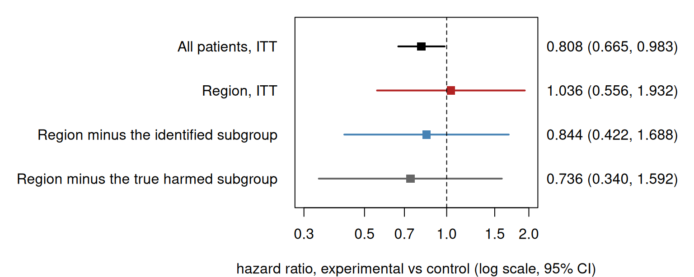

# MRCT regional consistency: simulations

Code

``` r

suppressPackageStartupMessages({
  library(forestsearch)
  library(survival)
  library(data.table)
})
# The article's records ship with the package (inst/extdata/mrct-consistency; provenance in its
# PROVENANCE.md). mrct_record() reads them: from a source tree the local copy, otherwise the installed one.
f2 <- function(x) formatC(x, format = "f", digits = 2)
f3 <- function(x) formatC(x, format = "f", digits = 3)
f4 <- function(x) formatC(x, format = "f", digits = 4)
pc <- function(x, d = 1) formatC(100 * x, format = "f", digits = d)
big <- function(x) format(x, big.mark = ",", trim = TRUE, scientific = FALSE)
near <- function(a, b, tol = 1e-9) all(abs(a - b) <= tol * pmax(1, abs(b)))
t_article <- proc.time()[["elapsed"]]
```

> **Installing forestsearch**
>
> This article needs forestsearch 0.5.0 or later. Run the steps in a
> fresh R session.
>
> ``` r
>
> # 1. a reliable CRAN mirror
> options(repos = c(CRAN = "https://cloud.r-project.org"))
>
> # 2. forestsearch from CRAN, which also installs every package it needs
> install.packages("forestsearch")
>
> # 3. two packages forestsearch only suggests, which this article uses (speff2trial for the
> #    ACTG 175 data, latentcor for the copula expansion), and knitr for the tables
> install.packages(c("speff2trial", "latentcor", "knitr"))
>
> packageVersion("forestsearch")   # this article needs 0.5.0 or later
> ```
>
> If a step asks whether to install packages from sources, answer no.
> The chunk below stops with a message naming anything that is missing,
> before any computation starts.
>
> **Installing from GitHub.** The GitHub repository holds the version
> under development, which can be ahead of the CRAN release. Use it if
> you want changes that have not reached CRAN yet, or if the chunk below
> reports that your installed version is too old and CRAN has nothing
> newer. Do steps 1 to 3 first, so that every package forestsearch needs
> is already installed, then:
>
> ``` r
>
> install.packages("remotes")
> options(timeout = 600)   # R's default download limit of 60 seconds is too short for this repository
> remotes::install_github("larry-leon/forestsearch", upgrade = "never")
> packageVersion("forestsearch")
> ```
>
> `upgrade = "never"` leaves the packages already installed as they are.
> The call downloads the whole forestsearch repository, several
> gigabytes, and builds only the package from it, so it takes several
> minutes. Restart R afterwards, so that the new version is the one
> loaded.

Code

``` r

needed <- c("inject_mrct_structure", "scale_dgm_hazard", "ahr_population", "ahr_limit", "ahr_design", "ahr_solve",
            "mrct_region_sims", "mrct_select_case", "mrct_case_study", "analysis_covariates", "get_dfpred",
            "mr_estimates_table", "mrct_record", "mrct_build_dgm", "mrct_trial_analysis", "mrct_core_summary",
            "ahr_truths_table", "ahr_design_table")
missing_fns <- setdiff(needed, getNamespaceExports("forestsearch"))
if (length(missing_fns))
  stop("This article needs forestsearch 0.5.0 or later (see 'Installing forestsearch'); ",
       "the installed version (", as.character(packageVersion("forestsearch")), ") lacks: ",
       paste(missing_fns, collapse = ", "), ".", call. = FALSE)
missing_pkgs <- c("speff2trial", "latentcor", "knitr")[!vapply(c("speff2trial", "latentcor", "knitr"), requireNamespace, NA, quietly = TRUE)]
if (length(missing_pkgs))
  stop("This article needs: ", paste(missing_pkgs, collapse = ", "),
       " (install.packages(c(", paste0('"', missing_pkgs, '"', collapse = ", "), ")).", call. = FALSE)
c(forestsearch = as.character(packageVersion("forestsearch")))
```

    forestsearch
         "0.5.0" 

> **Rendering this article yourself**
>
> Rendering needs the Quarto command-line tools and about five minutes.
> The article’s records are installed with the package, so only the
> `.qmd` file itself is needed. Download it into a scratch folder and
> render it there:
>
> ``` r
>
> dir.create("~/Downloads/scratch/mrct-article", recursive = TRUE, showWarnings = FALSE)
> download.file("https://raw.githubusercontent.com/larry-leon/forestsearch/master/vignettes/articles/mrct-consistency-simulations.qmd",
>               "~/Downloads/scratch/mrct-article/mrct-consistency-simulations.qmd")
> ```
>
> ``` bash
> cd ~/Downloads/scratch/mrct-article && quarto render mrct-consistency-simulations.qmd
> ```
>
> The rendered `mrct-consistency-simulations.html` is written beside the
> `.qmd`. Delete the scratch folder when done.

This article is the simulation side of the regional-consistency
strategy: how the report’s data-generating mechanism and cells were
built, the analytic layer that predicts the design’s behaviour before
any simulation, the committed campaign’s results, and how the case study
of the application article
([mrct-consistency](https://larry-leon.github.io/forestsearch/articles/mrct-consistency.md))
was found. It executes independently of that article: the case study’s
objects, which the checks below compare against, are recomputed first
([Section 1](#sec-case-objects)).

## 1 The case study’s objects, recomputed

The application article analyses one trial, replicate 5 of S2, from its
shipped data (`rep5_trial.csv`) to its multiplier-resampling bounds,
with every call explained. The simulation sections below check
themselves against that analysis — the redraw of
[Section 3.4](#sec-find) must reproduce the trial, its $`\hat H`$ and
its four Cox fits, and [Section 3.5](#sec-case-sim) reads its MR values
— so this chunk recomputes the same objects by the one call of
[`mrct_trial_analysis()`](https://larry-leon.github.io/forestsearch/reference/mrct_trial_analysis.md),
on the same arguments; the application article is the walkthrough.

Code

``` r

trial <- mrct_record("rep5_trial.csv")
covs <- c("z_age", "z_wtkg", "z_karnof", "z_preanti", "z_cd40", "z_cd80",
          "z_hemo", "z_homo", "z_drugs", "z_race", "z_gender", "z_symptom")
# the replicate's call seed, from the MR campaign's record of this trial
seed_rep5 <- mrct_record("mr_field_S2_rep5.csv")$seed
stopifnot(length(seed_rep5) == 1, !anyDuplicated(trial$id),
          all(c("id", "y_sim", "event_sim", "treat_sim", "z_region", covs, "flag_harm") %in% names(trial)))
stopifnot(RNGkind()[1] == "Mersenne-Twister")
t_mr <- proc.time()[["elapsed"]]
ta5 <- mrct_trial_analysis(
  trial, "y_sim", "event_sim", "treat_sim", region.name = "z_region", id.name = "id",
  truth.name = "flag_harm",
  fs_args = list(confounders.name = covs, conf_force = character(0),
                 conf.cont_jcuts = list(z_cd40 = 10, z_wtkg = 10, z_preanti = 10),
                 use_grf = FALSE, use_lasso = FALSE, maxk = 2,
                 hr.threshold = 0.90, hr.consistency = 0.80, pconsistency.threshold = 0.90,
                 sg_focus = "hrMaxSG", effect_neighborhood = 0.20),
  mr_inference_args = list(ci_method = "field", include_complement = TRUE, field_complement = TRUE,
                           draws = 2000, multiplier = "poisson", return_reselection = TRUE,
                           seed = seed_rep5))
t_mr <- proc.time()[["elapsed"]] - t_mr
four <- ta5$sets
itt_ub <- four$hi[four$set == "itt_all"]
stopifnot(itt_ub < 1)
reg <- trial$z_region == 1
trigger <- ta5$trigger
stopifnot(trigger)
fs <- ta5$fs
mr <- ta5$mr
Hhat_def <- ta5$Hhat
stopifnot(!is.null(fs$sg.harm), mr$ci_method == "field", mr$settings$draws == 2000,
          mr$field$n_out_used == mr$field$R_out)
in_Hhat <- ta5$in_Hhat
stopifnot(identical(in_Hhat, trial$id %in% c(fs$df.est$id[fs$df.est$treat.recommend == 0],
                                              fs$df.test$id[fs$df.test$treat.recommend == 0])))
Hstar <- trial$flag_harm == 1                       # simulation only: H* is unknown in a real trial
set_label <- c(itt_all = "All patients, ITT", itt_region = "Region, ITT",
               region_Gstar = "Region minus H* (G*)", region_Ghat = "Region minus Ĥ (Ĝ)")
mr_tab <- mr_estimates_table(fs, est.scale = "hr", digits = 3)
mv <- attr(mr_tab, "mr_values")
cc <- mr$complement; fl <- mr$field
stopifnot(near(mv$naive_est, c(mr$naive$est, cc$naive$est), 1e-12),
          near(mv$field_bound, c(fl$lower_1s, fl$complement$upper_1s), 1e-12),
          near(mv$bonferroni_bound, c(fl$joint$bonf_lower_H, fl$joint$bonf_upper_Hc), 1e-12))
c(patients = nrow(trial), seconds_mr = round(t_mr, 1)); Hhat_def
```

      patients seconds_mr
        1000.0       53.7 

    [1] "{z_cd40 <= 236} & !{z_preanti <= 196}"

$`\hat H`$ is `{z_cd40 <= 236} & !{z_preanti <= 196}`; the four sets and
the bounds are read and discussed in the application article.

## 2 Setting up simulations from your own trial

This section treats `rep5_trial.csv` as if it were your trial, with its
region **observed**: the column `z_region` is taken as recorded, and
nothing about who is in the region is modelled. $`H^*`$ and the effects
in the cells are then your statements. Five steps, in order.

**1. A data-generating mechanism that carries the observed region.**
[`inject_mrct_structure()`](https://larry-leon.github.io/forestsearch/reference/inject_mrct_structure.md),
the function of the report’s build ([Section 3.1](#sec-dgm)), is given
the trial and `region = list(observed = "region")`: with
`region$observed`, the region is carried through the expansion with the
covariates and nothing about membership is modelled. With `loghr` left
at `NULL` the region’s prognostic log hazard ratio is estimated by the
Weibull AFT fit, as the other covariates’ effects are; $`H^*`$, $`b`$
and $`h`$ are set as in the report’s build (`spline_spec` gives $`b`$
everywhere, `x3` defines $`H^*`$ = CD4 $`\le`$ 230 and multiplies the
hazard ratio in it by $`h/b`$), and the super-population is expanded by
the copula. There is no
[`scale_dgm_hazard()`](https://larry-leon.github.io/forestsearch/reference/scale_dgm_hazard.md)
call here: replicate 5’s outcomes were drawn with every hazard already
multiplied by 3, so the Weibull fit to them estimates the scaled
intercept directly, and a `scale_dgm_hazard(…, m = 3)` call would
multiply every hazard by 3 a second time.

Code

``` r

own <- mrct_record("rep5_trial.csv")
own <- own[, setdiff(names(own), c("id", "flag_harm"))]   # your trial has no flag_harm
names(own) <- sub("^z_", "", names(own))                   # plain names; the build adds z_
build_own <- function(h, b = 0.55, cut = 230) {
  mrct_build_dgm(
    own,
    outcome_var = "y_sim", event_var = "event_sim", treatment_var = "treat_sim",
    continuous_vars = c("age", "wtkg", "karnof", "preanti", "cd40", "cd80"),
    factor_vars = c("hemo", "homo", "drugs", "race", "gender", "symptom"),
    x_pred = "cd40",
    spline_spec = list(knot = 300, zeta = 800, log_hrs = rep(log(b), 3)),      # b
    region = list(observed = "region"),                                        # r estimated
    x3 = list(vars = "cd40", cuts = list(cd40 = cut), loghr = log(h / b)),     # h in H*
    n_super = 20000, expand = "copula", seed = 7L,
    continuous_vars_cens = c("age", "cd40"), factor_vars_cens = "symptom")
}
t_own <- proc.time()[["elapsed"]]
dgm_own <- build_own(h = 2)
t_own <- proc.time()[["elapsed"]] - t_own
for (w in attr(dgm_own, "build_warnings")) warning(w, call. = FALSE)   # kept by the build, shown here
```

    Warning: Ran out of iterations and did not converge
    Warning: Ran out of iterations and did not converge
    Warning: Ran out of iterations and did not converge

Code

``` r

ds_own <- dgm_own$df_super
stopifnot(isTRUE(dgm_own$mrct$region$observed), dgm_own$mrct$region$z_name == "z_region",
          "z_cd40" %in% names(ds_own), !any(grepl("^z_z_", names(ds_own))),
          near(ds_own$loghr_po, ifelse(ds_own$z_cd40 <= 230, log(2), log(0.55)), 1e-12),
          all((ds_own$z_cd40 <= 230) == (ds_own$flag_harm == 1)))
r_own <- dgm_own$mrct$region$prognostic_loghr
c(rows = nrow(ds_own), region_super = mean(ds_own$z_region), region_trial = mean(own$region),
  Hstar = mean(ds_own$flag_harm), region_prognostic_loghr = r_own, generating_r = -log(4),
  build_warnings = length(attr(dgm_own, "build_warnings")), seconds = round(t_own, 1))
```

                       rows            region_super            region_trial
               20000.000000                0.195550                0.194000
                      Hstar region_prognostic_loghr            generating_r
                   0.164250               -1.541238               -1.386294
             build_warnings                 seconds
                   3.000000                0.600000 

Every patient’s log hazard ratio is $`\log 0.55`$ outside $`H^*`$ and
$`\log 2`$ inside it. The region’s prognostic log hazard ratio,
estimated from the trial, is $`\hat r`$ = -1.541 ($`e^{\hat r}`$ =
0.214); the mechanism that generated replicate 5 used $`r = -\log 4`$ =
-1.386 ([Section 3.1](#sec-dgm)). The region is 19.6% of the
super-population and 19.4% of the trial. The build took 0.6 seconds. Its
3 warnings, shown above, come from the censoring model’s fit: every
censoring time in this trial lies between 29.01 and 39.98 months, that
is, all censoring is administrative, and the Weibull fit to it does not
converge. Trials are drawn below with `cens_adjust = 50`, which pushes
that model far beyond the window, so all censoring is again
administrative.

**2. $`H^*`$ and the cells.** The build above is one cell: S2’s
$`h = 2`$ in $`H^*`$ = CD4 $`\le`$ 230 and $`b = 0.55`$ outside it. The
other cells change only $`h`$ (shown, not run):

Code

``` r

h_cells <- c(N0 = 0.55, N1 = 0.75, S1 = 1, S2 = 2, S3 = 3, S4 = 4)   # h in H*; b = 0.55 outside
dgms_own <- lapply(h_cells, build_own)
```

> **Choosing the cells**
>
> A cell is one data-generating mechanism: your trial’s build with a
> stated $`H^*`$, a hazard ratio $`h`$ inside it and $`b`$ outside it,
> in every region. Choose $`h`$ as the sizes of harm you want the
> strategy to be able to explain, and keep cells in which there is
> nothing harmful to find ($`h = b`$; $`h`$ between $`b`$ and 1;
> $`h = 1`$): those are where the strategy explains a trigger that has
> no trial-wide explanation, and the rate at which it does so is a
> result to report.

**3. The analytic layer on that mechanism.** The four truths of the
region, the non-region patients and $`G^*`$, and the design
probabilities at $`n = 1{,}000`$, with this trial’s analysis at 40
months and entry over 11.

Code

``` r

pop_own <- ahr_population(dgm_own, analysis_time = 40, max_entry = 11)
sets_own <- c(region = "region", nonregion = "non-region", region_Gstar = "G* (region minus H*)")
lim_own <- ahr_truths_table(pop_own, sets = names(sets_own), b = 0.55, h = 2)
p_own <- ahr_design_table(pop_own, b = 0.55, h = 2, n = 1000)
tab_own <- rbind(
  data.frame(row = unname(sets_own[lim_own$set]), a = f3(lim_own$marghr), b = f3(lim_own$marghr_inf),
             c = f3(lim_own$ahr), d = f3(lim_own$cde)),
  data.frame(row = c("P(trigger), n = 1,000", "P(oracle joint), n = 1,000"),
             a = f3(c(p_own[["p_trigger"]], p_own[["p_trigger_and_Gstar_lt1"]])), b = "", c = "", d = ""))
knitr::kable(setNames(tab_own, c("", "margHR(40)", "margHR(∞)", "AHR", "CDE")), row.names = FALSE,
             align = "lrrrr", caption = "The analytic layer on the mechanism built from the trial (h = 2, b = 0.55).")
```

|                            | margHR(40) | margHR(∞) |   AHR |   CDE |
|:---------------------------|-----------:|----------:|------:|------:|
| region                     |      0.884 |     0.669 | 0.673 | 1.091 |
| non-region                 |      0.740 |     0.667 | 0.682 | 1.077 |
| G\* (region minus H\*)     |      0.557 |     0.609 | 0.550 | 0.550 |
| P(trigger), n = 1,000      |      0.242 |           |       |       |
| P(oracle joint), n = 1,000 |      0.180 |           |       |       |

The analytic layer on the mechanism built from the trial (h = 2, b =
0.55). {.table .caption-top}

Code

``` r

# S2's values from the campaign's analytic record (the same numbers as in the analytic-layer section)
pred_S2 <- mrct_record("predictions_full.csv"); pred_S2 <- pred_S2[pred_S2$cell == "S2_rmlog4", ]
s2 <- function(q, set) { v <- pred_S2$value[pred_S2$quantity == q & pred_S2$set == set]; stopifnot(length(v) == 1); v }
```

As a reading, not a check: the region’s margHR(40) is 0.884 here against
0.868 in S2, P(trigger) 0.242 against 0.241 and the oracle joint 0.180
against 0.187 ([Section 3.3](#sec-analytic)); the build from one trial
of 1,000 is not S2’s build from ACTG 175 and is not expected to
reproduce it.

> **The analytic layer**
>
> [`ahr_population()`](https://larry-leon.github.io/forestsearch/reference/ahr_population.md)
> on each cell’s mechanism, with your analysis time and entry period,
> then
> [`ahr_truths_table()`](https://larry-leon.github.io/forestsearch/reference/ahr_tables.md)
> on the sets you care about gives each set’s four truths: read margHR
> at the analysis time as the set’s windowed Cox limit, what its Cox
> estimate converges to — it moves with the event rate and the window
> while the AHR and CDE do not (the application article’s
> [appendix](https://larry-leon.github.io/forestsearch/articles/mrct-consistency.html#sec-window)
> shows why) — and the AHR and CDE as the effect in the set.
> [`ahr_design_table()`](https://larry-leon.github.io/forestsearch/reference/ahr_tables.md)
> at your trial size gives P(ITT ub \< 1.0), P(region ITT \> 1.0),
> P(trigger) and the oracle joint before any simulation; if P(trigger)
> is very small, the campaign will have few triggered trials to
> summarise.
> [`ahr_solve()`](https://larry-leon.github.io/forestsearch/reference/ahr_solve.md)
> places one free parameter so that P(trigger) reaches a target
> ([Section 3.3.1](#sec-roots)). These are computed by quadrature and
> take seconds per cell.

**4. The campaign.** One
[`mrct_region_sims()`](https://larry-leon.github.io/forestsearch/reference/mrct_region_sims.md)
call per cell, with the identifier’s arguments of
[Section 1](#sec-case-objects) (shown, not run; no campaign is run in
this section):

Code

``` r

res_own <- mrct_region_sims(
  dgm_own, n_sims = 10000, n_sample = 1000, region_var = "z_region",
  sg_focus = "hrMaxSG", maxk = 2,
  hr.threshold = 0.90, hr.consistency = 0.80, pconsistency.threshold = 0.90,
  confounders.name = analysis_covariates(dgm_own, "observed"),   # all z_ but z_region
  conf_force = character(0),
  fs_args = list(conf.cont_jcuts = list(z_cd40 = 10, z_wtkg = 10, z_preanti = 10),
                 effect_neighborhood = 0.20, use_grf = FALSE, use_lasso = FALSE),
  sim_args = list(rand_ratio = 1, draw_treatment = TRUE, max_entry = 11, cens_adjust = 50),
  analysis_time = 40, cens_adjust = 50,
  parallel_args = list(plan = "multisession", workers = 64, show_message = FALSE),
  details = FALSE, seed = 20261102, record = "full")
```

> **The campaign**
>
> Give
> [`mrct_region_sims()`](https://larry-leon.github.io/forestsearch/reference/mrct_region_sims.md)
> your cell’s mechanism, your trial size, your region variable and the
> identifier’s arguments you used in [Section 1](#sec-case-objects);
> `sim_args` and `analysis_time` carry the entry, window and dropout of
> the design. Keep `record = "full"`: case selection reads the per-trial
> Cox fits it stores. Give each cell its own seed and record it: a
> replicate is redrawn from the mechanism, the call seed and its index.
> Before a full campaign, time a short run at the worker count you will
> use; the time per trial on a lightly loaded machine does not carry
> over to all workers busy.

**5. Case selection and the summaries conditional on the trigger**
(shown, not run): the shares of the triggered trials, from the per-trial
Cox fits of the full record, and a case chosen by the rule of
[Section 3.4](#sec-find).

Code

``` r

mrct_core_summary(res_own)                                    # the core rows, on the triggered trials
case_own <- mrct_select_case(res_own)                         # the first trial meeting the rule
```

> **Reading the results**
>
> Summarise the campaign conditional on the trigger: a team runs the
> joint analysis only when the trial is positive and the region’s
> estimate is above 1.0, so the triggered trials are the denominator
> that matters. Report for each cell the share of triggered trials with
> a declaration, the joint and, beside it, the oracle joint as the
> benchmark that removing $`H^*`$ exactly would give under the stated
> mechanism (a benchmark, not a bound: in a given trial $`\hat G`$ can
> do better); then the same rows in the null cells.
> [`mrct_select_case()`](https://larry-leon.github.io/forestsearch/reference/mrct_select_case.md)
> picks a case by a stated rule before it is looked at, and
> [`mrct_case_study()`](https://larry-leon.github.io/forestsearch/reference/mrct_case_study.md)
> redraws and examines it ([Section 3.4](#sec-find)).

## 3 How replicate 5 was generated: the report’s simulation design

Replicate 5 is one trial drawn from the report’s S2 cell. This section
is that design: the data-generating mechanism built from ACTG 175
([Section 3.1](#sec-dgm)), the eight cells, the analytic layer
([Section 3.3](#sec-analytic)), and the rule and the calls by which
replicate 5 was found and redrawn ([Section 3.4](#sec-find)); it closes
with what can be said about replicate 5 only because it is simulated
([Section 3.5](#sec-case-sim)).

### 3.1 The data-generating mechanism, built from ACTG 175

A Weibull accelerated-failure-time model is fitted to a published trial
and expanded to a super-population of 20,000 rows by a Gaussian copula.
A region of about 20% of patients is planted by a logistic model with
odds ratio 3 on symptomatic status and no CD4 term, and its baseline
hazard is shifted by $`r`$; every patient’s hazard ratio is $`b = 0.55`$
outside $`H^*`$ = {CD4 $`\le`$ 230} and $`h`$ inside it, in every
region; all hazards are then multiplied by $`m = 3`$. Three calls build
it, shown here as a reader would make them with their own trial.

**1. The trial data.** ACTG 175 (`speff2trial`), arms ZDV + ddI
(`arms == 1`, experimental) and ddI alone (`arms == 3`, control). The
outcome is `days` to the composite endpoint, in months, with event
indicator `cens`; the prognostic covariates are age, weight (`wtkg`),
Karnofsky score (`karnof`), days of prior antiretroviral therapy
(`preanti`), baseline CD4 (`cd40`) and CD8 (`cd80`) counts, and the
binary haemophilia (`hemo`), homosexual activity (`homo`), drug use
(`drugs`), race, gender and symptomatic status (`symptom`).

Code

``` r

actg <- subset(speff2trial::ACTG175, arms %in% c(1L, 3L))
actg$treat_mrct <- as.integer(actg$arms == 1L)   # ZDV + ddI = 1, ddI = 0
actg$time_months <- actg$days / 30.4375
rownames(actg) <- NULL
c(patients = nrow(actg), events = sum(actg$cens), experimental = sum(actg$treat_mrct))
```

        patients       events experimental
            1083          231          522 

**2. The region and the harmed subgroup.**
[`inject_mrct_structure()`](https://larry-leon.github.io/forestsearch/reference/inject_mrct_structure.md)
fits the Weibull model on the twelve covariates, expands it by the
copula, plants the region (`region`: prevalence, the logistic model’s
odds ratios, the prognostic log hazard ratio $`r`$) and the harmed
subgroup (`spline_spec` sets $`b`$ everywhere; `x3` multiplies it by
$`h/b`$ in CD4 $`\le`$ 230), here for cell S2 ($`h = 2`$). The copula’s
latent correlation is fitted live by latentcor (Suggests); without
latentcor the call warns and uses the normal-score correlation instead,
which gives a valid but different super-population.

Code

``` r

dgm_live <- inject_mrct_structure(
  actg,
  outcome_var = "time_months", event_var = "cens", treatment_var = "treat_mrct",
  continuous_vars = c("age", "wtkg", "karnof", "preanti", "cd40", "cd80"),
  factor_vars = c("hemo", "homo", "drugs", "race", "gender", "symptom"),
  x_pred = "cd40",
  spline_spec = list(knot = 300, zeta = 800, log_hrs = rep(log(0.55), 3)),  # b = 0.55
  region = list(prevalence = 0.20, or_pred = 1, x1_vars = "symptom", or_x1 = 3,
                loghr = -log(4),                                          # r
                band = list(cut = 230, or = 1)),
  x3 = list(vars = "cd40", cuts = list(cd40 = 230), loghr = log(2 / 0.55)),  # h = 2 in H*
  region_treat_loghr = NULL,
  n_super = 20000, expand = "copula", seed = 7L,
  continuous_vars_cens = c("age", "cd40"), factor_vars_cens = "symptom")
```

**3. The hazard scale.**
[`scale_dgm_hazard()`](https://larry-leon.github.io/forestsearch/reference/scale_dgm_hazard.md)
multiplies every hazard by $`m`$ on both arms, by shifting the fitted
Weibull intercept ([Section 5](#sec-appendix), the DGM in closed form),
and leaves every hazard ratio unchanged. The Weibull fit to ACTG 175
carries that trial’s own event rate; $`m = 3`$ raises it toward a modern
trial’s (the [application
article](https://larry-leon.github.io/forestsearch/articles/mrct-consistency.html#sec-dgm-overview)
gives both rates). The windowed Cox limits move with $`m`$ although no
hazard ratio does; the application article’s
[appendix](https://larry-leon.github.io/forestsearch/articles/mrct-consistency.html#sec-window)
shows why.

Code

``` r

dgm_live <- scale_dgm_hazard(dgm_live, m = 3)
c(rows = nrow(dgm_live$df_super), region = mean(dgm_live$df_super$z_region),
  Hstar = mean(dgm_live$df_super$flag_harm))
```

         rows    region     Hstar
    2.000e+04 2.006e-01 1.569e-01 

**To use your own trial**, change these and nothing else:

- the data frame and its outcome, event and treatment names
  (`outcome_var`, `event_var`, `treatment_var`; treatment coded 1 =
  experimental);
- the covariates (`continuous_vars`, `factor_vars`, binary factors coded
  0/1, and the censoring model’s `continuous_vars_cens`,
  `factor_vars_cens`);
- the region model (`region`: its prevalence, the covariates that
  predict membership and their odds ratios, its prognostic log hazard
  ratio $`r`$);
- $`H^*`$ and its effects: the covariate and cut that define it (`x3`,
  `region$band`), $`b`$ outside it (`spline_spec$log_hrs`) and $`h`$
  inside it (`x3$loghr` $`= \log(h/b)`$);
- the analysis window and entry: the analysis time and the uniform entry
  period used below (`analysis_time = 40`, `max_entry = 11`), and
  `cens_adjust` for the dropout model.

> **Reproducing this report’s build exactly**
>
> This chunk exists only so that the committed record is reproduced to
> the last digit on any platform: it builds the cells with the latent
> correlation stored with the campaign’s build (`latent_R.csv`, passed
> as `latent_R`), so no latentcor fit is made. A reader never needs it.
> Everything from the build check onward uses the cells built here
> (`build_cell()`).
>
> Code
>
> ``` r
>
> latent_R <- as.matrix(mrct_record("latent_R.csv", row.names = 1))
>
> # One cell: hazard ratio h in H* = {CD4 <= 230}, b = 0.55 elsewhere, region
> # prognostic log-HR r, all hazards x m; the calls of steps 2 and 3 above.
> build_cell <- function(h, r = -log(4), b = 0.55, cut = 230, m = 3) {
>   mrct_build_dgm(
>     actg,
>     outcome_var = "time_months", event_var = "cens", treatment_var = "treat_mrct",
>     continuous_vars = c("age", "wtkg", "karnof", "preanti", "cd40", "cd80"),
>     factor_vars = c("hemo", "homo", "drugs", "race", "gender", "symptom"),
>     x_pred = "cd40",
>     spline_spec = list(knot = 300, zeta = 800, log_hrs = rep(log(b), 3)),
>     region = list(prevalence = 0.20, or_pred = 1, x1_vars = "symptom", or_x1 = 3,
>                   loghr = r, band = list(cut = cut, or = 1)),
>     x3 = list(vars = "cd40", cuts = list(cd40 = cut), loghr = log(h / b)),
>     region_treat_loghr = NULL,
>     n_super = 20000, expand = "copula", seed = 7L,
>     continuous_vars_cens = c("age", "cd40"), factor_vars_cens = "symptom",
>     latent_R = latent_R,
>     m = m)
> }
> t_build <- proc.time()[["elapsed"]]
> dgm_S2 <- build_cell(h = 2)
> t_build <- proc.time()[["elapsed"]] - t_build
> # the live fit of step 2 against the shipped matrix
> R_live <- dgm_live$mrct$latent_R
> R_diff <- if (is.null(R_live)) NA_real_ else max(abs(R_live[rownames(latent_R), colnames(latent_R)] - latent_R))
> live_same <- isTRUE(R_diff == 0) && identical(dgm_live$df_super, dgm_S2$df_super)
> c(seconds = round(t_build, 1), rows = nrow(dgm_S2$df_super), latent_R_max_abs_diff = R_diff,
>   super_population_identical = live_same)
> ```
>
>                        seconds                       rows
>                   5.000000e-01               2.000000e+04
>          latent_R_max_abs_diff super_population_identical
>                   2.858824e-15               0.000000e+00 
>
> On this render machine the live fit of step 2 differs from the shipped
> matrix (largest absolute difference 2.9e-15), so the reader’s path
> gives a slightly different super-population; the checks below use this
> chunk’s build.

**Build check.** The build must equal the campaign’s build record of S2
(`build_full_summary.csv`, the `S2_rmlog4` row) in every numeric column
that describes the build; the article stops otherwise.

Code

``` r

pop_S2 <- ahr_population(dgm_S2, analysis_time = 40, max_entry = 11)
e_reg <- ahr_limit(pop_S2, "region", b = 0.55, h = 2, variance = FALSE)
e_non <- ahr_limit(pop_S2, "nonregion", b = 0.55, h = 2, variance = FALSE)
ds <- dgm_S2$df_super; reg_s <- ds$z_region == 1; Hs_s <- ds$flag_harm == 1; rg <- dgm_S2$mrct$region
ours <- c(
  h = 2, r = -log(4), mu = unname(dgm_S2$model_params$mu), mu_fitted = unname(dgm_S2$mrct$mu_fitted),
  tau = dgm_S2$model_params$tau, m = dgm_S2$mrct$hazard_multiplier,
  b0_z_region = unname(dgm_S2$model_params$b0["z_region"]), b0_treat = unname(dgm_S2$model_params$b0["treat"]),
  b0_treat_harm = unname(dgm_S2$model_params$b0["treat_harm"]),
  prognostic_loghr_recorded = rg$prognostic_loghr, region_alpha0 = rg$alpha0,
  region_coef_cd40 = unname(rg$coefs["cd40"]), region_coef_symptom = unname(rg$coefs["symptom"]),
  region_coef_cd4_le_230 = log(rg$band$or), prevalence = mean(reg_s),
  Hstar_share_region = mean(Hs_s[reg_s]), Hstar_share_nonregion = mean(Hs_s[!reg_s]),
  event_prob_40_region = e_reg$d, event_prob_40_nonregion = e_non$d,
  events_n1000_region = 1000 * mean(reg_s) * e_reg$d, events_n1000_nonregion = 1000 * mean(!reg_s) * e_non$d,
  mean_theta0_region = mean(ds$theta_0[reg_s]), mean_theta0_nonregion = mean(ds$theta_0[!reg_s]),
  n_build_warnings = length(attr(dgm_S2, "build_warnings")))
br <- mrct_record("build_full_summary.csv"); br <- br[br$cell == "S2_rmlog4", ]
num_cols <- names(br)[vapply(br, is.numeric, NA)]
stopifnot(nrow(br) == 1,
          setequal(setdiff(num_cols, names(ours)), c("prevalence_trials", "seed", "truth_seed", "replicates")),
          isTRUE(all.equal(unname(ours), unname(unlist(br[names(ours)])), tolerance = 1e-8)),
          all((ds$z_cd40 <= 230) == (ds$flag_harm == 1)))
build_diff <- max(abs(ours - unlist(br[names(ours)])) / pmax(1, abs(unlist(br[names(ours)]))))
c(columns_compared = length(ours), largest_relative_difference = signif(build_diff, 2))
```

               columns_compared largest_relative_difference
                        2.4e+01                     3.8e-15 

**Passed**: the build equals the record (largest relative difference
3.8e-15). In this build the region holds 20.1% of the super-population,
$`H^*`$ holds 15.7% of all patients (16.5% of the region and 15.5%
outside it), and at equal covariates a region patient has $`e^{r}`$ =
0.25 times the hazard of a non-region patient. The trial:
$`n = 1{,}000`$, 1:1, entry uniform over 11 months, analysis at 40
months; the Weibull dropout is pushed far beyond the window
(`cens_adjust = 50`), so all censoring is administrative.

### 3.2 The cells

Six cells at $`r = -\log 4`$ differ only in the hazard ratio $`h`$
inside $`H^*`$; two later-enrolling cells keep S2’s effects and let the
region enter later, with $`r`$ or the delay solved so that P(trigger) =
0.25 ([Section 3.3.1](#sec-roots)). The specifications as the committed
runs’ timing records state them:

Code

``` r

tf <- mrct_record("timing_full.csv"); ts1 <- mrct_record("timing_S1.csv"); te <- mrct_record("timing_entry_cells.csv")
cells <- rbind(
  data.frame(cell = sub("_rmlog4$", "", tf$setting), h = tf$h, r = -log(4), delay = 0, n = 1000,
             replicates = tf$replicates, seed = tf$seed),
  data.frame(cell = "S1", h = ts1$h[ts1$setting == "S1_rmlog4"], r = -log(4), delay = 0, n = 1000,
             replicates = ts1$replicates[ts1$setting == "S1_rmlog4"], seed = ts1$seed[ts1$setting == "S1_rmlog4"]),
  data.frame(cell = te$setting, h = te$h, r = te$r, delay = te$a, n = te$n, replicates = te$replicates,
             seed = te$seed))
cells <- cells[match(c("N0", "N1", "S1", "S2", "S3", "S4", "S2_D1", "S2_D2"), cells$cell), ]
rownames(cells) <- NULL
# the shipped build record's h and r for the five full cells
bfull <- mrct_record("build_full_summary.csv")
stopifnot(!anyNA(cells$cell), near(bfull$h, cells$h[match(sub("_rmlog4$", "", bfull$cell), cells$cell)]),
          near(bfull$r, -log(4), 1e-12))
find <- ifelse(cells$h == 0.55, "nothing: the same benefit everywhere",
               ifelse(cells$h < 1, "nothing harmful: less benefit in CD4 ≤ 230",
                      ifelse(cells$h == 1, "nothing harmful: no effect in CD4 ≤ 230", "harm in CD4 ≤ 230")))
knitr::kable(data.frame(
  cell = cells$cell, `HR in CD4 ≤ 230; elsewhere` = sprintf("%s; 0.55", formatC(cells$h, format = "fg")),
  `what there is to find` = find,
  `region prognostic shift` = sprintf("r = −log %s", formatC(exp(-cells$r), format = "fg", digits = 4)),
  `region enrols later by` = ifelse(cells$delay == 0, "—", sprintf("%s months", f2(cells$delay))),
  n = big(cells$n), replicates = big(cells$replicates), `call seed` = cells$seed, check.names = FALSE),
  align = "lllllrrr", caption = "The cells. Every patient's hazard ratio is the same in every region.")
```

| cell | HR in CD4 ≤ 230; elsewhere | what there is to find | region prognostic shift | region enrols later by | n | replicates | call seed |
|:---|:---|:---|:---|:---|---:|---:|---:|
| N0 | 0.55; 0.55 | nothing: the same benefit everywhere | r = −log 4 | — | 1,000 | 10,000 | 613600000 |
| N1 | 0.75; 0.55 | nothing harmful: less benefit in CD4 ≤ 230 | r = −log 4 | — | 1,000 | 10,000 | 613700000 |
| S1 | 1; 0.55 | nothing harmful: no effect in CD4 ≤ 230 | r = −log 4 | — | 1,000 | 10,000 | 614600000 |
| S2 | 2; 0.55 | harm in CD4 ≤ 230 | r = −log 4 | — | 1,000 | 10,000 | 613800000 |
| S3 | 3; 0.55 | harm in CD4 ≤ 230 | r = −log 4 | — | 1,000 | 10,000 | 613900000 |
| S4 | 4; 0.55 | harm in CD4 ≤ 230 | r = −log 4 | — | 1,000 | 10,000 | 614000000 |
| S2_D1 | 2; 0.55 | harm in CD4 ≤ 230 | r = −log 2 | 11.62 months | 1,000 | 10,000 | 615000000 |
| S2_D2 | 2; 0.55 | harm in CD4 ≤ 230 | r = −log 2.946 | 6.00 months | 1,000 | 10,000 | 615100000 |

The cells. Every patient’s hazard ratio is the same in every region.
{.table .caption-top style="width:100%;"}

### 3.3 The analytic layer in brief

For any patient set of such a DGM, analysed at a calendar time with
uniform staggered entry and administrative censoring only, the analytic
layer computes by quadrature (nothing is drawn) the exact limit of the
two-sample Cox estimate on the set (the Struthers–Kalbfleisch root,
margHR(40): the set’s windowed Cox limit), its information and robust
variance, the expected events, the correlation between nested sets’
estimates, the set’s AHR and CDE, and the normal-approximation
probability of the trigger at a trial size.
[`ahr_population()`](https://larry-leon.github.io/forestsearch/reference/ahr_population.md)
reads the DGM;
[`ahr_limit()`](https://larry-leon.github.io/forestsearch/reference/ahr_limit.md)
gives a set’s four truths;
[`ahr_design()`](https://larry-leon.github.io/forestsearch/reference/ahr_design.md)
gives the trial-level probabilities;
[`ahr_solve()`](https://larry-leon.github.io/forestsearch/reference/ahr_solve.md)
solves P(trigger) = target in one free parameter.
[`ahr_truths_table()`](https://larry-leon.github.io/forestsearch/reference/ahr_tables.md)
and
[`ahr_design_table()`](https://larry-leon.github.io/forestsearch/reference/ahr_tables.md)
tabulate
[`ahr_limit()`](https://larry-leon.github.io/forestsearch/reference/ahr_limit.md)
and
[`ahr_design()`](https://larry-leon.github.io/forestsearch/reference/ahr_design.md)
over the cells. [Section 5](#sec-appendix) states the formulas.

Code

``` r

t_an <- proc.time()[["elapsed"]]
cells6 <- cells[cells$delay == 0, ]
dgms <- lapply(setNames(cells6$h, cells6$cell), function(h) if (h == 2) dgm_S2 else build_cell(h = h))
pops <- lapply(dgms, ahr_population, analysis_time = 40, max_entry = 11)
sets4 <- c(all = "all patients", nonregion = "non-region", region = "region", region_Gstar = "G* (region minus H*)")
h6 <- setNames(cells6$h, cells6$cell)
truths <- ahr_truths_table(pops, sets = names(sets4), b = 0.55, h = h6)
truths$horizon <- NULL; names(truths)[names(truths) == "marghr"] <- "marghr_40"
# against the committed predictions (the analytic records of the campaign)
pred <- rbind(mrct_record("predictions_full.csv"), mrct_record("predictions_S1.csv"))
pv <- function(cell, q, set) { v <- pred$value[pred$cell == cell & pred$quantity == q & pred$set == set]; stopifnot(length(v) == 1); v }
tr_ref <- mapply(function(c, s, q) pv(paste0(c, "_rmlog4"), q, s),
                 rep(truths$cell, 4), rep(truths$set, 4),
                 rep(c("marghr_40", "marghr_inf", "ahr", "cde"), each = nrow(truths)))
stopifnot(near(unlist(truths[c("marghr_40", "marghr_inf", "ahr", "cde")]), tr_ref))
tt <- truths
tt$set <- sets4[tt$set]; tt[3:6] <- lapply(tt[3:6], f3)
reg_S2 <- truths[truths$cell == "S2" & truths$set == "region", ]
stopifnot(reg_S2$marghr_40 < 1, reg_S2$cde > 1)
knitr::kable(setNames(tt, c("cell", "set", "margHR(40)", "margHR(∞)", "AHR", "CDE")), row.names = FALSE,
             align = "llrrrr", caption = "The four truths of four sets in the six cells at r = −log 4 (ahr_truths_table()); equal to the committed predictions to 1e-9.")
```

| cell | set                    | margHR(40) | margHR(∞) |   AHR |   CDE |
|:-----|:-----------------------|-----------:|----------:|------:|------:|
| N0   | all patients           |      0.595 |     0.663 | 0.550 | 0.550 |
| N0   | non-region             |      0.588 |     0.621 | 0.550 | 0.550 |
| N0   | region                 |      0.572 |     0.631 | 0.550 | 0.550 |
| N0   | G\* (region minus H\*) |      0.560 |     0.617 | 0.550 | 0.550 |
| N1   | all patients           |      0.632 |     0.677 | 0.577 | 0.620 |
| N1   | non-region             |      0.623 |     0.635 | 0.577 | 0.620 |
| N1   | region                 |      0.628 |     0.646 | 0.579 | 0.625 |
| N1   | G\* (region minus H\*) |      0.560 |     0.617 | 0.550 | 0.550 |
| S1   | all patients           |      0.667 |     0.689 | 0.604 | 0.708 |
| S1   | non-region             |      0.656 |     0.646 | 0.603 | 0.707 |
| S1   | region                 |      0.690 |     0.658 | 0.607 | 0.720 |
| S1   | G\* (region minus H\*) |      0.560 |     0.617 | 0.550 | 0.550 |
| S2   | all patients           |      0.743 |     0.711 | 0.673 | 1.059 |
| S2   | non-region             |      0.723 |     0.666 | 0.672 | 1.056 |
| S2   | region                 |      0.868 |     0.679 | 0.681 | 1.097 |
| S2   | G\* (region minus H\*) |      0.560 |     0.617 | 0.550 | 0.550 |
| S3   | all patients           |      0.777 |     0.720 | 0.718 | 1.409 |
| S3   | non-region             |      0.749 |     0.674 | 0.715 | 1.404 |
| S3   | region                 |      0.980 |     0.687 | 0.728 | 1.474 |
| S3   | G\* (region minus H\*) |      0.560 |     0.617 | 0.550 | 0.550 |
| S4   | all patients           |      0.796 |     0.725 | 0.751 | 1.760 |
| S4   | non-region             |      0.762 |     0.678 | 0.748 | 1.753 |
| S4   | region                 |      1.053 |     0.692 | 0.763 | 1.851 |
| S4   | G\* (region minus H\*) |      0.560 |     0.617 | 0.550 | 0.550 |

The four truths of four sets in the six cells at r = −log 4
(ahr_truths_table()); equal to the committed predictions to 1e-9.
{.table .caption-top}

The four truths differ, and the difference is the point. The AHR and the
CDE depend on a set only through its $`H^*`$ shares; the two marginal
ratios are bounded in $`h`$ and depend on the window and the prognostic
structure. In S2 the region’s margHR(40) is 0.868, below 1, although its
CDE is 1.097: the trigger in S2 is a sampling event around a regional
limit below 1.

**The trigger predictions at $`n = 1{,}000`$**, and the oracle joint,
P(trigger and region($`G^*`$) \< 1.0) — in the application article’s
named events, non-consistency and oracle consistency:

Code

``` r

# ahr_design_table()'s probabilities, under the names of the committed predictions
design_tab <- function(n, ref_cell) {
  d <- ahr_design_table(pops, b = 0.55, h = h6, n = n)
  data.frame(cell = d$cell, n = d$n, p_A = d$p_itt_ub_lt1, p_B = d$p_region_itt_gt1,
             p_A_B = d$p_trigger, p_Cstar = d$p_region_Gstar_lt1,
             p_A_B_Cstar = d$p_trigger_and_Gstar_lt1, ref = ref_cell(d$cell))
}
d1000 <- design_tab(1000, function(k) paste0(k, "_rmlog4"))
for (q in c("p_A", "p_B", "p_A_B", "p_Cstar", "p_A_B_Cstar"))
  stopifnot(all(abs(d1000[[q]] - vapply(d1000$ref, function(cc) pv(cc, q, ""), 0)) < 1e-9))
show_design <- function(d) knitr::kable(data.frame(
  cell = d$cell, `P(ITT ub < 1.0)` = f3(d$p_A), `P(region ITT > 1.0)` = f3(d$p_B), `P(trigger)` = f3(d$p_A_B),
  `P(region(G*) < 1.0)` = f3(d$p_Cstar), `P(oracle joint)` = f3(d$p_A_B_Cstar),
  `P(G* < 1.0 | trigger)` = f3(d$p_A_B_Cstar / d$p_A_B), check.names = FALSE),
  row.names = FALSE, align = "lrrrrrr")
show_design(d1000)
```

| cell | P(ITT ub \< 1.0) | P(region ITT \> 1.0) | P(trigger) | P(region(G\*) \< 1.0) | P(oracle joint) | P(G\* \< 1.0 \| trigger) |
|:---|---:|---:|---:|---:|---:|---:|
| N0 | 0.999 | 0.055 | 0.054 | 0.913 | 0.017 | 0.310 |
| N1 | 0.994 | 0.086 | 0.084 | 0.913 | 0.036 | 0.436 |
| S1 | 0.978 | 0.131 | 0.123 | 0.913 | 0.068 | 0.555 |
| S2 | 0.844 | 0.326 | 0.241 | 0.913 | 0.187 | 0.777 |
| S3 | 0.718 | 0.473 | 0.289 | 0.913 | 0.245 | 0.848 |
| S4 | 0.635 | 0.568 | 0.305 | 0.913 | 0.268 | 0.879 |

At $`n = 700`$ (predictions only; the $`n = 700`$ campaign is in the
report and is not reproduced here):

Code

``` r

pred700 <- rbind(mrct_record("predictions_n700.csv"), mrct_record("predictions_S1.csv"))
pv7 <- function(cell, q) { v <- pred700$value[pred700$cell == cell & pred700$quantity == q & pred700$set == ""]; stopifnot(length(v) == 1); v }
d700 <- design_tab(700, function(k) paste0(k, "_rmlog4_n700"))
for (q in c("p_A", "p_B", "p_A_B", "p_Cstar", "p_A_B_Cstar"))
  stopifnot(all(abs(d700[[q]] - vapply(d700$ref, pv7, 0, q = q)) < 1e-9))
show_design(d700)
```

| cell | P(ITT ub \< 1.0) | P(region ITT \> 1.0) | P(trigger) | P(region(G\*) \< 1.0) | P(oracle joint) | P(G\* \< 1.0 \| trigger) |
|:---|---:|---:|---:|---:|---:|---:|
| N0 | 0.986 | 0.091 | 0.086 | 0.873 | 0.025 | 0.294 |
| N1 | 0.961 | 0.127 | 0.114 | 0.873 | 0.045 | 0.399 |
| S1 | 0.914 | 0.175 | 0.142 | 0.873 | 0.071 | 0.501 |
| S2 | 0.700 | 0.353 | 0.198 | 0.873 | 0.141 | 0.709 |
| S3 | 0.565 | 0.478 | 0.211 | 0.873 | 0.166 | 0.786 |
| S4 | 0.488 | 0.557 | 0.212 | 0.873 | 0.174 | 0.822 |

Code

``` r

reg_lt1 <- truths$cell[truths$set == "region" & truths$marghr_40 < 1]
stopifnot(all(d700$p_B[d700$cell %in% reg_lt1] > d1000$p_B[d1000$cell %in% reg_lt1]))
```

Both tables equal the committed predictions to $`10^{-9}`$. In the cells
whose regional limit is below 1 (N0, N1, S1, S2, S3), P(region ITT \>
1.0) is larger at $`n = 700`$ than at $`n = 1{,}000`$: there the trigger
is a small-sample event, made frequent by the region’s few events.

#### 3.3.1 How $`r = -\log 4`$ was chosen, and the later-enrolling regions

The campaign’s regional shift was chosen to make the trigger frequent at
the design: with S2’s effects ($`h = 2`$), $`r`$ solving P(trigger) =
0.25 at $`n = 1{,}000`$ is found by
[`ahr_solve()`](https://larry-leon.github.io/forestsearch/reference/ahr_solve.md),
and the campaign rounded it to $`-\log 4`$. Each evaluation rebuilds the
DGM at that $`r`$.

Code

``` r

p_trig_r <- function(r, delay = NULL) {
  d <- build_cell(h = 2, r = r)
  ahr_design(ahr_population(d, 40, 11, entry_delay = delay), b = 0.55, h = 2, n = 1000)$prob[["p_trigger"]]
}
roots <- mrct_record("entry_roots.csv")
rref <- function(tag) { x <- roots[startsWith(roots$row, tag), ]; stopifnot(nrow(x) == 1); x }
sol_r <- ahr_solve(p_trig_r, 0.25, c(-log(5), -log(3.5)), n_scan = 5L, tol = 1e-10)
ref0 <- rref("Reference: a = 0, r solving")
stopifnot(sol_r$n_roots == 1, abs(sol_r$roots - ref0$r) < 1e-6)
c(root_r = sol_r$roots, k_in_minus_log_k = exp(-sol_r$roots), committed_root = ref0$r,
  P_trigger_at_root = sol_r$values)
```

               root_r  k_in_minus_log_k    committed_root P_trigger_at_root
            -1.441190          4.225721         -1.441190          0.250000 

The root is $`r = -\log 4.226`$, the committed -1.4412; the campaign
used $`r = -\log 4`$, where P(trigger) is 0.241. The same target defines
the two later-enrolling cells, in which the region’s patients enter
$`a`$ months after the others (`entry_delay`): D1 keeps $`r = -\log 2`$
and solves the delay $`a`$; D2 fixes $`a = 6`$ months and solves $`r`$.

Code

``` r

dgm_r2 <- build_cell(h = 2, r = -log(2))
p_trig_a <- function(a) ahr_design(ahr_population(dgm_r2, 40, 11, entry_delay = list(var = "z_region", delay = a)),
                                   b = 0.55, h = 2, n = 1000)$prob[["p_trigger"]]
sol_a <- ahr_solve(p_trig_a, 0.25, c(11, 12), scan = c(11, 12), tol = 1e-8)
sol_r6 <- ahr_solve(p_trig_r, 0.25, c(-log(3.5), -log(2.5)), n_scan = 5L, tol = 1e-10,
                    delay = list(var = "z_region", delay = 6))
d1r <- rref("D1:"); d2r <- rref("D2:")
stopifnot(sol_a$n_roots == 1, abs(sol_a$roots - d1r$a) < 1e-6,
          sol_r6$n_roots == 1, abs(sol_r6$roots - d2r$r) < 1e-6)
# the design layer at the two roots, against the committed root records
dD <- lapply(list(S2_D1 = list(r = -log(2), a = sol_a$roots), S2_D2 = list(r = sol_r6$roots, a = 6)), function(x) {
  d <- if (abs(x$r + log(2)) < 1e-12) dgm_r2 else build_cell(h = 2, r = x$r)
  ahr_design(ahr_population(d, 40, 11, entry_delay = list(var = "z_region", delay = x$a)), 0.55, 2, 1000)
})
for (k in names(dD)) {
  x <- if (k == "S2_D1") d1r else d2r; p <- dD[[k]]$prob
  stopifnot(abs(p[["p_itt_ub_lt1"]] - x$p_itt_ub_lt1) < 1e-6, abs(p[["p_region_itt_gt1"]] - x$p_region_itt_gt1) < 1e-6,
            abs(p[["p_trigger_and_Gstar_lt1"]] - x$p_trigger_Gstar_lt1) < 1e-6)
}
knitr::kable(data.frame(
  cell = c("S2_D1", "S2_D2"), `r` = sprintf("−log %s", f3(exp(-c(-log(2), sol_r6$roots)))),
  `region delay a (months)` = f3(c(sol_a$roots, 6)),
  `P(ITT ub < 1.0)` = f3(vapply(dD, function(d) d$prob[["p_itt_ub_lt1"]], 0)),
  `P(region ITT > 1.0)` = f3(vapply(dD, function(d) d$prob[["p_region_itt_gt1"]], 0)),
  `P(trigger)` = f3(vapply(dD, function(d) d$prob[["p_trigger"]], 0)),
  `P(oracle joint)` = f3(vapply(dD, function(d) d$prob[["p_trigger_and_Gstar_lt1"]], 0)),
  `region margHR(40)` = f3(vapply(dD, function(d) d$sets$marghr[d$sets$set == "region"], 0)),
  check.names = FALSE), row.names = FALSE, align = "lrrrrrrr",
  caption = "The later-enrolling cells: roots reproduced with entry_delay (committed roots to 1e-6).")
```

| cell | r | region delay a (months) | P(ITT ub \< 1.0) | P(region ITT \> 1.0) | P(trigger) | P(oracle joint) | region margHR(40) |
|:---|---:|---:|---:|---:|---:|---:|---:|
| S2_D1 | −log 2.000 | 11.619 | 0.862 | 0.323 | 0.250 | 0.193 | 0.866 |
| S2_D2 | −log 2.946 | 6.000 | 0.855 | 0.329 | 0.250 | 0.193 | 0.869 |

The later-enrolling cells: roots reproduced with entry_delay (committed
roots to 1e-6). {.table .caption-top}

Code

``` r

t_an <- proc.time()[["elapsed"]] - t_an
```

A later-enrolling region is followed for less time, which keeps its
40-month window in the phase where the treated $`H^*`$ patients are
failing: a delay of 11.62 months at $`r = -\log 2`$, or of 6 months at
$`r = -\log 2.946`$, does what the shift to $`-\log 4`$ does at no
delay. The analytic computations of this section took 34 seconds.

### 3.4 Finding a case study

The report’s case example is one trial of the S2 cell, chosen by a
stated rule: the first replicate, by index, that reaches the trigger,
declares $`\hat H`$ and has region($`\hat G`$) \< 1.0. Four calls find
and examine such a trial in any simulation. They are shown on S2 with
the campaign’s arguments and call seed at 100 replicates (`nsims_demo`,
set at the top of the file), on workers from
[`parallel::detectCores()`](https://rdrr.io/r/parallel/detectCores.html);
with the campaign’s seed these replicates are the campaign’s first 100.
The same run is summarised beside the campaign in
[Section 4.6](#sec-demo).

**1. Simulate with the full record.**
`mrct_region_sims(record = "full")` keeps, for every trial, the Cox fits
of the patient sets (the `"estimators"` attribute) that the selection
reads.

Code

``` r

seed_S2 <- cells$seed[cells$cell == "S2"]
confounders <- analysis_covariates(dgm_S2, "observed")
workers_demo <- max(1L, min(parallel::detectCores(), nsims_demo))
t_demo <- proc.time()[["elapsed"]]
demo <- mrct_region_sims(
  dgm_S2, n_sims = nsims_demo, n_sample = 1000, region_var = "z_region",
  sg_focus = "hrMaxSG", maxk = 2,
  hr.threshold = 0.90, hr.consistency = 0.80, pconsistency.threshold = 0.90,
  confounders.name = confounders, conf_force = character(0),
  fs_args = list(conf.cont_jcuts = list(z_cd40 = 10, z_wtkg = 10, z_preanti = 10),
                 effect_neighborhood = 0.20, use_grf = FALSE, use_lasso = FALSE),
  sim_args = list(rand_ratio = 1, draw_treatment = TRUE, max_entry = 11, cens_adjust = 50),
  analysis_time = 40, cens_adjust = 50,
  parallel_args = list(plan = "multisession", workers = workers_demo, show_message = FALSE),
  details = FALSE, verbose_n_sims = 0, seed = seed_S2, record = "full")
t_demo <- proc.time()[["elapsed"]] - t_demo
future::plan(future::sequential)
c(replicates = nsims_demo, workers = workers_demo, seconds = round(t_demo, 1))
```

    replicates    workers    seconds
         100.0        4.0      308.2 

**2. Select the trial.**
[`mrct_select_case()`](https://larry-leon.github.io/forestsearch/reference/mrct_select_case.md)
flags every trial for the trigger, a declaration and region($`\hat G`$)
\< 1.0, and returns the first meeting all three.

Code

``` r

case <- mrct_select_case(demo)
case
```

      sim trigger declared region_Ghat_lt1 hr_itt_all    itt_ub hr_itt_region
    1   5    TRUE     TRUE            TRUE  0.8084137 0.9828564        1.0364
      hr_region_Ghat hr_region_Gstar                              sg_found
    1      0.8436078       0.7359127 {z_cd40 <= 236} & !{z_preanti <= 196}

Code

``` r

# the selection returns replicate 5, the report's case example
stopifnot(nrow(case) == 1, case$sim == 5)
est <- as.data.frame(attr(demo, "estimators")); demo <- as.data.frame(demo)[order(demo$sim), ]
stopifnot(nrow(demo) == nsims_demo, identical(demo$sim, seq_len(nsims_demo)))
# the campaign's first replicates, as the shipped record has them
trials5 <- mrct_record("s2_example_trials.csv")
k5 <- intersect(trials5$sim, demo$sim)
stopifnot(near(demo$hr_itt[match(k5, demo$sim)], trials5$hr_itt[match(k5, trials5$sim)], 1e-10),
          near(demo$hr_test[match(k5, demo$sim)], trials5$hr_region[match(k5, trials5$sim)], 1e-10),
          identical(demo$sg_found[match(k5, demo$sim)], trials5$sg_found[match(k5, trials5$sim)]))
```

**3. Redraw it, and check it against [Section 1](#sec-case-objects).**
[`mrct_case_study()`](https://larry-leon.github.io/forestsearch/reference/mrct_case_study.md)
redraws trial `k` exactly as the simulation drew it (under
L’Ecuyer-CMRG, by
[`simulate_from_dgm()`](https://larry-leon.github.io/forestsearch/reference/simulate_from_dgm.md)
with seed equal to the call seed plus $`k`$, restoring R’s default
generator after), runs the identifier on its non-region patients with
the simulation’s arguments (the arguments
[`mrct_region_sims()`](https://larry-leon.github.io/forestsearch/reference/mrct_region_sims.md)
takes directly go into `fs_args` here) and analyses the four sets. It
runs here with `mr_inference = FALSE`: the MR draws are made once, in
[Section 1](#sec-case-objects). The redrawn trial must equal the shipped
`rep5_trial.csv` in every shipped column, to floating-point precision
(see the note below the check), and its $`\hat H`$ and four sets those
of [Section 1](#sec-case-objects); the article stops otherwise.

Code

``` r

t_cs <- proc.time()[["elapsed"]]
cs <- mrct_case_study(
  dgm_S2, seed = seed_S2, k = case$sim, n = 1000, region_var = "z_region",
  fs_args = list(sg_focus = "hrMaxSG", maxk = 2,
                 hr.threshold = 0.90, hr.consistency = 0.80, pconsistency.threshold = 0.90,
                 confounders.name = confounders, conf_force = character(0),
                 conf.cont_jcuts = list(z_cd40 = 10, z_wtkg = 10, z_preanti = 10),
                 effect_neighborhood = 0.20, use_grf = FALSE, use_lasso = FALSE),
  sim_args = list(rand_ratio = 1, draw_treatment = TRUE, max_entry = 11, cens_adjust = 50),
  analysis_time = 40, cens_adjust = 50,
  mr_inference = FALSE)
t_cs <- proc.time()[["elapsed"]] - t_cs
```

Code

``` r

# the simulation route against the case study of @sec-case-objects
redraw_rel <- max(vapply(names(trial), function(v) {
  a <- as.numeric(cs$trial[[v]]); b <- as.numeric(trial[[v]])
  max(abs(a - b) / pmax(abs(b), .Machine$double.eps))
}, 0))
stopifnot(RNGkind()[1] == "Mersenne-Twister", seed_S2 + case$sim == seed_rep5,
          cs$call_args$sim_args$seed == seed_rep5, identical(confounders, covs),
          nrow(cs$trial) == nrow(trial), all(names(trial) %in% names(cs$trial)),
          all(vapply(names(trial), function(v) isTRUE(all.equal(as.numeric(cs$trial[[v]]), as.numeric(trial[[v]]), tolerance = 1e-12)), NA)),
          identical(cs$Hhat, Hhat_def), identical(cs$in_Hhat, in_Hhat), identical(cs$sets$set, four$set),
          all(cs$sets$n == four$n, cs$sets$events_exp == four$events_exp, cs$sets$events_ctl == four$events_ctl),
          near(c(cs$sets$hr, cs$sets$lo, cs$sets$hi), c(four$hr, four$lo, four$hi), 1e-12))
knitr::kable(data.frame(set = set_label[four$set], `mrct_case_study()` = f3(cs$sets$hr),
                        `the case study` = f3(four$hr), abs_difference = signif(abs(cs$sets$hr - four$hr), 2),
                        check.names = FALSE), row.names = FALSE, align = "lrrr",
             caption = sprintf("The four hazard ratios by the simulation route and by the case study; Ĥ the same (%s).", Hhat_def))
```

| set                    | mrct_case_study() | the case study | abs_difference |
|:-----------------------|------------------:|---------------:|---------------:|
| All patients, ITT      |             0.808 |          0.808 |              0 |
| Region, ITT            |             1.036 |          1.036 |              0 |
| Region minus H\* (G\*) |             0.736 |          0.736 |              0 |
| Region minus Ĥ (Ĝ)     |             0.844 |          0.844 |              0 |

The four hazard ratios by the simulation route and by the case study; Ĥ
the same ({z_cd40 \<= 236} & !{z_preanti \<= 196}). {.table
.caption-top}

**Passed**: the redrawn trial equals `rep5_trial.csv` (largest relative
difference 5.3e-15), and its $`\hat H`$ and four hazard ratios (largest
absolute difference 0) are those of [Section 1](#sec-case-objects). The
call took 9 seconds.

> **Platform precision**
>
> `rep5_trial.csv` was written on the Linux machine that ran the
> campaign. On another platform the redraw is the same trial, but
> continuous columns can differ in their last digits, because the
> linear-algebra library and floating-point arithmetic differ. On macOS
> (arm64, R 4.5.2, Apple’s Accelerate library), two columns differ,
> `y_sim` and `z_wtkg`, by at most 5e-15 relative, and every integer and
> 0/1 column is identical. The check therefore compares with a relative
> tolerance of 1e-12, not exactly.

**4. Print and plot.** The four sets (and, when it is run with
`mr_inference = TRUE`, the multiplier-resampling bounds for $`\hat H`$
and its non-region complement); the forest plot of the four sets
(`plot(cs)` also draws the Kaplan–Meier panels, as in the application
article).

Code

``` r

print(cs)
```

    MRCT case study: trial 5 (seed 613800000 + 5), n = 1000, region 'z_region'
    H-hat: {z_cd40 <= 236} & !{z_preanti <= 196}
    Trigger (ITT ub < 1.0 and region ITT > 1.0): TRUE

     Set                        n    exp n/events ctl n/events HR    95% CI
     All patients, ITT          1000 500/187      500/218      0.808 0.665, 0.983
     Region, ITT                 194 104/22       90/18        1.036 0.556, 1.932
     Region minus H* (G*)        159 83/12        76/14        0.736 0.340, 1.592
     Region minus H-hat (G-hat)  174 92/16        82/16        0.844 0.422, 1.688

    H-hat against H* (TP, FP, FN, TN):
      nonregion  65, 8, 65, 668
      region     18, 2, 17, 157

    Multiplier resampling: not run, or nothing declared.

Code

``` r

plot(cs, which = "forest")
```



Figure 1: Replicate 5 of S2 by the simulation route: hazard ratio,
experimental vs control, with 95% CI (log scale).

The selection returns replicate 5, the report’s case example and the
trial of [Section 1](#sec-case-objects).

### 3.5 Because this trial is simulated

With a real trial none of this is available: $`H^*`$ is unknown, so
there is no $`G^*`$, no oracle and no sensitivity or specificity. This
subsection uses the S2 build and the analytic layer, so it is placed
here, after them, rather than in the application article.

#### 3.5.1 $`\hat H`$ against $`H^*`$, in the region and outside

Code

``` r

cc2 <- function(w) c(TP = sum(in_Hhat[w] & Hstar[w]), FP = sum(in_Hhat[w] & !Hstar[w]),
                     FN = sum(!in_Hhat[w] & Hstar[w]), TN = sum(!in_Hhat[w] & !Hstar[w]))
cf_non <- cc2(!reg); cf_reg <- cc2(reg)
stopifnot(identical(cf_non, cs$confusion$nonregion), identical(cf_reg, cs$confusion$region))
sens <- function(x) x[["TP"]] / (x[["TP"]] + x[["FN"]]); spec <- function(x) x[["TN"]] / (x[["TN"]] + x[["FP"]])
knitr::kable(data.frame(population = c("non-region (where the identifier ran)", "region (where Ĥ is applied)"),
                        n = c(sum(!reg), sum(reg)),
                        TP = c(cf_non[["TP"]], cf_reg[["TP"]]), FP = c(cf_non[["FP"]], cf_reg[["FP"]]),
                        FN = c(cf_non[["FN"]], cf_reg[["FN"]]), TN = c(cf_non[["TN"]], cf_reg[["TN"]]),
                        Sens = f3(c(sens(cf_non), sens(cf_reg))), Spec = f3(c(spec(cf_non), spec(cf_reg)))),
             row.names = FALSE, align = "lrrrrrrr",
             caption = "Ĥ against H* = {CD4 ≤ 230}. TP: in Ĥ and in H*; FP: in Ĥ, not in H*; FN: in H*, not in Ĥ.")
```

| population                            |   n |  TP |  FP |  FN |  TN |  Sens |  Spec |
|:--------------------------------------|----:|----:|----:|----:|----:|------:|------:|
| non-region (where the identifier ran) | 806 |  65 |   8 |  65 | 668 | 0.500 | 0.988 |
| region (where Ĥ is applied)           | 194 |  18 |   2 |  17 | 157 | 0.514 | 0.987 |

Ĥ against H\* = {CD4 ≤ 230}. TP: in Ĥ and in H*; FP: in Ĥ, not in H*;
FN: in H\*, not in Ĥ. {.table .caption-top}

Code

``` r

hr4 <- setNames(four$hr, four$set)
stopifnot(hr4[["region_Gstar"]] < hr4[["region_Ghat"]], hr4[["region_Ghat"]] < 1, hr4[["itt_region"]] > 1)
```

$`\hat H`$ has the right variable and nearly the right cut, narrowed by
prior therapy: it finds about half of the harmed patients (Sens 0.500
outside the region) and almost no one else (Spec 0.988). Applied in the
region it removes 20 patients, 18 of them in $`H^*`$, and
region($`\hat G`$) is 0.844, between the whole region and the oracle
region($`G^*`$) = 0.736, as a partial removal of $`H^*`$ should.

#### 3.5.2 Reproduction check against the committed record

The four hazard ratios must equal the shipped record to three decimals
with the same counts, $`\hat H`$ the committed definition, the
$`2 \times 2`$ tables the committed ones, and the MR values the MR
campaign’s record of this replicate (same call, same seed); the article
stops otherwise.

Code

``` r

rec <- mrct_record("s2_example_four_sets.csv", colClasses = c(hr_3dp = "character", ci_3dp = "character"))
rec <- rec[match(four$set, rec$set), ]
trials5 <- mrct_record("s2_example_trials.csv")
defs <- readLines(system.file("extdata", "mrct-consistency", "s2_example_definitions.md", package = "forestsearch"))
rec2x2 <- function(lab) {
  l <- defs[grepl(paste0("^- ", lab, "( \\(|:)"), defs)]; stopifnot(length(l) == 1)
  vapply(c(TP = "TP", FP = "FP", FN = "FN", TN = "TN"),
         function(k) as.integer(sub(sprintf(".*%s ([0-9]+).*", k), "\\1", l)), 0L)
}
stopifnot(identical(rec$set, four$set), all(rec$sim == 5),
          identical(f3(four$hr), rec$hr_3dp),
          all(four$n == rec$n, four$events_exp == rec$events_exp, four$events_ctl == rec$events_ctl),
          identical(Hhat_def, trials5$sg_found[trials5$sim == 5]),
          identical(cf_reg, rec2x2("Region")), identical(cf_non, rec2x2("Non-region")))
knitr::kable(data.frame(set = set_label[four$set], reproduced = f3(four$hr), committed = rec$hr_3dp,
                        abs_difference = signif(abs(four$hr - rec$hr), 2)), row.names = FALSE,
             caption = "Reproduced against the committed hazard ratios.")
```

| set                    | reproduced | committed | abs_difference |
|:-----------------------|:-----------|:----------|---------------:|
| All patients, ITT      | 0.808      | 0.808     |              0 |
| Region, ITT            | 1.036      | 1.036     |              0 |
| Region minus H\* (G\*) | 0.736      | 0.736     |              0 |
| Region minus Ĥ (Ĝ)     | 0.844      | 0.844     |              0 |

Reproduced against the committed hazard ratios. {.table .caption-top}

**Passed** under forestsearch 0.5.0: the four hazard ratios (largest
absolute difference 1.6e-15), the counts, $`\hat H`$ and both
$`2 \times 2`$ tables equal the record.

Code

``` r

# against the MR campaign's record of this replicate (same call, same seed)
mf <- mrct_record("mr_field_S2_rep5.csv")
stopifnot(nrow(mf) == 1, mf$sim == 5, identical(mf$sg_found, Hhat_def),
          near(c(mv$naive_est[1], mv$debiased_est[1], mv$ij_lower[1], mv$ij_upper[1], mv$field_bound[1],
                 mv$naive_est[2], mv$debiased_est[2], mv$field_bound[2], mv$bonferroni_bound),
               c(mf$naive_H, mf$debiased_H, mf$ij_lower_H, mf$ij_upper_H, mf$field_lower_1s_H,
                 mf$naive_Hc, mf$debiased_Hc, mf$field_upper_1s_Hc, mf$bonf_lower_H, mf$bonf_upper_Hc), 1e-8),
          abs(mr$reselection$p_hat[[mr$selected_index]] - mf$p_hat_H) < 1e-12)
stopifnot(fl$lower_1s < 1, fl$complement$upper_1s < 1, mr$naive$est > mr$debiased$est)
c(p_hat_Hhat = mr$reselection$p_hat[[mr$selected_index]], selection_rate = mr$selection_rate)
```

        p_hat_Hhat selection_rate
             0.186          1.000 

The MR values equal the campaign’s record of this replicate: the naive,
de-biased, IJ and field values for $`\hat H`$ and $`\hat H^c`$, the
Bonferroni pair and the re-selection share.

#### 3.5.3 The four sets beside their limits

The analytic layer’s limit of each set’s Cox estimate, with the set’s
AHR and CDE; $`\hat G`$ is replicate 5’s rule applied to every
super-population row of the region. $`z`$ is the estimate’s distance
from its limit in units of the robust SE that the limit implies at the
set’s size.

Code

``` r

Hhat_super <- get_dfpred(dgm_S2$df_super, sg.harm = fs$sg.harm, version = 2)$treat.recommend == 0
lim_sets <- list(itt_all = "all", itt_region = "region", region_Gstar = "region_Gstar",
                 region_Ghat = pop_S2$region & !Hhat_super)
lims <- lapply(lim_sets, function(s) ahr_limit(pop_S2, s, b = 0.55, h = 2, variance = TRUE))
z <- (log(four$hr) - vapply(lims[four$set], `[[`, 0, "beta")) /
  sqrt(vapply(lims[four$set], `[[`, 0, "var_robust") / four$n)
knitr::kable(data.frame(
  Set = set_label[four$set], `replicate 5 HR` = f3(four$hr),
  `margHR(40)` = f3(vapply(lims[four$set], `[[`, 0, "hr")), `margHR(∞)` = f3(vapply(lims[four$set], `[[`, 0, "marghr_inf")),
  AHR = f3(vapply(lims[four$set], `[[`, 0, "ahr")), CDE = f3(vapply(lims[four$set], `[[`, 0, "cde")),
  z = f2(z), check.names = FALSE), row.names = FALSE, align = "lrrrrrr",
  caption = "Replicate 5 of S2: the estimates beside the analytic limits of their sets.")
```

| Set                    | replicate 5 HR | margHR(40) | margHR(∞) |   AHR |   CDE |    z |
|:-----------------------|---------------:|-----------:|----------:|------:|------:|-----:|
| All patients, ITT      |          0.808 |      0.743 |     0.711 | 0.673 | 1.059 | 0.84 |
| Region, ITT            |          1.036 |      0.868 |     0.679 | 0.681 | 1.097 | 0.56 |
| Region minus H\* (G\*) |          0.736 |      0.560 |     0.617 | 0.550 | 0.550 | 0.63 |
| Region minus Ĥ (Ĝ)     |          0.844 |      0.716 |     0.645 | 0.610 | 0.813 | 0.44 |

Replicate 5 of S2: the estimates beside the analytic limits of their
sets. {.table .caption-top style="width:100%;"}

Code

``` r

stopifnot(lims$itt_region$hr < 1, z[four$set == "itt_region"] > 0)
```

The region’s limit, margHR(40) = 0.868, is below 1; replicate 5’s
regional estimate sits 0.56 robust SDs above it. A regional prognostic
effect, a harmed subgroup and a finite window move the region’s limit
toward 1, and sampling did the rest.

## 4 Simulation results

The campaign ran 10,000 replicates per cell at $`n = 1{,}000`$ with
[`mrct_region_sims()`](https://larry-leon.github.io/forestsearch/reference/mrct_region_sims.md).
Its records are summarised here from the shipped core tables;
[Section 4.6](#sec-demo) summarises the small run of
[Section 3.4](#sec-find) beside them.

### 4.1 The core operating characteristics at $`n = 1{,}000`$

Code

``` r

core <- mrct_record("core_n1000.csv")
cn <- rbind(mrct_record("core_full_numeric.csv"), mrct_record("core_S1_numeric.csv")[, names(mrct_record("core_full_numeric.csv"))])
cn <- cn[cn$setting %in% paste0(cells6$cell, "_rmlog4"), ]
ord6 <- c("N0", "N1", "S1", "S2", "S3", "S4")
wide <- reshape(core[, c("row", "label", "column", "value")], idvar = c("row", "label"), timevar = "column",
                direction = "wide")
names(wide) <- sub("^value\\.", "", names(wide))
wide <- wide[order(as.integer(sub("r", "", wide$row))), c("label", ord6)]
# recount: each cell of the table from the counts of the numeric core tables
lead <- function(x) sub("^([0-9.,]+).*$", "\\1", x)          # the leading number, as printed
p1 <- function(k, n) sprintf("%.1f", 100 * k / n)
for (k in ord6) {
  x <- cn[cn$setting == paste0(k, "_rmlog4"), ]; v <- core[core$column == k, ]; g <- function(r) v$value[v$row == r]
  of <- as.numeric(gsub(",", "", sub("^.*SE [0-9.]+; ([0-9,]+) of [0-9,]+\\)$", "\\1", g("r1"))))
  stopifnot(nrow(x) == 1, x$replicates == 10000,
            lead(g("r1")) == p1(of, x$replicates),
            lead(g("r2")) == big(x$n_trigger),
            lead(g("r3")) == p1(x$n_declared, x$n_trigger),
            lead(g("r6")) == p1(x$n_declared_Ghat_lt1, x$n_trigger),
            lead(g("r7")) == p1(x$n_Gstar_lt1, x$n_trigger),
            lead(g("r8")) == p1(x$n_declared_Ghat_ge1, x$n_trigger),
            x$n_declared_Ghat_lt1 + x$n_declared_Ghat_ge1 == x$n_declared)
}
# the reading's verbal claims
xs <- cn[match(paste0(ord6, "_rmlog4"), cn$setting), ]; rownames(xs) <- ord6
stopifnot(!is.unsorted(xs$n_trigger), all(xs[c("S2", "S3", "S4"), "pct_declared"] > 99.9),
          all(xs[c("S2", "S3", "S4"), "sens_nonregion"] > 55 & xs[c("S2", "S3", "S4"), "sens_nonregion"] < 65),
          all(xs[c("S2", "S3", "S4"), "spec_nonregion"] > 95))
knitr::kable(wide, row.names = FALSE, align = c("l", rep("r", 6)),
             caption = "Core operating characteristics, n = 1,000, 10,000 replicates per cell. Rows 3–8 are % of the triggered trials (Sens / Spec: recovery of the simulation's $H^*$, averaged over the declared triggered trials; not available in a real trial), with binomial SE.")
```

| label | N0 | N1 | S1 | S2 | S3 | S4 |
|:---|---:|---:|---:|---:|---:|---:|
| trial power (ITT ub \< 1.0) | 99.9 (SE 0.0; 9,993 of 10,000) | 99.5 (SE 0.1; 9,945 of 10,000) | 98.1 (SE 0.1; 9,806 of 10,000) | 84.0 (SE 0.4; 8,397 of 10,000) | 72.3 (SE 0.4; 7,233 of 10,000) | 63.7 (SE 0.5; 6,371 of 10,000) |
| trials reaching the trigger (count) | 540 | 775 | 1,236 | 2,398 | 2,890 | 3,048 |
| subgroup declared | 52.2 (SE 2.1) | 72.9 (SE 1.6) | 88.8 (SE 0.9) | 100.0 (SE 0.0) | 100.0 (SE 0.0) | 100.0 (SE 0.0) |
| Sens / Spec of Ĥ vs H\*, non-region | 14.9 (SE 0.8) / 87.3 (SE 0.3) | 21.7 (SE 0.9) / 87.7 (SE 0.3) | 33.6 (SE 0.8) / 90.2 (SE 0.2) | 61.0 (SE 0.5) / 96.8 (SE 0.1) | 63.9 (SE 0.3) / 98.8 (SE 0.0) | 62.6 (SE 0.2) / 99.4 (SE 0.0) |
| Sens / Spec of Ĥ vs H\*, region | 15.2 (SE 0.9) / 86.9 (SE 0.4) | 21.7 (SE 0.9) / 87.3 (SE 0.3) | 33.5 (SE 0.8) / 89.9 (SE 0.2) | 59.7 (SE 0.5) / 96.7 (SE 0.1) | 62.8 (SE 0.3) / 98.7 (SE 0.0) | 61.3 (SE 0.3) / 99.3 (SE 0.0) |
| declared, region(Ĝ) \< 1.0 | 10.6 (SE 1.3) | 17.5 (SE 1.4) | 24.1 (SE 1.2) | 51.2 (SE 1.0) | 59.8 (SE 0.9) | 61.6 (SE 0.9) |
| region(G\*) \< 1.0 | 30.6 (SE 2.0) | 43.5 (SE 1.8) | 55.5 (SE 1.4) | 77.7 (SE 0.8) | 85.3 (SE 0.7) | 89.2 (SE 0.6) |
| declared, region(Ĝ) ≥ 1.0 | 41.7 (SE 2.1) | 55.4 (SE 1.8) | 64.6 (SE 1.4) | 48.7 (SE 1.0) | 40.2 (SE 0.9) | 38.4 (SE 0.9) |

Core operating characteristics, n = 1,000, 10,000 replicates per cell.
Rows 3–8 are % of the triggered trials (Sens / Spec: recovery of the
simulation’s $`H^*`$, averaged over the declared triggered trials; not
available in a real trial), with binomial SE. {.table .caption-top}

Every count-derived entry equals its recount from the numeric records.
Reading: the trigger becomes more frequent as the harm in $`H^*`$ grows
(from 540 triggered trials in N0 to 3,048 in S4). Where there is
something to find (S2–S4) a subgroup is declared in essentially every
triggered trial, it overlaps $`H^*`$ with sensitivity about 0.6 and
specificity above 0.95, and the joint holds in 51.2% to 61.6% of
triggered trials, against an oracle benchmark of 77.7% to 89.2%. Where
there is nothing harmful to find (N0) a subgroup is still declared in
52.2% of triggered trials and the joint holds in 10.6%: the strategy
“explains” some triggers when there is nothing to explain, which is why
it is signal generation.

### 4.2 The later-enrolling cells

Code

``` r

ce <- mrct_record("entry_cells_core.csv"); cen <- mrct_record("entry_cells_core_numeric.csv")
gv <- function(q, k) cen[[k]][cen$quantity == q]
for (k in c("S2", "S2_D1", "S2_D2")) {
  stopifnot(abs(gv("trigger_pct", k) - 100 * gv("trigger_n", k) / gv("n_trials", k)) < 1e-9,
            abs(gv("p_trigger", k) - gv("trigger_n", k) / gv("n_trials", k)) < 1e-12,
            lead(ce[[k]][ce$row == "r2"]) == sprintf("%.1f", gv("trigger_pct", k)),
            grepl(sprintf("(%s)", big(gv("trigger_n", k))), ce[[k]][ce$row == "r2"], fixed = TRUE),
            lead(ce[[k]][ce$row == "r8"]) == sprintf("%.1f", gv("joint", k)),
            lead(ce[[k]][ce$row == "r9"]) == sprintf("%.1f", gv("oracle", k)))
}
# the S2 column is the n = 1,000 campaign's S2 cell
x2 <- cn[cn$setting == "S2_rmlog4", ]
stopifnot(gv("trigger_n", "S2") == x2$n_trigger,
          abs(gv("joint", "S2") - 100 * x2$n_declared_Ghat_lt1 / x2$n_trigger) < 1e-9)
knitr::kable(ce[, c("label", "denominator", "S2", "S2_D1", "S2_D2")], row.names = FALSE,
             align = "llrrr", caption = "S2 at no delay and the two later-enrolling cells, 10,000 replicates each.")
```

| label | denominator | S2 | S2_D1 | S2_D2 |
|:---|:---|---:|---:|---:|
| 1\. trial power (ITT ub \< 1.0) | all trials | 84.0 | 86.1 | 86.1 |
| 2\. trials reaching the trigger, % (count) | all trials | 24.0 (2,398) | 25.1 (2,515) | 25.1 (2,515) |
| 3\. subgroup declared | trigger trials | 100.0 | 100.0 | 100.0 |
| 4\. Sens / Spec of Ĥ vs H\*, non-region | declared trigger trials | 61.0 / 96.8 | 60.3 / 96.6 | 60.4 / 96.6 |
| 5\. Sens / Spec of Ĥ vs H\*, region | declared trigger trials | 59.7 / 96.7 | 59.2 / 96.6 | 59.2 / 96.5 |
| 6\. Ĝ, % of region patients | declared trigger trials | 87.2 | 87.2 | 87.1 |
| 7\. Ĝ / G\*, % | declared trigger trials | 104.9 | 104.9 | 104.8 |
| 8\. declared, region(Ĝ) \< 1.0 | trigger trials | 51.2 | 49.7 | 50.3 |
| 9\. region(G\*) \< 1.0 | trigger trials | 77.7 | 78.2 | 77.9 |
| 10\. declared, region(Ĝ) ≥ 1.0 | trigger trials | 48.7 | 50.2 | 49.7 |

S2 at no delay and the two later-enrolling cells, 10,000 replicates
each. {.table .caption-top}

The later-enrolling cells behave as S2: the same trigger rate by
construction, the same identification and nearly the same joint (49.74%
and 50.34% against 51.21%). What makes the region look inconsistent does
not need to be a prognostic shift: a shorter regional follow-up does the
same.

### 4.3 Predicted against observed

The analytic layer’s trigger probability and oracle joint (computed in
[Section 3.3](#sec-analytic)) against the campaign’s frequencies over
10,000 trials, with $`z`$ the difference in binomial SEs.

Code

``` r

po <- rbind(
  data.frame(cell = d1000$cell, pred_trigger = d1000$p_A_B, pred_oracle = d1000$p_A_B_Cstar,
             obs_trigger = cn$n_trigger[match(paste0(d1000$cell, "_rmlog4"), cn$setting)] / 10000,
             obs_oracle = cn$n_Gstar_lt1[match(paste0(d1000$cell, "_rmlog4"), cn$setting)] / 10000),
  data.frame(cell = names(dD), pred_trigger = vapply(dD, function(d) d$prob[["p_trigger"]], 0),
             pred_oracle = vapply(dD, function(d) d$prob[["p_trigger_and_Gstar_lt1"]], 0),
             obs_trigger = vapply(names(dD), gv, 0, q = "p_trigger"),
             obs_oracle = vapply(names(dD), gv, 0, q = "p_trigger_Gstar_lt1")))
zb <- function(o, p) (o - p) / sqrt(p * (1 - p) / 10000)
po$z_trigger <- zb(po$obs_trigger, po$pred_trigger); po$z_oracle <- zb(po$obs_oracle, po$pred_oracle)
knitr::kable(data.frame(cell = po$cell, `P(trigger): predicted` = f4(po$pred_trigger), observed = f4(po$obs_trigger),
                        z = f2(po$z_trigger), `oracle joint: predicted` = f4(po$pred_oracle),
                        `observed ` = f4(po$obs_oracle), `z ` = f2(po$z_oracle), check.names = FALSE),
             row.names = FALSE, align = "lrrrrrr",
             caption = "Analytic predictions against the campaign (10,000 trials per cell).")
```

| cell | P(trigger): predicted | observed | z | oracle joint: predicted | observed | z |
|:---|---:|---:|---:|---:|---:|---:|
| N0 | 0.0544 | 0.0540 | -0.19 | 0.0169 | 0.0165 | -0.28 |
| N1 | 0.0837 | 0.0775 | -2.24 | 0.0365 | 0.0337 | -1.49 |
| S1 | 0.1230 | 0.1236 | 0.17 | 0.0683 | 0.0686 | 0.13 |
| S2 | 0.2412 | 0.2398 | -0.34 | 0.1874 | 0.1864 | -0.26 |
| S3 | 0.2894 | 0.2890 | -0.08 | 0.2455 | 0.2465 | 0.24 |
| S4 | 0.3054 | 0.3048 | -0.13 | 0.2684 | 0.2720 | 0.81 |
| S2_D1 | 0.2500 | 0.2515 | 0.35 | 0.1932 | 0.1967 | 0.89 |
| S2_D2 | 0.2500 | 0.2515 | 0.35 | 0.1933 | 0.1959 | 0.66 |

Analytic predictions against the campaign (10,000 trials per cell).
{.table .caption-top}

The normal approximation predicts the trigger and the oracle joint
before any simulation; the largest $`|z|`$ over the eight cells is 2.24.

### 4.4 Post-selection inference on $`\hat H`$ in the triggered trials

The MR field call of [Section 1](#sec-case-objects) was run on every
triggered trial of the eight cells. Three shares are read by location,
against clinically meaningful hazard ratios: the share of declared
triggered trials whose $`\hat H`$ lower bound is above 0.90 and above
1.0, and the share whose $`\hat H^c`$ upper bound is below 1.0.

Code

``` r

mfc <- mrct_record("mr_field_core.csv")
knitr::kable(mfc[, -1], row.names = FALSE, align = c("l", rep("r", 8)),
             caption = "MR field inference on the triggered trials (rows 1–3: % of declared triggered trials).")
```

| label | N0 | N1 | S1 | S2 | S3 | S4 | S2_D1 | S2_D2 |
|:---|---:|---:|---:|---:|---:|---:|---:|---:|
| Ĥ lower bound (field, one-sided 95%) \> 0.90 | 0.000 | 0.200 | 0.300 | 18.700 | 62.300 | 88.900 | 18.300 | 17.800 |
| Ĥ lower bound \> 1.0 | 0.000 | 0.200 | 0.200 | 13.600 | 54.000 | 83.900 | 12.900 | 12.100 |
| Ĥᶜ upper bound (field, one-sided 95%) \< 1.0 | 100.000 | 100.000 | 100.000 | 100.000 | 100.000 | 100.000 | 100.000 | 100.000 |
| median de-biased HR of Ĥ | 0.740 | 0.736 | 0.745 | 1.209 | 1.935 | 2.797 | 1.209 | 1.176 |
| median Ĥ lower bound | 0.348 | 0.343 | 0.355 | 0.613 | 1.054 | 1.608 | 0.600 | 0.589 |
| median Ĥᶜ upper bound | 0.714 | 0.739 | 0.748 | 0.748 | 0.743 | 0.744 | 0.748 | 0.754 |
| median p̂(Ĥ) | 0.064 | 0.054 | 0.042 | 0.095 | 0.184 | 0.274 | 0.091 | 0.087 |

MR field inference on the triggered trials (rows 1–3: % of declared
triggered trials). {.table .caption-top}

Code

``` r

mv_ <- function(row, k) mfc[[k]][mfc$row == row]
stopifnot(max(vapply(c("N0", "N1", "S1"), mv_, 0, row = "lb_090")) < 1)
```

Reading: where there is nothing harmful to find (N0, N1, S1) the lower
bound for $`\hat H`$ almost never excludes a hazard ratio of 0.90 (0.30%
at most): the bound does not mistake a selected subgroup for a harmed
one. With harm $`h = 2`$ (S2) it excludes 0.90 in 18.70% of declared
triggered trials and 1.0 in 13.60%; with $`h = 4`$ in 88.90% and 83.90%.
The upper bound for $`\hat H^c`$ is below 1.0 in every cell’s declared
triggered trials (100.00% at least): the patients outside $`\hat H`$
benefit. The spread between the de-biased estimate and the bound is the
price of the selection.

### 4.5 The campaign code and its wall-clock

The committed campaign, one
[`mrct_region_sims()`](https://larry-leon.github.io/forestsearch/reference/mrct_region_sims.md)
call per cell, with every argument (shown, not run):

Code

``` r

campaign_cell <- function(dgm, seed, n_sims = 10000L, workers = 64L, entry_delay = NULL) {
  mrct_region_sims(
    dgm, n_sims = n_sims, n_sample = 1000, region_var = "z_region",
    sg_focus = "hrMaxSG", maxk = 2,
    hr.threshold = 0.90, hr.consistency = 0.80, pconsistency.threshold = 0.90,
    confounders.name = analysis_covariates(dgm, "observed"), conf_force = character(0),
    fs_args = list(conf.cont_jcuts = list(z_cd40 = 10, z_wtkg = 10, z_preanti = 10),
                   effect_neighborhood = 0.20, use_grf = FALSE, use_lasso = FALSE),
    sim_args = list(rand_ratio = 1, draw_treatment = TRUE, max_entry = 11, cens_adjust = 50,
                    entry_delay = entry_delay),
    analysis_time = 40, cens_adjust = 50,
    parallel_args = list(plan = "multisession", workers = workers, show_message = FALSE),
    details = FALSE, seed = seed, record = "full")
}
# the six cells at r = -log 4
for (k in c("N0", "N1", "S1", "S2", "S3", "S4"))
  res[[k]] <- campaign_cell(build_cell(h = cells$h[cells$cell == k]), seed = cells$seed[cells$cell == k])
# the later-enrolling cells: the region enters a months later
res$S2_D1 <- campaign_cell(build_cell(h = 2, r = -log(2)), seed = cells$seed[cells$cell == "S2_D1"],
                           entry_delay = list(var = "z_region", delay = sol_a$roots))
res$S2_D2 <- campaign_cell(build_cell(h = 2, r = sol_r6$roots), seed = cells$seed[cells$cell == "S2_D2"],
                           entry_delay = list(var = "z_region", delay = 6))
```

The committed runs predate `record = "full"` and `entry_delay`: their
per-replicate records were rebuilt by redrawing each trial from its
seed, which `record = "full"` now returns directly from the same trials,
and the later-enrolling cells stored a fixed entry time per
super-population row (`entry_var`), where `entry_delay` redraws the
entry each trial with the same law. The timing records:

Code

``` r

tm <- rbind(data.frame(cell = sub("_rmlog4$", "", tf$setting), workers = tf$workers, wall_sec = tf$wall_sec),
            data.frame(cell = "S1", workers = ts1$workers[ts1$setting == "S1_rmlog4"], wall_sec = ts1$wall_sec[ts1$setting == "S1_rmlog4"]),
            data.frame(cell = te$setting, workers = te$workers, wall_sec = te$wall_sec))
tm <- tm[match(cells$cell, tm$cell), ]
mft <- do.call(rbind, lapply(cells$cell, function(k) {
  x <- mrct_record(sprintf("timing_mr_field_%s.csv", k))
  data.frame(cell = k, mr_trials = sum(x$trials_run_this_session), mr_workers = x$workers[1], mr_wall_sec = sum(x$wall_sec))
}))
stopifnot(identical(mft$cell, tm$cell))
knitr::kable(data.frame(cell = tm$cell, `simulation: workers` = tm$workers, `simulation: wall-clock (min)` = f2(tm$wall_sec / 60),
                        `MR field: triggered trials` = big(mft$mr_trials), `MR field: workers` = mft$mr_workers,
                        `MR field: wall-clock (min)` = f2(mft$mr_wall_sec / 60), check.names = FALSE),
             row.names = FALSE, align = "lrrrrr", caption = "Wall-clock of the committed runs, from their timing records.")
```

| cell | simulation: workers | simulation: wall-clock (min) | MR field: triggered trials | MR field: workers | MR field: wall-clock (min) |
|:---|---:|---:|---:|---:|---:|
| N0 | 25 | 100.11 | 540 | 64 | 7.64 |
| N1 | 25 | 107.05 | 775 | 64 | 14.90 |
| S1 | 60 | 47.18 | 1,236 | 64 | 28.99 |
| S2 | 25 | 136.82 | 2,398 | 64 | 63.94 |
| S3 | 25 | 143.93 | 2,890 | 64 | 77.75 |
| S4 | 25 | 148.04 | 3,048 | 64 | 81.78 |
| S2_D1 | 64 | 22.85 | 2,515 | 64 | 67.34 |
| S2_D2 | 64 | 22.52 | 2,515 | 64 | 67.17 |

Wall-clock of the committed runs, from their timing records. {.table
.caption-top}

The five cells N0–S4 ran side by side (the longest took 2.47 hours on 25
workers each), S1 took 47 minutes and the two later-enrolling cells 23
and 23 minutes, one after the other. The MR field campaign ran the eight
cells one after another on the 15,917 triggered trials in 6.82 hours.

### 4.6 The demonstration run

The run of [Section 3.4](#sec-find) (100 replicates of S2 with the
campaign’s arguments and call seed, on 4 workers, 308 seconds),
summarised into the core rows by the definitions of the core table. With
the campaign’s seed, its replicates are the campaign’s first 100;
[Section 3.4](#sec-find) checks its first replicates against the shipped
record.

Code

``` r

demo_core <- mrct_core_summary(structure(demo, estimators = est))
dsp <- setNames(demo_core$display, demo_core$quantity)
K <- demo_core$count[demo_core$quantity == "trigger"]
demo_rows <- data.frame(
  row = c("trial power (ITT ub < 1.0)", "trials reaching the trigger (count)", "subgroup declared",
          "Sens / Spec of Ĥ vs H*, non-region", "Sens / Spec of Ĥ vs H*, region",
          "declared, region(Ĝ) < 1.0", "region(G*) < 1.0", "declared, region(Ĝ) ≥ 1.0"),
  demonstration = c(dsp[["power"]], dsp[["trigger"]], dsp[["declared"]],
                    paste(dsp[["sens_nonregion"]], "/", dsp[["spec_nonregion"]]),
                    paste(dsp[["sens_region"]], "/", dsp[["spec_region"]]),
                    dsp[["declared_Ghat_lt1"]], dsp[["Gstar_lt1"]], dsp[["declared_Ghat_ge1"]]),
  campaign = wide$S2)
knitr::kable(demo_rows, row.names = FALSE, align = "lrr",
             col.names = c("", sprintf("demonstration (%d replicates)", nsims_demo), "campaign (10,000)"),
             caption = "The core rows of S2: the live demonstration beside the committed campaign (rows 3–8 in % of triggered trials).")
```

|  | demonstration (100 replicates) | campaign (10,000) |
|:---|---:|---:|
| trial power (ITT ub \< 1.0) | 81.0 | 84.0 (SE 0.4; 8,397 of 10,000) |
| trials reaching the trigger (count) | 20 of 100 | 2,398 |
| subgroup declared | 100.0 | 100.0 (SE 0.0) |
| Sens / Spec of Ĥ vs H\*, non-region | 62.9 / 98.2 | 61.0 (SE 0.5) / 96.8 (SE 0.1) |
| Sens / Spec of Ĥ vs H\*, region | 61.6 / 98.0 | 59.7 (SE 0.5) / 96.7 (SE 0.1) |
| declared, region(Ĝ) \< 1.0 | 55.0 | 51.2 (SE 1.0) |
| region(G\*) \< 1.0 | 90.0 | 77.7 (SE 0.8) |
| declared, region(Ĝ) ≥ 1.0 | 45.0 | 48.7 (SE 1.0) |

The core rows of S2: the live demonstration beside the committed
campaign (rows 3–8 in % of triggered trials). {.table .caption-top}

At 100 replicates the demonstration has 20 triggered trials, so its rows
carry large Monte Carlo error; they are a check of the pipeline, not an
estimate of its operating characteristics. The whole article took 6.8
minutes to run.

## 5 Appendix: the analytic tools

This appendix condenses Section 3.5 of the accompanying manuscript (in
submission) and its supporting document **Analytic Derivations**, where
the derivations are; the sections of that document are cited inline
below by their section numbers (the development record is in the theory
notes `AHR_mrct_dgm.qmd` and `AHR_complete.qmd` and Chapter 6 of the
technical report, in the mrct-consistency repository). Each display
carries the manuscript’s role tag: **\[computed\]** results produce
reported numbers and name the forestsearch function that computes them;
**\[identity\]** results are exact consequences of them;
**\[assumption\]** marks a modelling assumption; and
**\[interpretation\]** marks an approximation used only to read the
exact results, which enters no reported number. The modelling
assumptions used below are (A1) 1:1 allocation, (A3) uniform staggered
entry with a calendar-time analysis, entry independent of event time,
and (A5) joint asymptotic normality; the full list (A1)–(A6) is in the
Analytic Derivations, §B.1.3.

**The DGM in closed form.** The Weibull AFT draws
$`\log T = \mu + \ell_z(x) + \tau\varepsilon`$ with
$`\varepsilon = \log \mathrm{Exp}(1)`$, so
``` math
\bar F(s \mid x, z) = \exp\{-\Lambda_0(s)\, e^{\theta_z(x)}\}, \qquad
\Lambda_0(s) = (s e^{-\mu})^{1/\tau}, \qquad \theta_z(x) = -\ell_z(x)/\tau ,
```
a proportional-hazards model in $`(x, z)`$ with Weibull baseline. The
prognostic part is
$`\theta_0(x) = x^\top\beta + r\,\mathbf 1\{x \in R\}`$, the treatment
effect
$`\psi(x) = \theta_1(x) - \theta_0(x) = \log b + \log(h/b)\,\mathbf 1\{\mathrm{CD4} \le 230\}`$,
and
[`scale_dgm_hazard()`](https://larry-leon.github.io/forestsearch/reference/scale_dgm_hazard.md)
sets $`\mu \leftarrow \mu_{\text{fit}} - \tau \log m`$, multiplying
every hazard by $`m`$ and leaving every $`\theta`$ unchanged.

**The clock and the arm functions.** Each patient’s event time $`T`$
follows the Weibull proportional-hazards law above, with log hazard
multiplier $`\theta_z`$ on arm $`z \in \{0, 1\}`$. $`\Lambda_0`$ is
continuous and strictly increasing from 0 to $`\infty`$, so on the
operational clock

**\[identity\]**
``` math
u = \Lambda_0(s) = \bigl(s\,e^{-\mu}\bigr)^{1/\tau}, \qquad
P\bigl(\Lambda_0(T) > u\bigr) = P\bigl(T > \Lambda_0^{-1}(u)\bigr) = e^{-u e^{\theta_z}}
```
every patient is exponential with rate $`e^{\theta_z}`$ (derivation:
Analytic Derivations, §B.3a). For a patient set $`\mathcal S`$, the
set-averaged arm survivor and event-density functions on the operational
clock are therefore finite mixtures of exponentials,

**\[computed\]**
[`ahr_limit()`](https://larry-leon.github.io/forestsearch/reference/ahr_limit.md)
``` math
A_z(u) = \frac{1}{|\mathcal S|}\sum_{i \in \mathcal S} e^{-u e^{\theta_{z,i}}}, \qquad
f_z(u) = -A_z'(u) = \frac{1}{|\mathcal S|}\sum_{i \in \mathcal S} e^{\theta_{z,i}} e^{-u e^{\theta_{z,i}}}
```
(derivation: Analytic Derivations, §B.3a), and arm $`z`$ of the set has
marginal survivor function $`A_z(\Lambda_0(s))`$ in on-study time.

**The window function.** Entry $`E`$ is uniform on $`(0, t_e)`$ and
independent of the event time, and the trial is analysed at calendar
time $`t_a`$ (here 11 and 40 months). A patient is at risk at on-study
time $`s`$ only if they entered by $`t_a - s`$, which has probability
$`H(t_a - s)`$ with $`H(v) = \min\{1, \max(v, 0)/t_e\}`$. Composing with
the inverse clock $`\Lambda_0^{-1}(u) = e^{\mu} u^{\tau}`$ gives the
probability $`H_w(u)`$ that a patient is still inside their follow-up
window at operational time $`u`$:

**\[identity\]**
``` math
H_w(u) = H\bigl(t_a - \Lambda_0^{-1}(u)\bigr) =
\begin{cases}
1, & 0 \le u \le u_\kappa,\\[2pt]
\dfrac{t_a - e^{\mu} u^{\tau}}{t_e}, & u_\kappa < u < \Lambda_0(t_a),\\[2pt]
0, & u \ge \Lambda_0(t_a),
\end{cases}
\qquad u_\kappa = \Lambda_0(t_a - t_e)
```
(derivation: Analytic Derivations, §B.3b). The entry kink $`u_\kappa`$
is the last operational time at which every patient is still in their
window; beyond it $`H_w`$ falls, linearly in $`s`$, and it is 0 from
$`\Lambda_0(t_a)`$ on.

**The expected-event measure of the window.** Per patient of
$`\mathcal S`$, the expected number of events at operational time $`u`$
inside the window is

**\[identity\]**
``` math
dN(u) = \tfrac12 H_w(u)\bigl\{f_1(u) + f_0(u)\bigr\}\,du, \qquad
\int dN = \tfrac12\bigl(D_1 + D_0\bigr), \qquad D_z = \int H_w f_z\,du
```
(derivation: Analytic Derivations, §B.3a for $`dN`$, §B.5 for its
total). A patient on arm $`z`$ has an event at $`u`$ with density
$`f_z(u)`$, and the event falls in the window with probability
$`H_w(u)`$; the product $`H_w f_z`$ is exact because entry and event
time are independent (A3), and the $`\tfrac12`$ averages the two arms
under 1:1 allocation (A1). $`D_z`$ is arm $`z`$’s per-patient
probability of an event in the window, so $`\int dN`$ is the expected
number of window events per patient of $`\mathcal S`$. A trial of $`n`$
patients has $`n_{\mathcal S} \sim \mathrm{Bin}(n, \pi_{\mathcal S})`$
of them in $`\mathcal S`$ and therefore expects
$`n\pi_{\mathcal S}\int dN`$ window events from $`\mathcal S`$: the
expected-events number the layer reports (derivation: Analytic
Derivations, §B.1.2 and §B.8.2).

**The events-weighted average over the window.** For a function $`g`$ of
operational time,

**\[identity\]**
``` math
\langle g\rangle_N = \frac{\int g\,dN}{\int dN}
```
is the average of $`g`$ over the expected events in the window
(derivation: Analytic Derivations, §B.5). Every windowed summary of the
layer is an integral or an average under $`dN`$: the score and
information, the events form and the imbalance moments below.

**The least-false limit.** On a patient set $`\mathcal S`$ patient $`i`$
has window $`t_a - E_i`$, at-risk process $`Y_i(s)`$ and counting
process $`N_i(s)`$. The two-sample Cox estimate
$`\hat\beta_{\mathcal S}`$ is the root of the partial-likelihood score
$`U_{n,\mathcal S}(\beta) = \sum_{i \in \mathcal S}\int_0^{t_a}\{Z_i - \bar Z_{\mathcal S}(s, \beta)\}\,dN_i(s)`$,
$`\bar Z_{\mathcal S} = S^{(1)}_{\mathcal S}/S^{(0)}_{\mathcal S}`$. The
model is misspecified (the set mixes patients with different hazard
ratios), and $`\hat\beta_{\mathcal S}`$ converges to the least-false
parameter $`\beta^*_{\mathcal S}`$ (Struthers and Kalbfleisch 1986;
Gerds and Schumacher 2001), which on the operational clock is the unique
root of the population score

**\[computed\]**
[`ahr_population()`](https://larry-leon.github.io/forestsearch/reference/ahr_population.md),
[`ahr_limit()`](https://larry-leon.github.io/forestsearch/reference/ahr_limit.md)
``` math
\begin{aligned}
U_{\mathcal S}(\beta) &= \tfrac12 \int_0^{\Lambda_0(t_a)} H_w(u)\Bigl\{f_1(u) - r(u, \beta)\,\bigl[f_1(u) + f_0(u)\bigr]\Bigr\}\,du,\\
r(u, \beta) &= \frac{e^\beta A_1(u)}{e^\beta A_1(u) + A_0(u)} ,
\end{aligned}
```
with margHR(40) $`= e^{\beta^*_{\mathcal S}}`$ at $`t_a = 40`$
(derivation: Analytic Derivations, §B.3a and §B.3c). The root is unique
because
$`\partial U_{\mathcal S}/\partial\beta = -\int r(1 - r)\,dN < 0`$: the
Struthers–Kalbfleisch limit written on the operational clock. With
$`\delta(u) = \log\{A_1/A_0\}`$ and the set’s instantaneous hazard ratio
$`\vartheta_{\mathcal S}(u) = (f_1/A_1)/(f_0/A_0)`$ the score is
$`\int\{\operatorname{expit}(\log\vartheta_{\mathcal S} + \delta) - \operatorname{expit}(\beta + \delta)\}\,dN`$:
the score of a time-varying-effect model whose profile is induced by
composition.
[`ahr_limit()`](https://larry-leon.github.io/forestsearch/reference/ahr_limit.md)
evaluates the arm functions as finite sums over the super-population
rows of the set, integrates by composite Gauss–Legendre quadrature on
geometric panels in $`u`$ with breaks at the entry kinks, and finds the
root by [`uniroot()`](https://rdrr.io/r/stats/uniroot.html). Breslow’s
estimator converges to $`\Lambda_0^*`$, with
$`\lambda_0^*/\lambda_0 = (f_1 + f_0)/(e^{\beta^*}A_1 + A_0)`$ in
operational time (Analytic Derivations).

margHR($`\infty`$) is $`e^{\beta}`$ at the root of the same score with
no censoring, $`H_w \equiv 1`$ and the integral run to infinity,

**\[computed\]**
[`ahr_limit()`](https://larry-leon.github.io/forestsearch/reference/ahr_limit.md)
``` math
U^{\infty}_{\mathcal S}(\beta) = \tfrac12 \int_0^{\infty} \Bigl\{f_1(u) - r(u, \beta)\,\bigl[f_1(u) + f_0(u)\bigr]\Bigr\}\,du
```
(derivation: Analytic Derivations, §B.3c); it depends on the set’s
patients alone, not on $`\mu`$ or $`\tau`$. With
$`\psi = \theta_1 - \theta_0`$ a patient’s log hazard ratio,
$`p_{\mathcal S}`$ the set’s $`H^*`$ patient share and
$`\omega^0_{\mathcal S} = \sum_{\mathcal S \cap H^*} e^{\theta_0} / \sum_{\mathcal S} e^{\theta_0}`$
the share of its baseline hazard carried by $`H^*`$, the set’s other
truths are closed forms:

**\[computed\]**
[`ahr_limit()`](https://larry-leon.github.io/forestsearch/reference/ahr_limit.md)
``` math
\mathrm{AHR}(\mathcal S) = \exp\Bigl\{\tfrac1{|\mathcal S|}\textstyle\sum_{\mathcal S}\psi\Bigr\} = b^{1 - p_{\mathcal S}} h^{p_{\mathcal S}},
\qquad
\mathrm{CDE}(\mathcal S) = \frac{\sum_{\mathcal S} e^{\theta_1}}{\sum_{\mathcal S} e^{\theta_0}} = (1 - \omega^0_{\mathcal S})\,b + \omega^0_{\mathcal S}\,h
```
(derivation: Analytic Derivations, §B.3c).

**The events form.** With $`\delta(u) = \log\{A_1(u)/A_0(u)\}`$ the log
ratio of the arms’ numbers at risk and $`\bar P = D_1/(D_1 + D_0)`$, the
score equation at the root reads exactly

**\[identity\]**
``` math
\bar P = \frac{D_1}{D_1 + D_0} = \bigl\langle\operatorname{expit}\bigl(\beta^*_{\mathcal S} + \delta\bigr)\bigr\rangle_N :
```
the experimental arm’s share of the expected window events equals the
events-weighted average of the fitted risk-set share. Expanding the
right side to second order about
$`\bar\delta = \langle\delta\rangle_N`$, where the first-order term
vanishes, gives

**\[interpretation\]**
``` math
\beta^*_{\mathcal S} \approx \log\frac{D_1}{D_0} - \bar\delta - \tfrac12(1 - 2\bar P)\,\mathrm{Var}_N(\delta),
\qquad \mathrm{Var}_N(\delta) = \langle\delta^2\rangle_N - \bar\delta^{\,2} :
```
the marginal hazard ratio is the ratio of the arms’ event probabilities
divided by the geometric-mean ratio of the arms’ numbers at risk at the
event times, corrected by the dispersion of that ratio. The
approximation ladder, and its tabulation against the exact root, are in
the Analytic Derivations, §B.6. Setting every imbalance to zero gives
the first-order form

**\[interpretation\]**
``` math
\operatorname{expit}(\beta^*_{\mathcal S}) \approx (1 - \omega_{\mathcal S})\frac{b}{1+b} + \omega_{\mathcal S}\frac{h}{1+h},
```
$`\omega_{\mathcal S}`$ the share of the set’s expected events in the
window carried by $`H^*`$, with a closed form through the event
probability
$`\pi(\theta) = 1 - \tfrac{1}{t_e}\int_{t_a - t_e}^{t_a}\exp\{-c\,w^{1/\tau}\}\,dw`$,
$`c = e^{\theta - \mu/\tau}`$ (Analytic Derivations). It fails for a
harmed $`H^*`$, whose treated patients are used up early.

**The clock identity and the frailty reading.** Under a uniform effect
($`h = b`$), $`A_1(u) = L_{\mathcal S}(bu)`$ and
$`A_0(u) = L_{\mathcal S}(u)`$ with $`L_{\mathcal S}`$ the Laplace
transform of $`e^{\theta_0}`$ over the set: the covariate-driven
baseline acts as a frailty, and
$`\vartheta_{\mathcal S}(s) = b\,\ell_{\mathcal S}(b\Lambda_0(s))/\ell_{\mathcal S}(\Lambda_0(s))`$,
with $`\ell_{\mathcal S}`$ the survival-weighted mean of
$`e^{\theta_0}`$ among the set’s survivors, drifts from $`b`$ toward 1
as high-hazard patients leave. The regional prognostic shift $`r`$ adds
$`r`$ to $`\theta_0`$ on every region row, so for a set inside the
region the arm functions at shift $`r`$ are those at shift 0 read at
$`e^r u`$:

**\[identity\]**
``` math
A^{(r)}_z(u) = A^{(0)}_z(e^r u), \qquad f^{(r)}_z(u) = e^r f^{(0)}_z(e^r u) .
```
**$`r`$ is a clock on the region**: margHR($`\infty`$), the AHR and the
CDE do not depend on $`r`$; only the windowed margHR(40) moves, and a
region delayed by $`a`$ is the undelayed region analysed at horizon
$`t_a - a`$. The hazard multiplier is the same clock on every patient:
multiplying every hazard by $`m`$ gives $`A^{(m)}_z(u) = A_z(m u)`$, so
a trial at $`m`$ times the hazards, analysed at $`t_a`$ with entry over
$`t_e`$, is the unscaled trial analysed at $`m^{\tau} t_a`$ with entry
over $`m^{\tau} t_e`$; again only margHR(40) moves. With a harmed
$`H^*`$ the region’s profile starts at its CDE, above 1, while the
treated $`H^*`$ patients fail, crosses 1 once they are spent and falls
toward $`b`$, before drifting back up as high-hazard patients leave; the
slower clock keeps the 40-month window in the harm phase and moves the
region’s margHR(40) toward the null. A regional prognostic effect, a
harmed subgroup and a finite window are needed together. The application
article’s
[appendix](https://larry-leon.github.io/forestsearch/articles/mrct-consistency.html#sec-window)
draws this profile for S2, for all patients and for the region, and
margHR(40) against $`m`$.

**The design layer.** **\[assumption\]** (A5): the three estimates
entering the trigger and the oracle joint, $`\hat\beta_{\text{all}}`$,
$`\hat\beta_R`$ and $`\hat\beta_{G^*}`$, are treated as jointly normal
around their limits, with the robust standard deviations and the
correlations of their influences. For a trial of $`n`$ patients, 1:1,
with $`n_{\mathcal S} \sim \mathrm{Bin}(n, \pi_{\mathcal S})`$ in
$`\mathcal S`$ and $`i_1 = \int r(1 - r)\,dN`$ the information per
patient,

**\[computed\]**
[`ahr_design()`](https://larry-leon.github.io/forestsearch/reference/ahr_design.md)
``` math
\begin{aligned}
\mathrm{Var}(\hat\beta_{\mathcal S}) &\approx \frac{1}{i_1}\,\mathrm E\Bigl[\frac{1}{n_{\mathcal S}}\Bigr] && \text{(model)},\\
&\approx \frac{\Sigma}{i_1^2}\,\mathrm E\Bigl[\frac{1}{n_{\mathcal S}}\Bigr] && \text{(robust)},\\
\mathrm E\Bigl[\frac{1}{n_{\mathcal S}}\Bigr] &\approx \frac{1}{n\pi_{\mathcal S}}\Bigl\{1 + \frac{1 - \pi_{\mathcal S}}{n\pi_{\mathcal S}}\Bigr\},
\end{aligned}
```
$`\Sigma`$ the variance of the Lin–Wei influence (Analytic Derivations).
Under a common proportional-hazards model the correlation of nested
estimates is the square root of the information share,
$`\rho = \mathrm{Corr}(\hat\beta_{\text{all}}, \hat\beta_R) = \sqrt{I_R/I_{\text{all}}}`$;
under misspecification the layer uses the exact covariance of the two
influences. With $`\mu_{\mathcal S} = \beta^*_{\mathcal S}`$,
$`\sigma_{\mathcal S}`$ the robust SD, $`\tilde\sigma_{\text{all}}`$ the
model SE and $`z_{0.975} = \Phi^{-1}(0.975) \approx 1.96`$,

**\[computed\]**
[`ahr_design()`](https://larry-leon.github.io/forestsearch/reference/ahr_design.md)
``` math
\begin{aligned}
P(\text{ITT ub} < 1) &= \Phi(z_A), & z_A &= \frac{-z_{0.975}\,\tilde\sigma_{\text{all}} - \mu_{\text{all}}}{\sigma_{\text{all}}};\\
P(\text{region ITT} > 1) &= \Phi(-z_B), & z_B &= \frac{-\mu_R}{\sigma_R};\\
P(\text{trigger}) &= \Phi_2(z_A, -z_B; -\rho_{\text{all},R}),
\end{aligned}
```
and the oracle joint is the trivariate
$`\Phi_3(z_A, -z_B, z_C; \mathbf R)`$ with
$`z_C = -\mu_{G^*}/\sigma_{G^*}`$, $`\mathbf R`$ the correlation matrix
of $`(\hat\beta_{\text{all}}, -\hat\beta_R, \hat\beta_{G^*})`$
([`ahr_design()`](https://larry-leon.github.io/forestsearch/reference/ahr_design.md);
derivation: Analytic Derivations).

**Per-patient entry.** With `entry_delay`, patient $`i`$ enters at
$`a_i + E`$, $`E \sim U(0, t_e)`$; each patient carries their own entry
factor $`H_{w,i}(u)`$, and the arm functions of the score become the
entry-weighted sums
$`A_{H}(u) = |\mathcal S|^{-1}\sum_{\mathcal S} H_{w,i}(u)\,e^{-u e^{\theta_{1,i}}}`$
(and likewise for the control arm and the event densities), with
quadrature breaks at each entry group’s kinks. For a set inside a region
delayed by $`a`$, the limit equals the undelayed limit at horizon
$`t_a - a`$: a later-enrolling region is a region analysed earlier. With
no delay every $`H_{w,i}`$ is the common $`H_w`$ and the layer is the
one above (derivation: Analytic Derivations).

**The functions.** The analytic layer’s exports, what each computes, and
where it is derived:

| Function | Computes | Derivation |
|:---|:---|:---|
| [`scale_dgm_hazard()`](https://larry-leon.github.io/forestsearch/reference/scale_dgm_hazard.md) | the hazard multiplier $`m`$: $`\mu \leftarrow \mu_{\text{fit}} - \tau\log m`$ (the DGM in closed form) | Analytic Derivations |
| [`ahr_population()`](https://larry-leon.github.io/forestsearch/reference/ahr_population.md) | each patient’s $`\theta_0`$, $`\psi`$, $`H^*`$ and region flags, entry delays, $`\mu`$, $`\tau`$, $`t_a`$, $`t_e`$: the inputs of the arm functions and of the least-false limit | §B.3a |
| [`ahr_limit()`](https://larry-leon.github.io/forestsearch/reference/ahr_limit.md) | evaluates the arm functions $`A_z`$, $`f_z`$; returns the least-false root $`\beta^*_{\mathcal S}`$ and margHR(40); margHR($`\infty`$); the AHR and the CDE; $`D_1`$, $`D_0`$ | §B.3a, §B.3c |
| [`ahr_design()`](https://larry-leon.github.io/forestsearch/reference/ahr_design.md) | at trial size $`n`$: each set’s model and robust SEs with $`\mathrm E[1/n_{\mathcal S}]`$, its expected events $`n\pi_{\mathcal S}\int dN`$, the nested-set correlations, $`P(\text{ITT ub} < 1)`$, $`P(\text{region ITT} > 1)`$, $`P(\text{trigger})`$ and the oracle joint | §B.8.2; Analytic Derivations |
| [`ahr_solve()`](https://larry-leon.github.io/forestsearch/reference/ahr_solve.md) | the value of one free design parameter at which $`P(\text{trigger})`$ attains a target (scan and [`uniroot()`](https://rdrr.io/r/stats/uniroot.html)) | Analytic Derivations |
