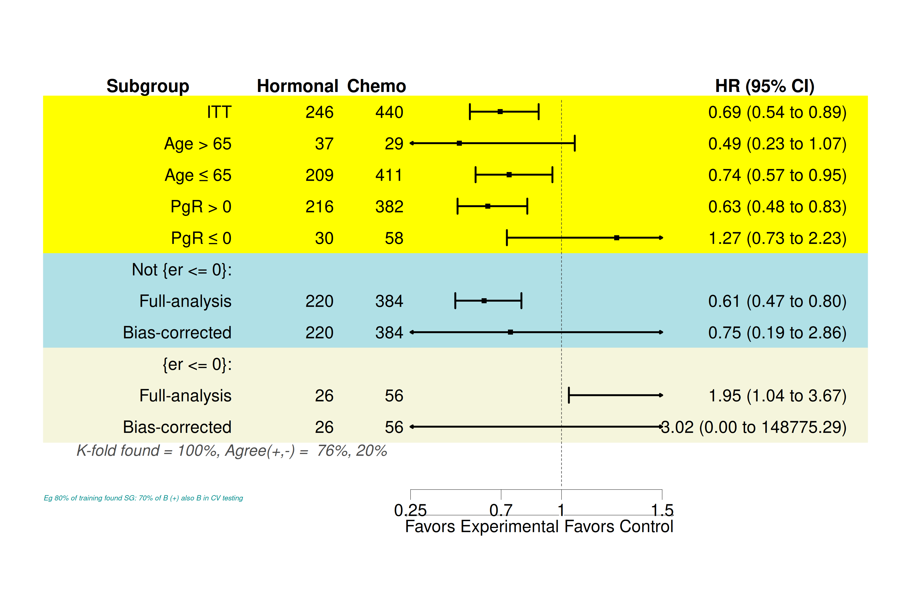
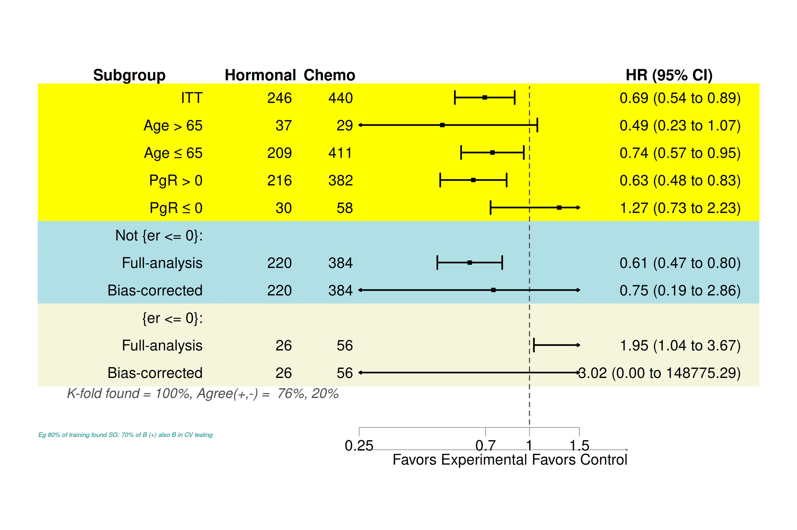

# REPORT — GitHub #7: `xlog` made real in `plot_subgroup_results_forestplot()`; forestploter 1.2.0 API

**Task:** `dev/tasks/cc_task_forestploter_xlog_2026-10-26.md` · **Run:** 2026-10-26, unattended · **Record:** `dev/reports/forestploter_xlog_2026-10-26/`

## 1. Provenance

| item | value |
|---|---|
| branch | `master` (lean-fits commits `7ff98f3d`, `d9761a71`, `a3e5d1d4` are on master; the merge had happened) |
| start HEAD | `155640319745bd9ca7ff8b99e516756d3fd80cbe` |
| `git status --porcelain` at start | `?? dev/tasks/cc_task_forestploter_xlog_2026-10-26.md` (the copied task only; no modified tracked file) |
| installed forestsearch | `0.4.0.9000`, `.fs_logit_two_group` exists: `TRUE` (lean build) — **GATE passed** |
| installed forestploter | `1.2.0` |
| CRAN forestploter (`available.packages`, cloud.r-project.org) | `1.2.0` — **GATE passed** |
| MD5 of `R/plot_subgroup_results_forestplot.R` at start | `9cf631ddf3532805f6d1d9b35f3f35e6` (= CRAN 0.4.0) |
| commits | `5240c243` task document · `c5f88e85` package edit (`Fixes #7`) · record commit (this report) |

Every named line was checked by content before editing. The 0.4.0 line numbers in the task matched: L38–40, L1104–1106 and L1214–1231.

## 2. The edits (`git diff 5240c243 c5f88e85`)

```diff
--- a/R/plot_subgroup_results_forestplot.R
+++ b/R/plot_subgroup_results_forestplot.R
@@ -38,6 +38,9 @@
 #' @param xlog Logical. If TRUE (default), the x-axis is plotted on a
 #'   logarithmic scale. This is standard for hazard ratio forest plots
 #'   where equal distances represent equal relative effects.
+#'   Implemented through forestploter's \code{set_xaxis(x_trans = "log")}
+#'   since 0.4.0.9000; earlier versions documented the log axis but drew a
+#'   linear one (GitHub #7).
@@ -220,8 +223,10 @@
-  if (!requireNamespace("forestploter", quietly = TRUE)) {
-    stop("Package 'forestploter' is required but not installed.", call. = FALSE)
+  if (!requireNamespace("forestploter", quietly = TRUE) ||
+      utils::packageVersion("forestploter") < "1.2.0") {
+    stop("plot_subgroup_results_forestplot() needs the 'forestploter' package, ",
+         "version 1.2.0 or later (install.packages(\"forestploter\")).", call. = FALSE)
   }
@@ -1101,9 +1106,7 @@
-    refline_lwd = refline_lwd,
-    refline_lty = refline_lty,
-    refline_col = refline_col,
+    refline_gp = grid::gpar(lwd = refline_lwd, lty = refline_lty, col = refline_col),
@@ -1211,23 +1214,31 @@
-  # Generate the forest plot
+  # Generate the forest plot (forestploter >= 1.2.0 API, 0.4.0.9000): forest()
+  # ... (6-line comment as specified)
   p <- forestploter::forest(
     dt[, c("Subgroup", E.name, C.name, " ", ci_label)],
-    title = title_text,
     est = dt$est, lower = dt$low, upper = dt$hi,
     sizes = 0.4, ci_column = 4, ref_line = ref_line,
-    arrow_lab = arrow_text,
-    xlim = xlim,
-    ticks_at = ticks_at,
-    xlog = xlog,
-    footnote = footnote_text,
-    theme = tm
+    style = tm
   )
+  xaxis_args <- list(plot = p, x_trans = if (isTRUE(xlog)) "log" else "none")
+  if (!is.null(xlim))     xaxis_args$xlim     <- xlim
+  if (!is.null(ticks_at)) xaxis_args$ticks_at <- ticks_at
+  p <- do.call(forestploter::set_xaxis, xaxis_args)
+  labs_args <- list(plot = p)
+  if (!is.null(title_text))    labs_args$title    <- title_text
+  if (!is.null(arrow_text))    labs_args$arrow    <- arrow_text
+  if (!is.null(footnote_text)) labs_args$footnote <- footnote_text
+  if (length(labs_args) > 1L) p <- do.call(forestploter::set_labs, labs_args)
```

`insert_text()` and everything after it are unchanged and now run after the `set_*` calls. The roxygen does not state a forestploter version requirement, so "(>= 1.2.0)" was not added there (§2.4 conditional).

```diff
--- a/DESCRIPTION
+++ b/DESCRIPTION
@@ -58,7 +58,7 @@ Suggests:
-    forestploter,
+    forestploter (>= 1.2.0),
```

`devtools::document()` re-stamped `Config/roxygen2/version: 8.1.0 → 8.1.1`, and I reverted that by hand. `NAMESPACE` is unchanged. `man/plot_subgroup_results_forestplot.Rd` gains the three `xlog` lines. `NEWS.md` gets a `### Bug fixes` entry under the development version that credits adayim (#7). The new test file is `tests/testthat/test-forestplot-xlog.R`. `devtools::install(upgrade = FALSE)` ran once, and afterwards the installed build reports `0.4.0.9000`, `.fs_logit_two_group` is `TRUE` and the body contains `set_xaxis`.

**Fixture and recipe (§2.7).** With one reference subgroup (`sex == 1`) in `subgroup_list`, the null-DGM DINA fixture `.make_null_dg_fit_plot()` reaches `forestploter::forest()`. I confirmed this with `trace()`. `str(attributes(p))` shows `names`, `class` (`forestplot gtable gTree grob gDesc`) and **`forest_recipe`**, a list of 18 that includes `xaxis`, `labs` and `style`. `attr(p, "forest_recipe")$xaxis$x_trans` records the scale, so test (c) asserts on it.

## 3. Test results (verbatim, `NOT_CRAN=true`, one `Rscript` session per file)

```
=== test-forestplot-xlog.R
forestplot-xlog: .......
══ DONE ══
1 forestplot call emits no forestploter deprecation / unknown-argument messages  nb 2 failed 0
2                            xlog = TRUE and xlog = FALSE both draw, and differ  nb 3 failed 0
3                 xlog maps to set_xaxis(x_trans = ) in the forestploter recipe  nb 2 failed 0
=== test-no-subgroup-dina-grf-plot.R
no-subgroup-dina-grf-plot: ......................
══ DONE ══
1          plot.forestsearch() is a graceful no-op for no-subgroup dina fit  9  failed 0
2           plot.forestsearch() is a graceful no-op for no-subgroup grf fit  9  failed 0
3 plot_subgroup_results_forestplot() skips FS rows for no-subgroup dina fit  2  failed 0
4  plot_subgroup_results_forestplot() skips FS rows for no-subgroup grf fit  2  failed 0
```

Both gating files are green; the logs are `test_test-forestplot-xlog.log` and `test_test-no-subgroup-dina-grf-plot.log`.

**Discrimination check (not required by the task):** I put the pre-fix function (`git show HEAD:R/...`) into the loaded namespace and package env, then ran the same test file against it (`test_forestplot-xlog_against_prefix_code.log`). Test (a) **fails**: 5 matching messages. Test (c) **fails**: `x_trans` is `"none"` under `xlog = TRUE`. Test (b) **passes** on the old code as well. The two grobs are never `identical()`, even when the axis is the same, so (b) only shows that both calls draw without error. It does not show that the axis changed. (a) and (c) carry the regression guard.

## 4. Pictures

| before (`new_V2.html`, lean build, old plot code) | after (this build) |
|---|---|
|  |  |

What changed: the HR axis is now log-scaled. The ticks `0.25, 0.70, 1.0, 1.5` are log-spaced (0.25→0.7 spans as much as 0.7→2, so 1 sits to the right of centre), and the CIs are drawn on that scale. The reference line is now a heavier dashed `gray30` line (`refline_gp`) rather than the faint dotted line before. The arrow labels' axis line now runs past 1.5. Table text and numbers are identical.

The after render is `vignette_after/forestsearch.html` (copy of `vignettes/forestsearch.Rmd`; 19 s, exit 0). Its log is `render_after.log`: `Unknown arguments ignored` 0 lines, `will be deprecated` 0 lines — **GATE passed** (see deviation 2). I extracted both figures with `extract_figure.R` (base64 `` keyed on the chunk's `fig.cap`).

**Non-figure outputs (§3.3).** `compare_outputs.R` uses `extract_lib.R`'s filter: 260 lines before, 260 after. Exactly one line differs (`diff_outputs.txt`):

```
152c152
< Projected for 1000 boots:      42.88 min (0.71 hrs)
---
> Projected for 1000 boots:      42.18 min (0.70 hrs)
```

## 5. Deviations (verbatim)

1. **§3.3 gate — one non-identical line, accepted as timing noise.** The only difference is the bootstrap wall-clock projection `Projected for 1000 boots`. `REPORT_rerender_compare_2026-10-26.md` (deviation 4) already records that `extract_lib.R` does not filter this line. A forest-plot change cannot reach it, and two renders cannot reproduce it exactly. The other 259 lines are identical. I counted the gate as passed and did not change the filter. If you read the gate strictly, revert `c5f88e85`.
2. **§3.2 "the before-render had them".** `render_V2.log` (the V2 before-render) has **0** forestploter message lines, not the expected non-zero count. The vignette sets `message = FALSE` in `opts_chunk`, so knitr discards the messages and they never reach the render log. The B (qmd) record is the one that showed them (`REPORT_rerender_compare` §4). The zero-line gate on the after-log therefore cannot tell the old and new code apart for this vignette. Test (a) is the real evidence that the messages are gone, because it fails on the old code (§3).
3. **Test (b) passes on the pre-fix code too** (§3). It is kept as specified, and the guard is (a) and (c).
4. The R probes I ran wrote a stray `Rplots.pdf` in the repo root. It was untracked, I created it, and I removed it. Not staged.

## 6. Verdict

1. Root cause confirmed: `xlog` went to `forest()`, which has no such argument, so the axis was always linear.
2. `xlog` now reaches `set_xaxis(x_trans = "log" | "none")`. The recipe shows `"log"`/`"none"` (test c).
3. The call uses only the 1.2.0 API (`style`, `set_xaxis`, `set_labs`, `refline_gp`) and no longer emits deprecation or unknown-argument messages (test a; it fails on the old code).
4. `Suggests: forestploter (>= 1.2.0)`. CRAN carries 1.2.0. A runtime guard gives a clear error on older installs.
5. `DESCRIPTION` changes in one line. `NAMESPACE` is unchanged. The roxygen stamp was reverted.
6. Both gating test files are green.
7. The vignette figure now has a log-spaced HR axis with the same table values.
8. Vignette text output is identical apart from one wall-clock projection line (deviation 1).
9. The render log has zero forestploter messages. That gate is weak for this vignette (deviation 2).
10. Installed build: lean `0.4.0.9000` plus this change. No R CMD check, fetch, pull, push or merge.

## 7. Closing block

See the printed output in the session. The commands are as in task §4.
